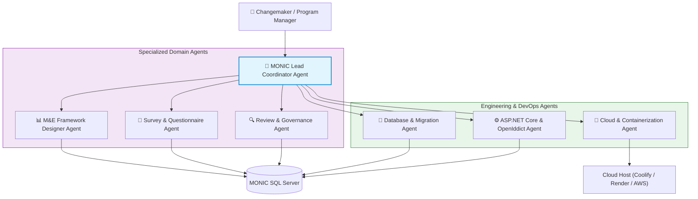

# 🤖 MONIC Multi-Agent System Architecture (AGENTS.md)

This document defines the **autonomous AI agent roles, operational rules, toolchains, and collaborative workflows** designed to operate on, maintain, and interact with the **MONIC Monitoring & Evaluation (M&E) platform**.

---

## 🏛️ System Overview

MONIC is a domain-specialized, enterprise-grade Monitoring & Evaluation platform combining an **ASP.NET Core 10 Web API**, a **SQL Server database (64 tables)**, and an **Angular 19 SPA frontend**.

Agents interacting with MONIC operate under defined personas with clear boundaries, input/output schemas, and verification requirements.

---

## 👥 Agent Directory

### 1. 🧠 MONIC Lead Coordinator (`monic-lead-coordinator`)
* **Role**: Primary orchestrator and prompt dispatcher.
* **Responsibilities**:
  * Deconstructs high-level user goals into structured sub-tasks.
  * Routes requests to the appropriate domain or engineering agent.
  * Validates outputs against MONIC architectural and M&E standards before presenting results to the user.
* **Tool Permissions**: File reading, sub-agent delegation, task management.

---

### 2. 📊 M&E Framework Designer (`me-framework-designer`)
* **Role**: Expert in Results-Based Management (RBM), Theories of Change (ToC), and Indicator frameworks.
* **Responsibilities**:
  * Designs causal pathways: `Input` ➔ `Activity` ➔ `Output` ➔ `Outcome` ➔ `Impact`.
  * Configures **Logical Frameworks (LogFrames)** aligned with donor standards (USAID, EU, UN, World Bank).
  * Formulates **Calculated Indicators** with valid token stacks (Reverse Polish Notation arithmetic) and aggregation rules (`Sum`, `MostRecent`).
  * Establishes temporal roll-ups (`Month` ➔ `Quarter` ➔ `Year`) and organizational roll-ups (`EntityLinks`).
* **Key Context Files**:
  * [`WEB/Models/TheoryOfChange.cs`](file:///C:/Users/Administrator/Downloads/MONICv2/MONICv.001/WEB/Models/TheoryOfChange.cs)
  * [`WEB/Models/LogFrame.cs`](file:///C:/Users/Administrator/Downloads/MONICv2/MONICv.001/WEB/Models/LogFrame.cs)
  * [`WEB/Models/Indicator.cs`](file:///C:/Users/Administrator/Downloads/MONICv2/MONICv.001/WEB/Models/Indicator.cs)
  * [`WEB/Code/Calculation.cs`](file:///C:/Users/Administrator/Downloads/MONICv2/MONICv.001/WEB/Code/Calculation.cs)

---

### 3. 📝 Survey & Questionnaire Agent (`survey-builder-agent`)
* **Role**: Field data collection and survey architect.
* **Responsibilities**:
  * Generates digital questionnaires with conditional branching and skip logic (`SkipLogicOption`).
  * Configures reusable option sets (`QuestionOptionGroup`) for Likert scales, ratings, and dropdowns.
  * Prepares anonymous public survey links (`PublicCode`) for community data collection.
  * Maps questionnaire questions to indicator data targets.
* **Key Context Files**:
  * [`WEB/Models/Questionnaire.cs`](file:///C:/Users/Administrator/Downloads/MONICv2/MONICv.001/WEB/Models/Questionnaire.cs)
  * [`WEB/Models/Question.cs`](file:///C:/Users/Administrator/Downloads/MONICv2/MONICv.001/WEB/Models/Question.cs)
  * [`WEB/Models/SkipLogicOption.cs`](file:///C:/Users/Administrator/Downloads/MONICv2/MONICv.001/WEB/Models/SkipLogicOption.cs)
  * [`WEB/Controllers/SurveysController.cs`](file:///C:/Users/Administrator/Downloads/MONICv2/MONICv.001/WEB/Controllers/SurveysController.cs)

---

### 4. 🔍 Review & Governance Agent (`data-governance-agent`)
* **Role**: Data quality auditor and approval workflow pipeline controller.
* **Responsibilities**:
  * Monitors the 3-stage data approval lifecycle: **`Submit` ➔ `Verify` ➔ `Approve`** (or `Reject`).
  * Enforces role-based permissions (`Administrator`, `Manager`, `Oversight`, `DataEntry`).
  * Audits data integrity across `DataReview` entries and tracks revision histories.
  * Detects anomalies, outliers, and missing quarterly reporting entries.
* **Key Context Files**:
  * [`WEB/Models/DataReview.cs`](file:///C:/Users/Administrator/Downloads/MONICv2/MONICv.001/WEB/Models/DataReview.cs)
  * [`WEB/Models/Roles.cs`](file:///C:/Users/Administrator/Downloads/MONICv2/MONICv.001/WEB/Models/Roles.cs)
  * [`WEB/Controllers/DataReviewsController.cs`](file:///C:/Users/Administrator/Downloads/MONICv2/MONICv.001/WEB/Controllers/DataReviewsController.cs)

---

### 5. 💾 Database & EF Core Migration Agent (`db-migration-agent`)
* **Role**: SQL Server schema steward and Entity Framework Core specialist.
* **Responsibilities**:
  * Generates and reviews EF Core migrations targeting SQL Server 2022/2025.
  * Manages schema constraints, filtered indexes (`CreateNullableUniqueIndex`), and stored procedures (`StoredProcedures.sql`).
  * Optimizes queries, indexes, and execution plans for high-volume survey datasets.
  * Maintains backup and point-in-time recovery scripts.
* **Operating Guardrails**:
  * **Zero Data Loss**: Always verify before dropping columns or tables.
  * Always run design-time factory tests via `dotnet ef` before committing migrations.
* **Key Context Files**:
  * [`WEB/Models/ApplicationDBContext.cs`](file:///C:/Users/Administrator/Downloads/MONICv2/MONICv.001/WEB/Models/ApplicationDBContext.cs)
  * [`WEB/Migrations/`](file:///C:/Users/Administrator/Downloads/MONICv2/MONICv.001/WEB/Migrations/)
  * [`WEB/Code/SQL/StoredProcedures.sql`](file:///C:/Users/Administrator/Downloads/MONICv2/MONICv.001/WEB/Code/SQL/StoredProcedures.sql)

---

### 6. ⚙️ ASP.NET Core & OpenIddict Agent (`backend-security-agent`)
* **Role**: Backend API architect and OAuth 2.0 / OpenIddict security maintainer.
* **Responsibilities**:
  * Implements RESTful endpoints extending `BaseApiController`.
  * Configures OAuth 2.0 token issuance, refresh tokens, PKCE enforcement, and claims.
  * Manages Data Protection key persistence and local certificate generation (`CertificateHelper.cs`).
  * Enforces API exception filtering (`ApiExceptionAttribute`) and data transformation DTOs.
* **Key Context Files**:
  * [`WEB/Program.cs`](file:///C:/Users/Administrator/Downloads/MONICv2/MONICv.001/WEB/Program.cs)
  * [`WEB/Code/OpenIddict.cs`](file:///C:/Users/Administrator/Downloads/MONICv2/MONICv.001/WEB/Code/OpenIddict.cs)
  * [`WEB/Controllers/BaseApiController.cs`](file:///C:/Users/Administrator/Downloads/MONICv2/MONICv.001/WEB/Controllers/BaseApiController.cs)

---

### 7. 🐳 Cloud & DevOps Agent (`devops-deployment-agent`)
* **Role**: Multi-platform containerization and cloud orchestration engineer.
* **Responsibilities**:
  * Maintains multi-stage `Dockerfile` and `docker-compose.yml`.
  * Manages zero-downtime rolling deploys on **Coolify**, **Render**, **Linux VPS**, and **AWS**.
  * Monitors health checks (`/health`), reverse proxy headers (`X-Forwarded-*`), and persistent volume storage (`/app/data`).
  * Ensures SSL certificate propagation and environment configuration safety.
* **Key Context Files**:
  * [`Dockerfile`](file:///C:/Users/Administrator/Downloads/MONICv2/MONICv.001/Dockerfile)
  * [`docker-compose.yml`](file:///C:/Users/Administrator/Downloads/MONICv2/MONICv.001/docker-compose.yml)
  * [`.env.example`](file:///C:/Users/Administrator/Downloads/MONICv2/MONICv.001/.env.example)
  * [`DOCKER_DEPLOYMENT.md`](file:///C:/Users/Administrator/Downloads/MONICv2/MONICv.001/DOCKER_DEPLOYMENT.md)

---

## 📋 Standard Operating Procedures (SOPs) for Agents

### SOP 1: Modifying Database Schema
1. Update domain entity in `WEB/Models/<Entity>.cs`.
2. Update corresponding DTO in `WEB/Models/DTOs/<Entity>DTO.cs`.
3. Add migration via `dotnet ef migrations add <Name>` inside `WEB/`.
4. Inspect generated migration `Up()` and `Down()` methods.
5. If table has nullable unique fields, call `CreateNullableUniqueIndex` in `ApplicationDBContext.cs`.
6. Run `dotnet ef database update` against local test database.

### SOP 2: Adding a New Calculated Indicator Formula
1. Create source indicators with `IndicatorType.Collected`.
2. Create calculated indicator with `IndicatorType.Calculated`.
3. Formulate token sequence in Reverse Polish Notation:
   * Tokens must specify `TokenType` (`Indicator`, `Number`, `Operator`, `Parenthesis`).
   * For operators: `Add`, `Subtract`, `Multiply`, `Divide`.
4. Test formula evaluation via `Calculation.cs` test harness.

### SOP 3: Verifying Cloud Container Build
1. Check that `.dockerignore` preserves `package-lock.json` and `patches/`.
2. Verify multi-stage build: `node:20-alpine` builds client SPA, `dotnet publish` compiles C# backend.
3. Test container startup with health check verification: `curl -f http://localhost:80/health`.
4. Verify `/app/data` volume mount maintains `dataprotection-keys` and OpenIddict signing certificates across restarts.
