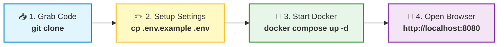
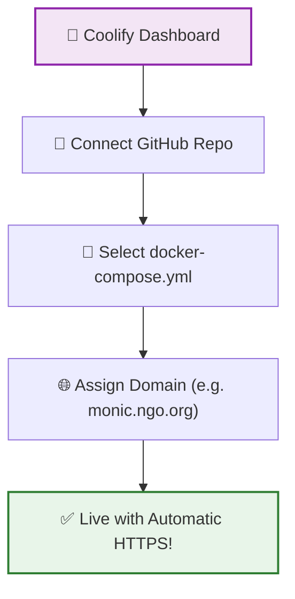
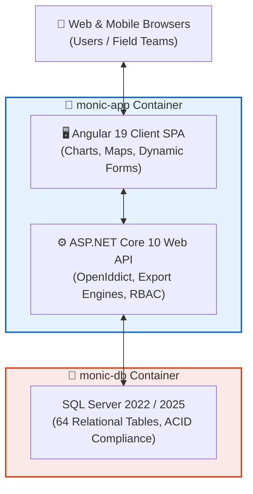

# 🌟 IARA: Monitoring & Evaluation Made Easy!

<div align="center">

  

  ### 🎯 The open-source impact tracker for changemakers, NGOs, and non-profits
  **Collect Data • Track Indicators • Measure Real Impact • No Headaches**

  [](LICENSE.txt)
  [](docker-compose.yml)
  [](https://www.youtube.com/watch?v=A5eus7Yhv1k)
  [](https://www.monic.tech)

</div>

---

## 👋 Hey there! Welcome to MONIC!

Are you trying to collect survey data, monitor field projects, or prove your organization's social impact? **MONIC** is built for you!

You don't need to be a software engineer or a database guru to get this up and running. Follow our visual guides below, copy and paste a couple of commands, and you'll have your very own MONIC portal live in minutes! 🚀

---

## 🗺️ The 60-Second Roadmap

Here is literally all you need to do to get MONIC running on your computer or server:



---

## 🧭 Choose Your Adventure: Where Are You Deploying?

Pick the option that matches your setup:

| Platform | Difficulty | Best For... | Quick Link |
| :--- | :---: | :--- | :--- |
| 💻 **Local PC / Laptop** | 🟢 *Super Easy* | Trying out MONIC, testing, or offline work | [👉 Jump to Local Guide](#-1-run-on-your-own-pc-or-laptop-easiest) |
| 🚀 **Coolify** | 🟢 *Click & Go* | Self-hosted production with automatic SSL | [👉 Jump to Coolify Guide](#-2-deploy-to-coolify-1-click-cloud) |
| ☁️ **Render** | 🟡 *Simple* | Free/cheap managed cloud web hosting | [👉 Jump to Render Guide](#-3-deploy-to-render) |
| 🐧 **Linux Server (VPS)** | 🟡 *Standard* | DigitalOcean, Hetzner, Linode, Ubuntu | [👉 Jump to Linux VPS Guide](#-4-deploy-on-a-linux-server--vps) |
| 🟧 **Amazon AWS** | 🔴 *Advanced* | High-scale enterprise deployments | [👉 Jump to AWS Guide](#-5-deploy-to-amazon-web-services-aws) |

---

## 💻 1. Run on Your Own PC or Laptop (Easiest!)

> **💡 What is Docker?**  
> Think of Docker as a "magic lunchbox". Inside the lunchbox is everything MONIC needs to run (the web app, the database, background workers). You don't have to install databases, compilers, or runtime tools on your PC — Docker runs it all inside an isolated container!

### Prerequisites:
* Download and install **[Docker Desktop](https://www.docker.com/products/docker-desktop/)** (Windows, Mac, or Linux).
* Make sure Docker Desktop is running (you should see the little whale icon in your system tray).

### Step 1: Open your Terminal / PowerShell
Open **PowerShell** (Windows) or **Terminal** (Mac/Linux), and download the repository:
```bash
git clone https://github.com/Matandaelis/MONIC.git
cd MONIC
```

### Step 2: Copy your settings file
```bash
# On Windows (PowerShell):
Copy-Item .env.example .env

# On Mac / Linux:
cp .env.example .env
```
*(The default settings in `.env` are already pre-configured to work straight out of the box!)*

### Step 3: Start MONIC! 🚀
Run this single command:
```bash
docker compose up -d
```
*(Docker will download the components and start MONIC in the background. Grab a quick coffee ☕ — the first time takes about 2 to 3 minutes!)*

### Step 4: Open your browser
Open your browser and navigate to:
👉 **[http://localhost:8080](http://localhost:8080)**

```
┌────────────────────────────────────────────────────────┐
│  🎉 HOORAY! Welcome to the MONIC Initial Setup Wizard   │
│                                                        │
│  1. Enter your First Name & Last Name                  │
│  2. Enter your Email (this will be your username)      │
│  3. Pick a secure Password                             │
│  4. Click "Submit"                                     │
│                                                        │
│  ...and BOOM! Your administrator account is ready! 🎯  │
└────────────────────────────────────────────────────────┘
```

---

## 🚀 2. Deploy to Coolify (1-Click Cloud)

[Coolify](https://coolify.io/) is an open-source, self-hosted platform (like Heroku or Netlify) that manages Docker apps and gives you free automatic SSL certificates (HTTPS).



### Step-by-Step in Coolify:
1. Log in to your Coolify dashboard.
2. Click **"+ New Resource"** ➔ **"Docker Compose"**.
3. Select your Git repository: `Matandaelis/MONIC`.
4. Leave the Compose file set to `./docker-compose.yml`.
5. Under **Environment Variables**, paste these values:
   ```env
   DB_PASSWORD=YourStrongDatabasePassword123!
   APP_PORT=80
   ROOT_URL=https://monic.yourdomain.com/
   SITE_NAME=MONIC
   ASPNETCORE_ENVIRONMENT=Production
   ```
6. In the Domain field, enter your public domain (e.g., `https://monic.yourdomain.com`).
7. Click **Deploy**! Coolify will build the container, route traffic to port `80`, and configure your SSL certificate automatically.

---

## ☁️ 3. Deploy to Render

Render is a popular managed cloud hosting provider. You can deploy MONIC directly using its built-in `Dockerfile`:

1. Sign up or log in at **[render.com](https://render.com)**.
2. Click **New +** ➔ **Web Service**.
3. Connect your MONIC GitHub repository.
4. Set the **Runtime** to **Docker** (Render will automatically detect the root `Dockerfile`).
5. Add your environment variables:
   * `ConnectionStrings__DefaultConnection`: Your connection string to your managed SQL Server database.
   * `Settings__RootUrl`: `https://your-service-name.onrender.com/`
   * `Settings__SiteName`: `MONIC`
6. Under **Health Check Path**, enter: `/health`.
7. Click **Create Web Service**. Render assigns the web port automatically and launches the site!

---

## 🐧 4. Deploy on a Linux Server / VPS

If you rented a server on DigitalOcean, Hetzner, Linode, or AWS EC2 running Ubuntu or Debian:

```bash
# 1. Install Docker (copy and paste this):
curl -fsSL https://get.docker.com | sh
sudo usermod -aG docker $USER

# 2. Clone the code
git clone https://github.com/Matandaelis/MONIC.git /opt/monic
cd /opt/monic

# 3. Create your settings file
cp .env.example .env

# 4. Edit your settings (change your database password and port)
nano .env

# 5. Launch everything!
docker compose up -d --build
```
Your server is now live at `http://YOUR-SERVER-IP:8080` (or port 80 if you set `APP_PORT=80`).

---

## 🟧 5. Deploy to Amazon Web Services (AWS)

For teams using AWS:

* **AWS App Runner**:
  Build the container with `docker build -t monic .`, push it to **Amazon ECR**, and connect App Runner. App Runner manages scaling and load balancing automatically.
* **AWS ECS (Elastic Container Service)**:
  Run MONIC as a Fargate task definition, connecting to **AWS RDS for SQL Server**, and place it behind an Application Load Balancer (ALB) pointing to `/health`.

---

## 📖 Jargon Buster: Words Explained in Plain English

| Term | What it actually means |
| :--- | :--- |
| **Container / Docker** | A self-contained virtual box that bundles software so it runs identically on any computer. |
| **Port (`:8080` or `:80`)** | Like an apartment door number on your computer. Your computer is the building; port 8080 is the door where MONIC lives! |
| **`.env` File** | A simple text file where you keep your private settings (passwords, domain name, email settings). |
| **SQL Server** | The database engine where all your survey responses, projects, and indicators are safely stored. |
| **Reverse Proxy** | A traffic guard (like Nginx, Caddy, or Traefik) that takes incoming website visitors and gives them a secure lock icon (HTTPS/SSL). |

---

## 🛟 Oops! Common Troubles & Quick Fixes

<details>
<summary><b>❌ Browser says: "This site can’t be reached" or "Connection Refused"</b></summary>

* **Fix 1:** Check if Docker is running! Open Docker Desktop and verify the `monic-app` and `monic-db` containers are green.
* **Fix 2:** Wait 30-40 seconds on your first run. The database initializes tables and runs migrations on first boot.
* **Fix 3:** Check the container logs by running:
  ```bash
  docker compose logs -f monic-app
  ```
</details>

<details>
<summary><b>⚠️ Browser says: "Your connection is not private" (SSL Warning)</b></summary>

* When testing locally on `https://`, browsers warn you that the local development certificate is self-signed.
* **Fix:** Click **Advanced** ➔ **Proceed to localhost (unsafe)**. This is completely normal and safe for local development.
</details>

<details>
<summary><b>🔒 "Database password does not meet complexity requirements"</b></summary>

* SQL Server requires strong passwords by default.
* Make sure `DB_PASSWORD` in your `.env` contains:
  * At least 8 characters
  * At least 1 uppercase letter (`A-Z`)
  * At least 1 lowercase letter (`a-z`)
  * At least 1 number (`0-9`)
  * At least 1 special character (`!@#$%^&*`)
  * *Example:* `@Monic2026Secure!`
</details>

<details>
<summary><b>🚪 Port 8080 is already used by another app on my computer</b></summary>

* Simply open your `.env` file and change:
  ```env
  APP_PORT=9000
  ```
* Re-run `docker compose up -d`, and access MONIC at `http://localhost:9000`!
</details>

---

## 🏛️ What's Under the Hood?

For the tech-curious, here is the architecture powering MONIC:



---

## ✨ Features at a Glance

* 📋 **Dynamic Questionnaire Builder**: Create complex surveys with skip logic, geolocation, and media.
* 📈 **Indicator & Metric Tracking**: Monitor quantitative & qualitative indicators over quarters and years.
* 🌿 **Theories of Change (ToC)**: Graphically map outputs, outcomes, activities, and assumptions.
* 📊 **Interactive Visual Dashboards**: Built with ECharts & D3 for presentation-ready charts and reports.
* 📄 **Instant Document Exports**: Generate Excel, CSV, and PDF reports in a single click.
* 👥 **Role-Based Access Control**: Assign granular permissions for administrators, field collectors, and viewers.

---

## 🤝 Need Help or Want to Contribute?

* 📺 **[Watch the 20-Minute Video Tour](https://www.youtube.com/watch?v=A5eus7Yhv1k)**
* 🐛 **[Report a Bug or Ask a Question on GitHub](https://github.com/Matandaelis/MONIC/issues)**
* 🌐 **[Visit the Official Website (monic.tech)](https://www.monic.tech)**

---

<div align="center">

  **Made with ❤️ for NGOs, researchers, and impact-driven teams around the world.**  
  ⭐ If MONIC helps your mission, please consider giving us a star on GitHub! ⭐

</div>
