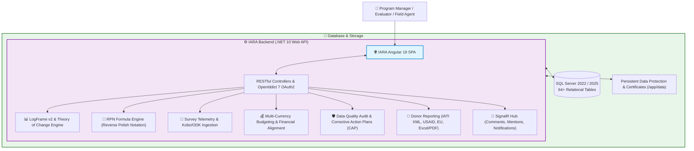

# 🌟 IARA: Universal Monitoring & Evaluation Platform

<div align="center">

  ### 🎯 Enterprise Results-Based Management, Impact Telemetry & Accountability Platform
  **Track Indicators • Structure LogFrames • Automate Governance • Publish Multi-Donor Reports**

  [](LICENSE.txt)
  [](WEB/WEB.csproj)
  [](WEB/ClientApp)
  [](docker-compose.yml)
  [](docker-compose.yml)
  [](WEB.Tests)

</div>

---

## 📖 Overview

**IARA** (Impact & Accountability Reporting Architecture) is a domain-specialized, enterprise-grade Monitoring & Evaluation (M&E) platform. Built upon the core open-source MONIC architecture, IARA expands the system into a comprehensive **Results-Based Management (RBM)** environment designed for non-governmental organizations (NGOs), development agencies, government ministries, researchers, and public-sector changemakers.

The platform eliminates the fragmentation of disparate spreadsheets, isolated field survey apps, and disconnected accounting systems by unifying theory of change causal chains, 4×4 logical frameworks (LogFrames), field surveys, financial budget alignments, automated data quality audits, and donor export pipelines into a single reactive application.



---

## 🏛️ Architecture & Technology Stack

IARA is engineered with a modern, decoupled architecture:

* **Backend**:
  * **ASP.NET Core 10 Web API** (`net10.0`), utilizing C# 13 and nullable reference annotations.
  * **OpenIddict 7**: Standards-compliant OAuth 2.0 / OpenID Connect server supporting Authorization Code Flow with PKCE, Refresh Tokens, and client credential issuance.
  * **Entity Framework Core 10**: Over 64 normalized database tables managed with 58+ code-first migrations (`ApplicationDBContext`).
  * **Real-Time Collaboration**: Microsoft SignalR hubs for immediate broadcast of comments, mentions, and system notifications.
  * **Data Engines**: EPPlus & CsvHelper for bulk data ingress/egress, iTextSharp LGPL for dynamic PDF generation.
* **Frontend**:
  * **Angular 19 SPA** (`WEB/ClientApp`), utilizing Angular Signals reactivity, PrimeNG 19 enterprise component toolkit, and Bootstrap 5 styling.
  * **Data Visualizations**: ECharts, Chart.js, and D3 for analytical graphs, demographic pyramids, and progress gauges.
  * **GIS Mapping**: Leaflet and GeoJSON layers for project location and facility mapping.
  * **Offline Data Collection**: Progressive Web App (PWA) with IndexedDB storage for field survey caching in zero-connectivity environments.
* **Database & Infrastructure**:
  * **Microsoft SQL Server 2022/2025**: ACID-compliant relational data store with filtered indexes and stored procedures.
  * **Containerization**: Multi-stage Linux containers with non-root security execution (`mcr.microsoft.com/dotnet/aspnet:10.0` with `libgdiplus` for graphics/PDF generation).

---

## ✨ Core Platform Capabilities

### 1. Results-Based Management (RBM) & LogFrame v2
* **Causal Pathways**: Model theories of change from `Input` ➔ `Activity` ➔ `Output` ➔ `Outcome` ➔ `Impact`.
* **4×4 Logical Framework Matrix**: Hierarchical tree-table representation with baseline, cumulative targets, and actual value roll-ups.
* **Milestone & Periodic Targets**: Schedule targets across Monthly, Quarterly, Semi-Annual, and Annual horizons.
* **Calculated Indicators**: Evaluate complex multi-variable indicator formulas at runtime using a Reverse Polish Notation (RPN) Shunting-Yard token stack (`Calculation.cs`).

### 2. Multi-Dimensional Indicator Disaggregations
* Break down indicators across demographic and spatial dimensions (e.g., Gender, Age Cohort, Urban/Rural, Facility).
* Automatic validation of disaggregated sums against parent indicator totals.
* Real-time variance tracking (`(Actual - Target) / Target`) with directional sensitivity (`LowerIsBetter` support).

### 3. Multi-Currency Budgeting & Financial Alignment
* Define project budgets across multiple currencies with automated exchange rate conversion.
* Link individual budget lines directly to specific LogFrame objectives and project indicators.
* Track planned vs. committed vs. disbursed expenditures against indicator milestone delivery.

### 4. Field Telemetry & Digital Surveys
* **Dynamic Questionnaire Builder**: Construct field questionnaires with conditional skip logic, Likert scales, GPS capture, and file attachments.
* **Anonymous Community Links**: Generate public web links (`PublicCode`) for citizen feedback and community questionnaires.
* **KoboToolbox & ODK Sync**: Webhook endpoint `/api/v1/surveys/kobo-webhook` for real-time ingestion of field submissions.
* **Community Feedback Mechanism (CFM)**: Dedicated complaints and feedback portal with severity categorization and protection safeguards.

### 5. Data Governance & Closed-Loop Quality Control
* **3-Tier Approval Workflow**: Structured `Submit` ➔ `Verify` ➔ `Approve` (or `Reject`) lifecycle with role-based governance.
* **Automated Corrective Action Plans (CAP)**: Automated background monitoring rules trigger formal CAP assignments when indicator variances exceed pre-configured variance thresholds.
* **Risk & Assumption Registers**: Continuous tracking of environmental, financial, and operational risks linked to LogFrame outcomes.
* **Lessons Learned Repository**: Formalized documentation of operational challenges, innovations, and recommendations.

### 6. Team Collaboration & In-App Alerts
* Polymorphic commenting on indicators, review cycles, and LogFrame nodes.
* Team @mentions with instant SignalR notification bell alerts.
* User roles: `Administrator`, `Manager`, `Oversight`, `DataEntry`.

### 7. Multi-Donor Reporting & Data Exchange
* **IATI XML v2.03**: Export compliant International Aid Transparency Initiative project and results records.
* **Donor LogFrame Matrices**: Pre-formatted exports matching USAID PMP (Performance Management Plan), EU ROM, and UN standards.
* **Performance Indicator Reference Sheets (PIRS)**: Standardized single-page indicator definitions and methodological notes.
* **ETL & Data Import**: Ingest indicator targets and historical data via Excel (`.xlsx`) and CSV with schema validation.

---

## 🚀 Quickstart: Running with Docker (Recommended)

The fastest and most reliable way to run IARA is using Docker Compose.

### Prerequisites
* **[Docker Desktop](https://www.docker.com/products/docker-desktop/)** (Windows, macOS, or Linux). Ensure the Docker daemon is active.

### 1. Clone the Repository
```bash
git clone https://github.com/Matandaelis/IARA-MONITORING-AND-EVALUATION.git
cd IARA-MONITORING-AND-EVALUATION
```

### 2. Configure Environment Variables
Copy the default environment configuration:
```bash
# On Linux / macOS:
cp .env.example .env

# On Windows (PowerShell):
Copy-Item .env.example .env
```
> [!NOTE]
> The default values in `.env.example` are pre-configured to run out of the box with local SQL Server credentials (`@Monic123Secure!`) and port `8080`.

### 3. Start the Containers
```bash
docker compose up -d --build
```
This launches two services:
* `monic-db`: Microsoft SQL Server 2022 on port `1433`.
* `monic-app`: ASP.NET Core 10 backend + compiled Angular 19 SPA on port `8080`.

### 4. Access the Application
Open your browser and navigate to:
👉 **[http://localhost:8080](http://localhost:8080)**

On the first launch:
1. The container automatically executes all 58+ EF Core migrations against the SQL Server instance.
2. The initial administrator account setup wizard is presented:
   - Enter your name, administrative email address, and password.
   - Once submitted, your organization profile is initialized and the full platform is active.

---

## 🛠️ Local Development Setup (Without Docker)

For active code contributions, you can run the .NET backend and Angular frontend natively.

### Prerequisites
* **.NET 10.0 SDK** (`dotnet --version` >= 10.0.100)
* **Node.js 20+ / 22+** and **npm**
* An accessible **SQL Server 2022** instance (LocalDB, SQL Express, or Docker container)

### 1. Database Connection
Update `WEB/appsettings.Development.json` (or set `ConnectionStrings__DefaultConnection` environment variable) with your SQL connection string:
```json
{
  "ConnectionStrings": {
    "DefaultConnection": "Server=localhost,1433;Database=IARA_DEV;User Id=sa;Password=YourPassword123!;TrustServerCertificate=true;Encrypt=false;"
  }
}
```

### 2. Restore & Build Backend
```bash
dotnet restore MONIC.sln
dotnet build MONIC.sln
```

### 3. Install Frontend Dependencies & Run SPA
```bash
cd WEB/ClientApp
npm install --force
npm start
```
The Angular development server starts at `https://localhost:44410` (or `http://localhost:4200`).

### 4. Run the Backend Web API
In a separate terminal:
```bash
cd WEB
dotnet run
```
The API launches, serves OpenAPI endpoints, and automatically proxies frontend requests during development.

---

## 🧪 Testing & Quality Assurance

The solution includes an automated xUnit test suite (`WEB.Tests`) validating core calculation logic, variance analysis, disaggregations, and API controllers.

Run the test suite from the repository root:
```bash
dotnet test WEB.Tests/WEB.Tests.csproj
```
*(All 185 test cases execute and validate against .NET 10).*

To build and verify the Angular frontend bundle:
```bash
cd WEB/ClientApp
npm run build -- --configuration production
```

---

## 🌐 Cloud Deployment Options

IARA is cloud-agnostic and ready for automated deployment:

| Deployment Target | Mechanism | Health Check URL | Notes |
| :--- | :--- | :--- | :--- |
| **Coolify** | `docker-compose.yml` | `/health` | Connect GitHub repo, specify persistent volume `/app/data` for signing keys. |
| **Render** | Root `Dockerfile` | `/health` | Set runtime to Docker; supply external managed SQL Server connection string. |
| **Linux VPS (Ubuntu/Debian)** | Docker Compose + Nginx/Caddy | `/health` | Standard reverse-proxy configuration with Let's Encrypt SSL. |
| **AWS ECS / App Runner** | AWS ECR container image | `/health` | Attach to AWS RDS for SQL Server; mount AWS EFS for `/app/data` key persistence. |

---

## 📁 Repository Structure

```
├── .agents/                    # Standardized development skills and agent tooling
├── docs/                       # Architectural manuals, gap analysis, and OpenAPI specs
│   ├── MONIC_FULL_SYSTEM_DETAILED_DOCUMENTATION.md
│   ├── GAP_ANALYSIS.md
│   └── postman/openapi.json
├── specs/                      # Specification-driven feature development artifacts
├── WEB/                        # ASP.NET Core 10 Web Application
│   ├── ClientApp/              # Angular 19 SPA source (components, services, SCSS)
│   ├── Code/                   # Calculation engines, monitoring metrics, OpenIddict helpers
│   ├── Controllers/            # REST API endpoints (LogFrames, Indicators, Surveys, Budgets)
│   ├── Migrations/             # 58+ Entity Framework Core database migrations
│   ├── Models/                 # EF Core domain entities and DTO schemas
│   ├── Services/               # Domain business services (NotificationDispatcher, etc.)
│   └── Program.cs              # Web application bootstrapper and DI configuration
├── WEB.Tests/                  # xUnit automated test suite (185 tests)
├── Dockerfile                  # Multi-stage production container build definition
├── docker-compose.yml          # Production multi-container orchestration
└── entrypoint.sh               # Container initialization and non-root execution script
```

---

## 📄 License & Governance

This project is licensed under the **GNU Affero General Public License v3.0 (AGPL-3.0)**. See the [`LICENSE.txt`](LICENSE.txt) file for the full license text.

For issue reporting, feature requests, or technical inquiries, please submit an issue via the [GitHub Issue Tracker](https://github.com/Matandaelis/IARA-MONITORING-AND-EVALUATION/issues).

---

<div align="center">
  <b>IARA: Impact & Accountability Reporting Architecture</b><br/>
  Engineered for precision, transparency, and accountability in global development.
</div>
