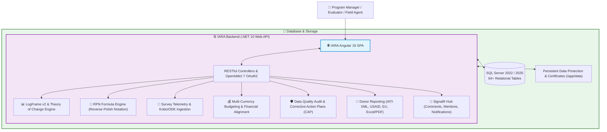

# 🌟 IARA: Universal Monitoring & Evaluation Platform

<div align="center">

  ### 🎯 Enterprise Results-Based Management, Impact Telemetry & Accountability Platform
  **Track Indicators • Structure LogFrames • Automate Governance • Publish Multi-Donor Reports**

  [](LICENSE.txt)
  [](WEB/WEB.csproj)
  [](WEB/ClientApp)
  [](docker-compose.yml)
  [](docker-compose.yml)
  [](WEB.Tests)

</div>

---

## 📖 Overview

**IARA** (Impact & Accountability Reporting Architecture) is a domain-specialized, enterprise-grade Monitoring & Evaluation (M&E) platform. Built upon the core open-source MONIC architecture, IARA provides a unified operating system for results-based management, survey collection, financial alignment, program governance, and donor reporting.

The platform eliminates the fragmentation of disparate spreadsheets, isolated field survey apps, and disconnected accounting systems by unifying theory of change causal chains, 4×4 logical framework management, operational tracking, and accountability reporting into one coherent system.



---

## 🏛️ Architecture & Technology Stack

IARA is engineered with a modern, decoupled architecture:

* **Backend**:
  * **ASP.NET Core 10 Web API** (`net10.0`), utilizing C# 13 and nullable reference annotations.
  * **OpenIddict 7**: Standards-compliant OAuth 2.0 / OpenID Connect server supporting Authorization Code Flow with PKCE, Refresh Tokens, and client credential issuance.
  * **Entity Framework Core 10**: Over 64 normalized database tables managed with 58+ code-first migrations (`ApplicationDBContext`).
  * **Real-Time Collaboration**: Microsoft SignalR hubs for immediate broadcast of comments, mentions, and system notifications.
  * **Data Engines**: EPPlus & CsvHelper for bulk data ingress/egress, iTextSharp LGPL for dynamic PDF generation.
* **Frontend**:
  * **Angular 19 SPA** (`WEB/ClientApp`), utilizing Angular Signals reactivity, PrimeNG 19 enterprise component toolkit, and Bootstrap 5 styling.
  * **Data Visualizations**: ECharts, Chart.js, and D3 for analytical graphs, demographic pyramids, and progress gauges.
  * **GIS Mapping**: Leaflet and GeoJSON layers for project location and facility mapping.
  * **Offline Data Collection**: Progressive Web App (PWA) with IndexedDB storage for field survey caching in zero-connectivity environments.
* **Database & Infrastructure**:
  * **Microsoft SQL Server 2022/2025**: ACID-compliant relational data store with filtered indexes and stored procedures.
  * **Containerization**: Multi-stage Linux containers with non-root security execution (`mcr.microsoft.com/dotnet/aspnet:10.0` with `libgdiplus` for graphics/PDF generation).

---

## 🧠 Business Logic Overview

IARA is not just a dashboard. It is an operational management and accountability engine for development programs, NGOs, public sector institutions, and donor-funded initiatives.

The business logic is centered on a single principle:

> Every project result must be linked to a measurable indicator, a responsible team, a timeline, a funding source, a data collection mechanism, and an approval/governance process.

### Core business concepts

* **Program or Project**: The organizational unit being implemented.
* **Theory of Change / Logical Framework**: The causal chain that explains how activities create outputs, outcomes, and impacts.
* **Indicators**: The measurable signals used to evaluate progress against results.
* **Disaggregations**: The dimensions used to break results down (gender, age, geography, facility, partner, etc.).
* **Targets & Baselines**: The expected value and starting point for each indicator.
* **Actuals**: Real data submitted by teams, field enumerators, or system integrations.
* **Variance Analysis**: Difference between actual and target, shown with thresholds and warnings.
* **Approval Workflow**: A formal process for submitting, verifying, approving, rejecting, or correcting data.
* **Budget Alignment**: The relationship between program expenditures and planned activities/outcomes.
* **Reporting**: Structured export of program progress to donors and internal stakeholders.

---

## ⚙️ Core Business Logic & Workflows

### 1. Results-based management and logframe logic

IARA models a program as a logical sequence:

`Input -> Activity -> Output -> Outcome -> Impact`

This is represented in a logframe with hierarchical relationships and planning periods.

Business rules include:

* Indicators are attached to the correct output or outcome.
* Actual values roll up from lower-level records into higher-level results.
* Targets are tracked by reporting period (month, quarter, semiannual, annual).
* Indicators can be calculated automatically using formula logic instead of manually entered values.
* Aggregation can be configured across entities, locations, and time periods.

The system supports multi-level monitoring, allowing program managers to answer:

* Are we on track to meet our annual target?
* Which district or implementing partner is behind schedule?
* Which outcome is most at risk?

### 2. Indicator calculation engine

The platform contains a calculation engine that evaluates formula-based indicators through reverse-polish-notation (RPN) token logic.

This means an indicator can be defined as a derived value, for example:

* `Indicator A + Indicator B / 2`
* `Total Beneficiaries - Reached Women`
* `Outcome Value * Coverage Rate`

Business logic rules:

* Formula-driven indicators refresh when input data changes.
* Different aggregation methods are supported (`Sum`, `MostRecent`, etc.).
* Variance thresholds can trigger alerts or corrective actions.
* Formula results can be validated against expected totals and disaggregated data.

### 3. Survey and field data collection logic

IARA supports digital survey ingestion and field data collection for remote programs.

Operational logic includes:

* Dynamic questionnaires with skip logic and conditional rules.
* Anonymous public links for community feedback or citizen data collection.
* KoboToolbox / ODK / webhook ingestion for external field systems.
* Attachment handling for photos, documents, and GPS-related inputs.
* Data quality checks for missing values, inconsistent answers, and invalid submissions.

This ensures that field data is not treated as isolated records but as structured evidence feeding program indicators.

### 4. Approval and governance logic

Governance is a central part of the system. Data is not simply stored. It follows a controlled lifecycle:

`Submit -> Verify -> Approve or Reject`

Business rules include:

* Only authorized users can submit, review, verify, or approve records.
* Role-based permissions enforce separation of duties.
* Rejecting a record requires explanation or corrective action.
* Reviewed, approved, or rejected data is preserved in the audit trail.
* Corrective Action Plans (CAPs) can be created when a threshold is breached.

This reduces manipulation, improves accountability, and gives stakeholders confidence in reported numbers.

### 5. Budget and financial alignment logic

A project is managed not only by activity counts, but also by financial reality.

IARA links budgets directly to program activities and results, allowing:

* Multi-currency budget planning.
* Allocation of funds to specific indicators, objectives, and implementation units.
* Planned vs. actual expenditure tracking.
* Linking financial burn-rate to outcome delivery.
* Monitoring whether funding is aligned to program priorities and donor requirements.

The platform can therefore answer:

* Is the budget supporting the intended outcome?
* Are funds being disbursed in line with implementation progress?
* Which workstream is over or under budget?

### 6. Risk, quality assurance, and corrective action logic

The platform captures operational risk and quality issues before they become major program failures.

Business rules include:

* Risk registers capture threats to delivery, assumptions, schedules, and finances.
* Data quality checks identify anomalies or outliers.
* Variance thresholds trigger CAP assignments.
* Corrective actions can be tracked and assigned to responsible owners.
* Review cycles provide a structured governance mechanism for continuous improvement.

### 7. Donor reporting and compliance logic

The system supports program reporting for multi-donor and multi-stakeholder environments.

Reporting logic includes:

* Donor-appropriate result frameworks.
* Export in formats such as IATI XML, Excel, PDF, and custom project tables.
* Standard indicator reference sheets and summary reports.
* Alignment to USAID, EU, UN, and other donor reporting conventions.

The business purpose is to reduce duplicate reporting effort while improving consistency and auditability.

### 8. Collaboration and operational accountability logic

IARA includes structured collaboration features to support accountability and decision-making.

Examples:

* Comments attached to indicators, reviews, and objectives.
* @mentions and notifications for project teams.
* Real-time updates through SignalR hubs.
* Role-based access to data and workflow actions.

This closes the gap between data management and team execution.

---

## 🧭 End-to-end business lifecycle

A typical project in IARA follows this lifecycle:

1. **Design the program structure**
   - Create the theory of change and logframe.
   - Define outcomes, outputs, indicators, and targets.

2. **Assign responsibilities**
   - Assign users to roles such as Administrator, Manager, Oversight, and DataEntry.
   - Define who can verify and approve data.

3. **Collect information**
   - Enter baseline values, targets, and actual results.
   - Import data from Excel or external survey systems.
   - Capture community feedback or field submissions.

4. **Validate data quality**
   - Run checks for missing data, outliers, and inconsistent sums.
   - Identify variance from target values.

5. **Review and approve**
   - Submit data for verification.
   - Approve or reject the record with accountability.

6. **Trigger actions**
   - Create corrective action plans when risks or gaps are detected.
   - Update budgets or reassign duties as needed.

7. **Report results**
   - Generate internal dashboards and external donor reports.
   - Publish outputs in a consistent and auditable format.

---

## 🔐 Business security and trust model

The platform is designed to support operational trust in sensitive environments.

Key principles:

* Authentication and authorization are role-based.
* OAuth 2.0 and OpenID Connect enable secure token-based access.
* Data protection keys and signing material are persisted for operational continuity.
* Sensitive data can be controlled by role and project.
* Approval workflows create an accountability trail for decision-making.

---

## ✨ Core Platform Capabilities

### 1. Results-Based Management (RBM) & LogFrame v2
* **Causal Pathways**: Model theories of change from `Input` ➔ `Activity` ➔ `Output` ➔ `Outcome` ➔ `Impact`.
* **4×4 Logical Framework Matrix**: Hierarchical tree-table representation with baseline, cumulative targets, and actual value roll-ups.
* **Milestone & Periodic Targets**: Schedule targets across Monthly, Quarterly, Semi-Annual, and Annual horizons.
* **Calculated Indicators**: Evaluate complex multi-variable indicator formulas at runtime using a Reverse Polish Notation (RPN) Shunting-Yard token stack (`Calculation.cs`).

### 2. Multi-Dimensional Indicator Disaggregations
* Break down indicators across demographic and spatial dimensions (e.g., Gender, Age Cohort, Urban/Rural, Facility).
* Automatic validation of disaggregated sums against parent indicator totals.
* Real-time variance tracking (`(Actual - Target) / Target`) with directional sensitivity (`LowerIsBetter` support).

### 3. Multi-Currency Budgeting & Financial Alignment
* Define project budgets across multiple currencies with automated exchange rate conversion.
* Link individual budget lines directly to specific LogFrame objectives and project indicators.
* Track planned vs. committed vs. disbursed expenditures against indicator milestone delivery.

### 4. Field Telemetry & Digital Surveys
* **Dynamic Questionnaire Builder**: Construct field questionnaires with conditional skip logic, Likert scales, GPS capture, and file attachments.
* **Anonymous Community Links**: Generate public web links (`PublicCode`) for citizen feedback and community questionnaires.
* **KoboToolbox & ODK Sync**: Webhook endpoint `/api/v1/surveys/kobo-webhook` for real-time ingestion of field submissions.
* **Community Feedback Mechanism (CFM)**: Dedicated complaints and feedback portal with severity categorization and protection safeguards.

### 5. Data Governance & Closed-Loop Quality Control
* **3-Tier Approval Workflow**: Structured `Submit` ➔ `Verify` ➔ `Approve` (or `Reject`) lifecycle with role-based governance.
* **Automated Corrective Action Plans (CAP)**: Automated background monitoring rules trigger formal CAP assignments when indicator variances exceed pre-configured variance thresholds.
* **Risk & Assumption Registers**: Continuous tracking of environmental, financial, and operational risks linked to LogFrame outcomes.
* **Lessons Learned Repository**: Formalized documentation of operational challenges, innovations, and recommendations.

### 6. Team Collaboration & In-App Alerts
* Polymorphic commenting on indicators, review cycles, and LogFrame nodes.
* Team @mentions with instant SignalR notification bell alerts.
* User roles: `Administrator`, `Manager`, `Oversight`, `DataEntry`.

### 7. Multi-Donor Reporting & Data Exchange
* **IATI XML v2.03**: Export compliant International Aid Transparency Initiative project and results records.
* **Donor LogFrame Matrices**: Pre-formatted exports matching USAID PMP (Performance Management Plan), EU ROM, and UN standards.
* **Performance Indicator Reference Sheets (PIRS)**: Standardized single-page indicator definitions and methodological notes.
* **ETL & Data Import**: Ingest indicator targets and historical data via Excel (`.xlsx`) and CSV with schema validation.

---

## 🚀 Quickstart: Running with Docker (Recommended)

The fastest and most reliable way to run IARA is using Docker Compose.

### Prerequisites
* **[Docker Desktop](https://www.docker.com/products/docker-desktop/)** (Windows, macOS, or Linux). Ensure the Docker daemon is active.

### 1. Clone the Repository
```bash
git clone https://github.com/Matandaelis/IARA-MONITORING-AND-EVALUATION.git
cd IARA-MONITORING-AND-EVALUATION
```

### 2. Configure Environment Variables
Copy the default environment configuration:
```bash
# On Linux / macOS:
cp .env.example .env

# On Windows (PowerShell):
Copy-Item .env.example .env
```
> [!NOTE]
> The default values in `.env.example` are pre-configured to run out of the box with local SQL Server credentials (`@Monic123Secure!`) and port `8080`.

### 3. Start the Containers
```bash
docker compose up -d --build
```
This launches two services:
* `monic-db`: Microsoft SQL Server 2022 on port `1433`.
* `monic-app`: ASP.NET Core 10 backend + compiled Angular 19 SPA on port `8080`.

### 4. Access the Application
Open your browser and navigate to:
👉 **[http://localhost:8080](http://localhost:8080)**

On the first launch:
1. The container automatically executes all 58+ EF Core migrations against the SQL Server instance.
2. The initial administrator account setup wizard is presented:
   - Enter your name, administrative email address, and password.
   - Once submitted, your organization profile is initialized and the full platform is active.

---

## ☁️ Coolify deployment

IARA is already structured for Coolify deployments using the included Docker Compose files and production-friendly environment variables.

### Recommended Coolify setup
1. Create a new application in Coolify using the `Docker Compose` build type.
2. Connect the repository: `Matandaelis/IARA-MONITORING-AND-EVALUATION`.
3. Set the branch to `master`.
4. Use `docker-compose.yml` as the compose file.
5. Add the environment variables from [`coolify.env.example`](coolify.env.example).
6. Set the application domain to your public HTTPS URL and enable Coolify SSL / reverse proxy support.

### Minimum production variables
```env
ConnectionStrings__DefaultConnection=Server=monic-db,1433;Database=MONIC;User Id=sa;Password=YourStrongPassword123!;TrustServerCertificate=true;Encrypt=false;
ASPNETCORE_ENVIRONMENT=Production
ASPNETCORE_URLS=http://+:80
ASPNETCORE_FORWARDEDHEADERS_ENABLED=true
Settings__RootUrl=https://your-domain.example.com/
Settings__SiteName=MONIC
Settings__AccessTokenExpiryMinutes=10
Settings__RefreshTokenExpiryMinutes=10880
Settings__EmailSettings__SendEmails=false
Logging__LogLevel__Default=Information
Logging__LogLevel__Microsoft=Warning
```

### Production notes
- Keep the database port internal-only unless you intentionally need external SQL access.
- Use Coolify secrets for the database password and SMTP credentials.
- Set `APP_PORT=80` in the deployment environment when running behind the Coolify reverse proxy.
- The app health endpoint is exposed at `/health` and is used by Docker health checks.

---

## 🌐 Cloud Deployment Options

IARA is cloud-agnostic and ready for automated deployment:

| Deployment Target | Mechanism | Health Check URL | Notes |
| :--- | :--- | :--- | :--- |
| **Coolify** | `docker-compose.yml` | `/health` | Use [`coolify.env.example`](coolify.env.example) and enable HTTPS via the Coolify reverse proxy. |
| **Render** | Root `Dockerfile` | `/health` | Set runtime to Docker; supply external managed SQL Server connection string. |
| **Linux VPS (Ubuntu/Debian)** | Docker Compose + Nginx/Caddy | `/health` | Standard reverse-proxy configuration with Let's Encrypt SSL. |
| **AWS ECS / App Runner** | AWS ECR container image | `/health` | Attach to AWS RDS for SQL Server; mount AWS EFS for `/app/data` key persistence. |

---

## 📁 Repository Structure

```
├── .agents/                    # Standardized development skills and agent tooling
├── docs/                       # Architectural manuals, gap analysis, and OpenAPI specs
│   ├── MONIC_FULL_SYSTEM_DETAILED_DOCUMENTATION.md
│   ├── GAP_ANALYSIS.md
│   └── postman/openapi.json
├── specs/                      # Specification-driven feature development artifacts
├── WEB/                        # ASP.NET Core 10 Web Application
│   ├── ClientApp/              # Angular 19 SPA source (components, services, SCSS)
│   ├── Code/                   # Calculation engines, monitoring metrics, OpenIddict helpers
│   ├── Controllers/            # REST API endpoints (LogFrames, Indicators, Surveys, Budgets)
│   ├── Migrations/             # 58+ Entity Framework Core database migrations
│   ├── Models/                 # EF Core domain entities and DTO schemas
│   ├── Services/               # Domain business services (NotificationDispatcher, etc.)
│   └── Program.cs              # Web application bootstrapper and DI configuration
├── WEB.Tests/                  # xUnit automated test suite (185 tests)
├── Dockerfile                  # Multi-stage production container build definition
├── docker-compose.yml          # Production multi-container orchestration
├── coolify.env.example        # Production-ready environment template for Coolify
├── entrypoint.sh               # Container initialization and non-root execution script
└── README.md                   # Project overview and setup guide
```

---

## 📄 License & Governance

This project is licensed under the **GNU Affero General Public License v3.0 (AGPL-3.0)**. See the [`LICENSE.txt`](LICENSE.txt) file for the full license text.

For issue reporting, feature requests, or technical inquiries, please submit an issue via the [GitHub Issue Tracker](https://github.com/Matandaelis/IARA-MONITORING-AND-EVALUATION/issues).

---

<div align="center">
  <b>IARA: Impact & Accountability Reporting Architecture</b><br/>
  Engineered for precision, transparency, and accountability in global development.
</div>


