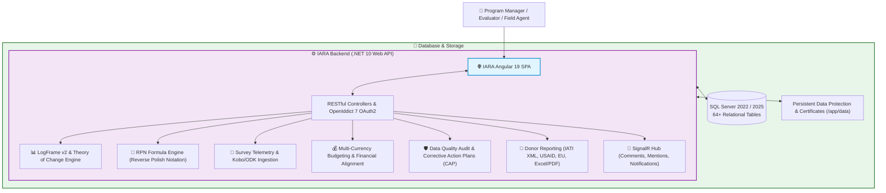

# 🌟 IARA: Universal Monitoring & Evaluation Platform

<div align="center">

  ### 🎯 Enterprise Results-Based Management, Impact Telemetry & Accountability Platform
  **Track Indicators • Structure LogFrames • Automate Governance • Publish Multi-Donor Reports**

  [](LICENSE.txt)
  [](WEB/WEB.csproj)
  [](WEB/ClientApp)
  [](docker-compose.yml)
  [](docker-compose.yml)
  [](WEB.Tests)

</div>

---

## 📖 Overview

**IARA** (Impact & Accountability Reporting Architecture) is a domain-specialized, enterprise-grade Monitoring & Evaluation (M&E) platform. Built upon the core open-source MONIC architecture, IARA ...

The platform eliminates the fragmentation of disparate spreadsheets, isolated field survey apps, and disconnected accounting systems by unifying theory of change causal chains, 4×4 logical framework management, and operational tracking into one system.



---

## 🚀 Quickstart: Running with Docker (Recommended)

The fastest and most reliable way to run IARA is using Docker Compose.

### Prerequisites
* **[Docker Desktop](https://www.docker.com/products/docker-desktop/)** (Windows, macOS, or Linux). Ensure the Docker daemon is active.

### 1. Clone the Repository
```bash
git clone https://github.com/Matandaelis/IARA-MONITORING-AND-EVALUATION.git
cd IARA-MONITORING-AND-EVALUATION
```

### 2. Configure Environment Variables
Copy the default environment configuration:
```bash
# On Linux / macOS:
cp .env.example .env

# On Windows (PowerShell):
Copy-Item .env.example .env
```
> [!NOTE]
> The default values in `.env.example` are pre-configured to run out of the box with local SQL Server credentials (`@Monic123Secure!`) and port `8080`.

### 3. Start the Containers
```bash
docker compose up -d --build
```
This launches two services:
* `monic-db`: Microsoft SQL Server 2022 on port `1433`.
* `monic-app`: ASP.NET Core 10 backend + compiled Angular 19 SPA on port `8080`.

### 4. Access the Application
Open your browser and navigate to:
👉 **[http://localhost:8080](http://localhost:8080)**

On the first launch:
1. The container automatically executes all 58+ EF Core migrations against the SQL Server instance.
2. The initial administrator account setup wizard is presented:
   - Enter your name, administrative email address, and password.
   - Once submitted, your organization profile is initialized and the full platform is active.

---

## ☁️ Coolify deployment

IARA is already structured for Coolify deployments using the included Docker Compose files and production-friendly environment variables.

### Recommended Coolify setup
1. Create a new application in Coolify using the `Docker Compose` build type.
2. Connect the repository: `Matandaelis/IARA-MONITORING-AND-EVALUATION`.
3. Set the branch to `master`.
4. Use `docker-compose.yml` as the compose file.
5. Add the environment variables from [`coolify.env.example`](coolify.env.example).
6. Set the application domain to your public HTTPS URL and enable Coolify SSL / reverse proxy support.

### Minimum production variables
```env
ConnectionStrings__DefaultConnection=Server=monic-db,1433;Database=MONIC;User Id=sa;Password=YourStrongPassword123!;TrustServerCertificate=true;Encrypt=false;
ASPNETCORE_ENVIRONMENT=Production
ASPNETCORE_URLS=http://+:80
ASPNETCORE_FORWARDEDHEADERS_ENABLED=true
Settings__RootUrl=https://your-domain.example.com/
Settings__SiteName=MONIC
Settings__AccessTokenExpiryMinutes=10
Settings__RefreshTokenExpiryMinutes=10880
Settings__EmailSettings__SendEmails=false
Logging__LogLevel__Default=Information
Logging__LogLevel__Microsoft=Warning
```

### Production notes
- Keep the database port internal-only unless you intentionally need external SQL access.
- Use Coolify secrets for the database password and SMTP credentials.
- Set `APP_PORT=80` in the deployment environment when running behind the Coolify reverse proxy.
- The app health endpoint is exposed at `/health` and is used by Docker health checks.

---

## 🌐 Cloud Deployment Options

IARA is cloud-agnostic and ready for automated deployment:

| Deployment Target | Mechanism | Health Check URL | Notes |
| :--- | :--- | :--- | :--- |
| **Coolify** | `docker-compose.yml` | `/health` | Use [`coolify.env.example`](coolify.env.example) and enable HTTPS via the Coolify reverse proxy. |
| **Render** | Root `Dockerfile` | `/health` | Set runtime to Docker; supply external managed SQL Server connection string. |
| **Linux VPS (Ubuntu/Debian)** | Docker Compose + Nginx/Caddy | `/health` | Standard reverse-proxy configuration with Let's Encrypt SSL. |
| **AWS ECS / App Runner** | AWS ECR container image | `/health` | Attach to AWS RDS for SQL Server; mount AWS EFS for `/app/data` key persistence. |

---

## 📁 Repository Structure

```
├── .agents/                    # Standardized development skills and agent tooling
├── docs/                       # Architectural manuals, gap analysis, and OpenAPI specs
│   ├── MONIC_FULL_SYSTEM_DETAILED_DOCUMENTATION.md
│   ├── GAP_ANALYSIS.md
│   └── postman/openapi.json
├── specs/                      # Specification-driven feature development artifacts
├── WEB/                        # ASP.NET Core 10 Web Application
│   ├── ClientApp/              # Angular 19 SPA source (components, services, SCSS)
│   ├── Code/                   # Calculation engines, monitoring metrics, OpenIddict helpers
│   ├── Controllers/            # REST API endpoints (LogFrames, Indicators, Surveys, Budgets)
│   ├── Migrations/             # 58+ Entity Framework Core database migrations
│   ├── Models/                 # EF Core domain entities and DTO schemas
│   ├── Services/               # Domain business services (NotificationDispatcher, etc.)
│   └── Program.cs              # Web application bootstrapper and DI configuration
├── WEB.Tests/                  # xUnit automated test suite (185 tests)
├── Dockerfile                  # Multi-stage production container build definition
├── docker-compose.yml          # Production multi-container orchestration
├── coolify.env.example        # Production-ready environment template for Coolify
├── entrypoint.sh               # Container initialization and non-root execution script
└── README.md                   # Project overview and setup guide
```

---

## 📄 License & Governance

This project is licensed under the **GNU Affero General Public License v3.0 (AGPL-3.0)**. See the [`LICENSE.txt`](LICENSE.txt) file for the full license text.

For issue reporting, feature requests, or technical inquiries, please submit an issue via the [GitHub Issue Tracker](https://github.com/Matandaelis/IARA-MONITORING-AND-EVALUATION/issues).

---

<div align="center">
  <b>IARA: Impact & Accountability Reporting Architecture</b><br/>
  Engineered for precision, transparency, and accountability in global development.
</div>
