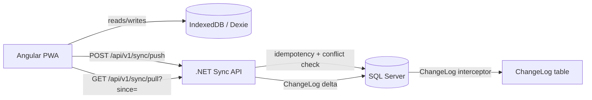

# MONIC × LogAlto Parity — Implementation & Integration Guide

**Prepared for:** MONIC engineering team  
**Scope:** Replicate the functional depth described in *LogAlto: Functional and technical details* (39 pp.) inside MONIC.  
**Target stack:** ASP.NET Core **.NET 10 / C# 13**, EF Core 10, SQL Server 2022+, Angular **19.2 (NgModule, migrating incrementally to standalone)**, PrimeNG **v19**, Bootstrap 5.3.  
**Source of truth for scope:** the attached LogAlto PDF only. Technical choices (Hangfire, Redis, Dexie, MinIO) come from the brief, not from LogAlto.

> **Reality check before you start**
>
> 1. The PDF is a commercial capability brochure, not an ERD or API contract. Every schema below is *deduced from described behaviour*; none of it is copied from LogAlto.
> 2. MONIC is **.NET 10**, not .NET 9. Use C# 13 features (primary constructors, collection expressions, `field` keyword where useful).
> 3. MONIC’s Angular app is **NgModule-based** (`standalone: false` everywhere). Do **not** big-bang migrate. New screens can be standalone components imported into the existing `SharedModule`; existing screens stay NgModule. Signals work in both.
> 4. MONIC already owns most of the primitives LogAlto sells. The guide **extends** them; it does not replace `Datum`, `Token`, `Response`, or `Calculation`.
> 5. PrimeNG is **not installed** yet. Phase 1 includes the install, the CSS-layer strategy, and a single pilot screen.

---

## 0. Traceability: PDF capability → MONIC gap → artifact

| PDF section (page) | Capability described | What MONIC already has | What is missing / artifact to add |
|---|---|---|---|
| Project portfolio (pp. 7–12) | Configurable project fields, filters, favourites, dashboards, activities/sub-activities, milestones, Gantt, budget/expenditure | `Project` (Name, Colour only), `Milestone`, `Task`, `Chart`, `Widget` | `Project` extensions, `CustomFieldDefinition/Value`, `Activity`, `ProjectFavorite`, `BudgetLine`, `Expenditure` |
| Logframe (pp. 13–14) | Goals/outcomes/outputs, drag-drop, **custom vocabulary and any number of levels**, required fields per level, project/org-unit/global logframes, corporate indicators, indicator library | `LogFrame`, **flat** `LogFrameRow` + fixed `LogFrameRowType`, `LogFrameRowIndicator`, `Category/Subcategory` | `LogFrameNode` (hierarchy), `LogFrameLevel` (vocabulary), `LogFrameNodeIndicator` (weight/inheritance), `IndicatorTag` |
| Indicator tracking (pp. 15–16) | Quantitative, qualitative, numerator/denominator, percentage; baseline/targets; **disaggregation of values, baselines and targets**; automatic calculation from forms | `Indicator` (Collected/Calculated/Group, `DataType`, targets, `DisaggregationGroup`, `Token` formulas, topological `Calculation`) | Indicator kind + numerator/denominator links, target disaggregation, `FormIndicatorMapping`, `IndicatorContribution` |
| Forms & surveys (pp. 17–20) | Drag-drop builder, rich field types, validation, conditional/skip logic, confidentiality, translation, form-to-form links, Excel import, record page, review/approve, sharing with access levels, public links, offline mobile | `Questionnaire`, `Section`, `Question`, `QuestionOption`, `SkipLogicOption`, `Response`, `Answer`, `PublicCode` | New question types/validation, `LocalizedText`, `FormShare`, `FormLink`/`RecordLink`, `Response` workflow/sync columns |
| Files (pp. 21–22) | Upload or link, attach to project/activity/record/indicator/report, tags, search/filter | `Document` + `DocumentContent` (**bytes in SQL Server**), `Folder`, Azure Blob service | `Attachment` (polymorphic, external URL, tags, storage key), `IFileStorage` abstraction |
| Comments (p. 23) | Comments on activity/record/indicator/report, reactions, @mentions, notifications | none | `Comment`, `CommentReaction`, `Notification` |
| Analytics & dashboards (pp. 24–28) | Tables, pivot, maps, 8 chart types, Excel/JPG/PNG export, aggregation by any dimension, report config, 3 dashboard types, Power BI | `Chart.Settings` JSON, `WidgetType`, ECharts, backend export | `Dashboard`, `DashboardWidget` (placement/size), `AggregateSnapshot`, pivot/map DTOs, Power BI embed config |
| Access rights (pp. 29–30) | Profiles, profile **per org unit/project**, form access levels (Guest…Administrator) | `Roles`, `EntityPermission`, `IndicatorPermission`, `AuthorizeRoles` | `UserRoleScope`, `ProjectPermission`, `FormShare` |
| Planning & reporting (p. 31) | Planning/reporting documents, period, configurable sections, approval workflow | `MeReview` (review module), `DataReview` (append-only review log) | `ReportDefinition`, `ReportInstance`, `ReportSectionInstance`, `ApprovalWorkflow*`, `DataSubmission` |
| Hosting/security/tech (pp. 34–38) | OAuth2, REST API, Redis, ElasticSearch, offline mobile | OpenIddict, REST controllers, `/health`, Brotli/Gzip, Azure Blob | Redis/HybridCache, Hangfire, ChangeLog/sync, observability |
| GDPR (p. 39) | PII inventory, deletion, consent | none explicit | `AuditLog`, retention/anonymisation jobs, consent flag on forms |

---

### 1. DOMAIN MODEL & SCHEMA IMPLEMENTATION (EF CORE)

#### 1.1 Design principles

1. **Do not fork the time series.** `Datum` already *is* `IndicatorTimeSeries` (PK: `IndicatorId + EntityId + DateId`). Adding a parallel `IndicatorTimeSeries` table would duplicate the calculation engine and create reconciliation bugs. Add a **contribution ledger** (`IndicatorContribution`) and an **audit trail** (`DatumRevision`) instead.
2. **Do not fork the logframe.** Add `LogFrameNode` as v2 beside `LogFrameRow`, backfill, dual-read behind a feature flag, then switch writes. Keep the legacy tables until parity is proven.
3. **Ledger, then projection.** Form submissions produce immutable `IndicatorContribution` rows. `Datum` is a deterministic projection of those rows. Recompute, never increment.
4. **Workflow attaches to an aggregate, not to a composite key.** A `Datum` has a 3-part key, which makes a generic workflow foreign key ugly. Introduce `DataSubmission` (one reporting batch per entity/period) as the approval aggregate.
5. **Relational for facts, JSON for configuration.** Answers, indicator values, approvals and audit stay relational. Expressions, form layout, filters, chart settings and custom-field payloads are JSON.
6. **Single-tenant now, tenant-ready later.** MONIC is single-tenant. Add `TenantId` only if multi-tenancy is actually funded; the pattern is in §1.8. Do not smear a nullable `TenantId` across 64 tables “just in case”.

#### 1.2 Entity map (new = N, extend = E, keep = K)

| Area | Entity | Action | Purpose |
|---|---|---|---|
| Logframe | `LogFrameNode` | N | Arbitrary-depth hierarchy, ordering, per-node custom fields |
| Logframe | `LogFrameLevel` | N | Custom vocabulary (Goal/Outcome/Output/Result/Impact…), rank, required fields |
| Logframe | `LogFrameNodeIndicator` | N | Weighted many-to-many, inherited corporate indicators |
| Logframe | `IndicatorTag` | N | Indicator library filtering (PDF p. 14) |
| Portfolio | `Project` | E | Code, org unit, dates, status, description |
| Portfolio | `CustomFieldDefinition` / `CustomFieldValue` | N | Configurable project/activity/indicator fields (pp. 7, 13, 15) |
| Portfolio | `Activity` | N | Activities/sub-activities, progress source, Gantt |
| Portfolio | `ProjectFavorite` | N | Favourites (p. 8) |
| Portfolio | `BudgetLine` / `Expenditure` | N | Budget by expense category (p. 12) |
| Indicators | `Indicator` | E | Kind, numerator/denominator, definition, method |
| Indicators | `FormIndicatorMapping` | N | Form → indicator rule (aggregation, expression, bindings) |
| Indicators | `QuestionIndicatorLink` | N | Question role: value/numerator/denominator/disaggregation/filter/date/entity |
| Indicators | `IndicatorContribution` | N | Immutable per-response contribution (the ledger) |
| Indicators | `IndicatorTargetDisaggregation` | N | Disaggregated baseline/target (p. 16) |
| Indicators | `DatumRevision` | N | Audit/version history for values |
| Forms | `Question` | E | Number/Date/YesNo/GeoPoint/Location/Project/Activity/User types, validation, confidential |
| Forms | `Answer` | E | Typed value columns for analytics |
| Forms | `Response` | E | `ClientGeneratedId`, `RowVersion`, review fields, device |
| Forms | `FormShare` | N | User/profile/org-unit/project/public-link access levels |
| Forms | `FormLink` / `RecordLink` | N | Form-to-form and record-to-record navigation |
| Forms | `LocalizedText` | N | Form/question/option translations |
| Files | `Attachment` | N | Polymorphic attachment: blob key or external URL, tags, confidentiality |
| Collaboration | `Comment`, `CommentReaction`, `Notification` | N | Comments, reactions, mentions |
| Reporting | `ReportDefinition`, `ReportInstance`, `ReportSectionInstance` | N | Planning/reporting documents |
| Workflow | `ApprovalWorkflow`, `ApprovalWorkflowStep`, `ApprovalWorkflowInstance`, `ApprovalAction` | N | Configurable approval chains |
| Workflow | `DataSubmission`, `DataSubmissionItem` | N | Approval aggregate for indicator data |
| Analytics | `Dashboard`, `DashboardWidget` | N | Global/project/user dashboards (p. 28) |
| Sync | `ClientDevice`, `SyncOperation`, `ChangeLog` | N | Offline idempotency and delta sync |
| Governance | `AuditLog` | N | Approval/audit/GDPR trace |

#### 1.3 Core entity classes

```csharp
using System.ComponentModel.DataAnnotations;
using System.ComponentModel.DataAnnotations.Schema;

namespace Monic.Web.Models;

// v2 hierarchy. Keep LogFrameRow for backward compatibility during migration.
public class LogFrameNode
{
    [Key] public Guid LogFrameNodeId { get; set; } = Guid.NewGuid();

    [Required] public Guid LogFrameId { get; set; }
    public Guid? ParentNodeId { get; set; }
    [Required] public Guid LogFrameLevelId { get; set; }

    [Required(AllowEmptyStrings = true), MaxLength(50)]
    public string Code { get; set; } = "";

    [Required(AllowEmptyStrings = true), MaxLength(500)]
    public string Title { get; set; } = "";

    public string Description { get; set; }
    public string MeansOfVerification { get; set; }
    public string RisksAndAssumptions { get; set; }

    [Required] public int SortOrder { get; set; }   // 1000, 2000, 3000 … gaps ease drag-drop
    [Required] public int Depth { get; set; }
    [Required] public bool IsActive { get; set; } = true;

    // Configurable fields for this level (validated against LogFrameLevel.RequiredFieldsJson)
    public string CustomFieldsJson { get; set; } = "{}";

    public Guid? LegacyLogFrameRowId { get; set; }  // traceability during backfill
    public Guid? InheritedFromNodeId { get; set; }  // corporate/global indicator reused in a project

    [Required] public DateTime CreatedAtUtc { get; set; } = DateTime.UtcNow;
    public Guid? CreatedById { get; set; }
    [Required] public DateTime UpdatedAtUtc { get; set; } = DateTime.UtcNow;
    public Guid? UpdatedById { get; set; }

    [Timestamp] public byte[] RowVersion { get; set; }

    public virtual LogFrameNode ParentNode { get; set; }
    public virtual ICollection<LogFrameNode> ChildNodes { get; set; } = new List<LogFrameNode>();
    public virtual LogFrame LogFrame { get; set; }
    public virtual LogFrameLevel Level { get; set; }
    public virtual ICollection<LogFrameNodeIndicator> Indicators { get; set; } = new List<LogFrameNodeIndicator>();
}

// Custom vocabulary: Goals/Outcomes/Outputs or Objectives/Results/Impacts — any number of levels.
public class LogFrameLevel
{
    [Key] public Guid LogFrameLevelId { get; set; } = Guid.NewGuid();

    public Guid? LogFrameId { get; set; }        // null = organization-wide template
    public Guid? OrganisationId { get; set; }    // scope for org-level vocabulary
    [Required, MaxLength(100)] public string Name { get; set; } = "";
    [Required, MaxLength(100)] public string PluralName { get; set; } = "";
    [Required] public int Rank { get; set; }     // 1 = top
    [Required] public bool IsIndicatorLevel { get; set; }
    [MaxLength(7)] public string Color { get; set; }

    // e.g. ["description","meansOfVerification","risksAndAssumptions"]
    public string RequiredFieldsJson { get; set; } = "[]";
    [Required] public bool IsActive { get; set; } = true;

    public virtual LogFrame LogFrame { get; set; }
    public virtual ICollection<LogFrameNode> Nodes { get; set; } = new List<LogFrameNode>();
}

public class LogFrameNodeIndicator
{
    [Required] public Guid LogFrameNodeId { get; set; }
    [Required] public Guid IndicatorId { get; set; }

    [Column(TypeName = "decimal(9,4)")] public decimal Weight { get; set; } = 1m;
    [Required] public bool IsPrimary { get; set; }
    [Required] public int SortOrder { get; set; }

    public virtual LogFrameNode Node { get; set; }
    public virtual Indicator Indicator { get; set; }
}

// Add to the existing partial Indicator class (Indicator.cs is already partial).
public partial class Indicator
{
    [Required] public IndicatorKind Kind { get; set; } = IndicatorKind.Quantitative;
    public Guid? NumeratorIndicatorId { get; set; }
    public Guid? DenominatorIndicatorId { get; set; }

    [MaxLength(2000)] public string Definition { get; set; }
    [MaxLength(1000)] public string DataCollectionMethod { get; set; }
    [MaxLength(1000)] public string RisksAndAssumptions { get; set; }

    [Required] public bool IsLibraryShared { get; set; }
    public Guid? OwnerOrganisationId { get; set; }
}
```

```csharp
public enum IndicatorKind { Quantitative, Qualitative, NumeratorDenominator, Percentage }

// The immutable ledger row produced by a form submission.
public class IndicatorContribution
{
    [Key] public Guid IndicatorContributionId { get; set; } = Guid.NewGuid();

    [Required] public Guid FormIndicatorMappingId { get; set; }
    [Required] public Guid ResponseId { get; set; }
    [Required] public Guid IndicatorId { get; set; }
    [Required] public Guid EntityId { get; set; }
    [Required] public Guid DateId { get; set; }

    // null = total row; set = one row per disaggregation option
    public Guid? DisaggregationOptionId { get; set; }

    [Column(TypeName = "decimal(20,8)")] public decimal Value { get; set; }
    [Column(TypeName = "decimal(20,8)")] public decimal? Numerator { get; set; }
    [Column(TypeName = "decimal(20,8)")] public decimal? Denominator { get; set; }

    [Required] public DateTime ComputedAtUtc { get; set; } = DateTime.UtcNow;
    [Timestamp] public byte[] RowVersion { get; set; }

    public virtual FormIndicatorMapping Mapping { get; set; }
    public virtual Response Response { get; set; }
}

// Form → indicator rule. Multiple rules per form are allowed; one per indicator per section.
public class FormIndicatorMapping
{
    [Key] public Guid FormIndicatorMappingId { get; set; } = Guid.NewGuid();

    [Required] public Guid QuestionnaireId { get; set; }
    [Required] public Guid IndicatorId { get; set; }
    public Guid? SectionId { get; set; }

    [Required] public MappingAggregation Aggregation { get; set; } = MappingAggregation.Sum;

    // Safe, non-eval expression tree, e.g. {"op":"sum","args":[{"q":"Q1"},{"q":"Q2"}]}
    [Required] public string ValueExpressionJson { get; set; } = "{\"op\":\"sum\",\"args\":[]}";

    // {"source":"response"} or {"questionCode":"Q_DATE"}
    public string DateBindingJson { get; set; } = "{\"source\":\"response\"}";
    public string EntityBindingJson { get; set; } = "{\"source\":\"response\"}";

    // Optional predicate; false = skip the response
    public string FilterJson { get; set; }

    public Guid? DisaggregationGroupId { get; set; }
    [Required] public bool CountOnlySubmitted { get; set; } = true;
    [Required] public bool IsActive { get; set; } = true;

    [Required] public DateTime UpdatedAtUtc { get; set; } = DateTime.UtcNow;
    public Guid? UpdatedById { get; set; }

    public virtual Questionnaire Questionnaire { get; set; }
    public virtual Indicator Indicator { get; set; }
    public virtual ICollection<QuestionIndicatorLink> QuestionLinks { get; set; } = new List<QuestionIndicatorLink>();
}

public enum MappingAggregation { Sum, Count, CountDistinct, Average, Min, Max, MostRecent }
public enum QuestionIndicatorRole { Value, Numerator, Denominator, Disaggregation, Filter, Date, Entity }

public class QuestionIndicatorLink
{
    [Key] public Guid QuestionIndicatorLinkId { get; set; } = Guid.NewGuid();
    [Required] public Guid FormIndicatorMappingId { get; set; }
    [Required] public Guid QuestionId { get; set; }
    [Required] public QuestionIndicatorRole Role { get; set; }

    // For Role = Disaggregation: which option this question value represents.
    public Guid? DisaggregationOptionId { get; set; }

    // {"yes":1,"no":0} for qualitative/option scoring
    public string ValueMapJson { get; set; }
    [Required] public int SortOrder { get; set; }

    public virtual FormIndicatorMapping Mapping { get; set; }
    public virtual Question Question { get; set; }
}
```

```csharp
// Approval attach point for indicator data. One batch per entity/period.
public class DataSubmission
{
    [Key] public Guid DataSubmissionId { get; set; } = Guid.NewGuid();
    [Required] public Guid EntityId { get; set; }
    [Required] public Guid DateId { get; set; }
    public Guid? ProjectId { get; set; }
    [Required] public Guid SubmittedById { get; set; }
    [Required] public DateTime SubmittedAtUtc { get; set; } = DateTime.UtcNow;

    [Required] public WorkflowState State { get; set; } = WorkflowState.Draft;
    public Guid? WorkflowInstanceId { get; set; }
    public string Note { get; set; }

    [Timestamp] public byte[] RowVersion { get; set; }
    public virtual ICollection<DataSubmissionItem> Items { get; set; } = new List<DataSubmissionItem>();
}

public class DataSubmissionItem
{
    [Key] public Guid DataSubmissionItemId { get; set; } = Guid.NewGuid();
    [Required] public Guid DataSubmissionId { get; set; }
    [Required] public Guid IndicatorId { get; set; }
    [Required] public Guid EntityId { get; set; }
    [Required] public Guid DateId { get; set; }
    [Column(TypeName = "decimal(20,8)")] public decimal? Value { get; set; }
    [MaxLength(250)] public string Note { get; set; }
    public virtual DataSubmission Submission { get; set; }
}
```

```csharp
// Configurable approval chain. Steps are data, not code.
public class ApprovalWorkflow
{
    [Key] public Guid ApprovalWorkflowId { get; set; } = Guid.NewGuid();
    [Required, MaxLength(200)] public string Name { get; set; } = "";
    [Required, MaxLength(100)] public string EntityType { get; set; } = ""; // "DataSubmission", "ReportInstance"
    [Required] public bool IsDefault { get; set; }
    [Required] public bool IsActive { get; set; } = true;
    [Required] public int Version { get; set; } = 1;
    [Required] public DateTime CreatedAtUtc { get; set; } = DateTime.UtcNow;
    public virtual ICollection<ApprovalWorkflowStep> Steps { get; set; } = new List<ApprovalWorkflowStep>();
}

public class ApprovalWorkflowStep
{
    [Key] public Guid ApprovalWorkflowStepId { get; set; } = Guid.NewGuid();
    [Required] public Guid ApprovalWorkflowId { get; set; }
    [Required] public int Sequence { get; set; }
    [Required, MaxLength(100)] public string Name { get; set; } = "";
    [Required] public PermissionType RequiredPermission { get; set; } // Submit/Verify/Approve
    public int? SlaDays { get; set; }
    [Required] public bool AllowDelegation { get; set; }
    [Required] public bool RequireDifferentUserFromPrevious { get; set; } = true;
    public virtual ApprovalWorkflow Workflow { get; set; }
}

public class ApprovalWorkflowInstance
{
    [Key] public Guid ApprovalWorkflowInstanceId { get; set; } = Guid.NewGuid();
    [Required] public Guid ApprovalWorkflowId { get; set; }
    [Required, MaxLength(100)] public string EntityType { get; set; } = "";
    [Required] public Guid EntityId { get; set; }
    public Guid? CurrentStepId { get; set; }
    [Required] public WorkflowState State { get; set; } = WorkflowState.Draft;
    [Required] public Guid StartedById { get; set; }
    [Required] public DateTime StartedAtUtc { get; set; } = DateTime.UtcNow;
    public DateTime? CompletedAtUtc { get; set; }
    [Timestamp] public byte[] RowVersion { get; set; }

    public virtual ApprovalWorkflow Workflow { get; set; }
    public virtual ICollection<ApprovalAction> Actions { get; set; } = new List<ApprovalAction>();
}

public class ApprovalAction
{
    [Key] public Guid ApprovalActionId { get; set; } = Guid.NewGuid();
    [Required] public Guid ApprovalWorkflowInstanceId { get; set; }
    public Guid? StepId { get; set; }
    [Required] public Guid UserId { get; set; }
    [Required] public ApprovalDecision Decision { get; set; }
    public string Comment { get; set; }
    [Required] public DateTime CreatedAtUtc { get; set; } = DateTime.UtcNow;
    public virtual ApprovalWorkflowInstance Instance { get; set; }
}

public enum WorkflowState { Draft, InProgress, Approved, Rejected, Returned, Cancelled }
public enum ApprovalDecision { Submit, Approve, Reject, Return, Delegate, Cancel }
```

```csharp
// Planning/reporting documents (PDF p. 31).
public class ReportDefinition
{
    [Key] public Guid ReportDefinitionId { get; set; } = Guid.NewGuid();
    [Required, MaxLength(200)] public string Name { get; set; } = "";
    [Required] public ReportKind Kind { get; set; }
    [Required] public ReportPeriodicity Periodicity { get; set; }
    [Required] public ReportScope Scope { get; set; }
    public Guid? ProjectId { get; set; }
    public Guid? EntityId { get; set; }

    // [{"type":"IndicatorGrid","title":"Results"},{"type":"Narrative","title":"Progress"}]
    public string SectionsJson { get; set; } = "[]";
    [Required] public bool IsActive { get; set; } = true;
    [Required] public DateTime CreatedAtUtc { get; set; } = DateTime.UtcNow;
    public virtual ICollection<ReportInstance> Instances { get; set; } = new List<ReportInstance>();
}

public class ReportInstance
{
    [Key] public Guid ReportInstanceId { get; set; } = Guid.NewGuid();
    [Required] public Guid ReportDefinitionId { get; set; }
    public Guid? ProjectId { get; set; }
    public Guid? EntityId { get; set; }
    [Required] public DateTime PeriodStart { get; set; }
    [Required] public DateTime PeriodEnd { get; set; }

    // Computed stable key for a filtered unique index (null columns are painful in SQL Server)
    [Required, MaxLength(200)] public string ScopeKey { get; set; } = "";

    [Required] public ReportStatus Status { get; set; } = ReportStatus.Draft;
    public Guid? WorkflowInstanceId { get; set; }
    [Required] public Guid CreatedById { get; set; }
    [Required] public DateTime CreatedAtUtc { get; set; } = DateTime.UtcNow;
    public DateTime? SubmittedAtUtc { get; set; }
    public DateTime? ApprovedAtUtc { get; set; }
    [Timestamp] public byte[] RowVersion { get; set; }

    public virtual ReportDefinition Definition { get; set; }
    public virtual ICollection<ReportSectionInstance> Sections { get; set; } = new List<ReportSectionInstance>();
}

public class ReportSectionInstance
{
    [Key] public Guid ReportSectionInstanceId { get; set; } = Guid.NewGuid();
    [Required] public Guid ReportInstanceId { get; set; }
    [Required] public ReportSectionType Type { get; set; }
    [Required, MaxLength(200)] public string Title { get; set; } = "";
    public string ContentJson { get; set; } = "{}";
    [Required] public int SortOrder { get; set; }
    public virtual ReportInstance Report { get; set; }
}

public enum ReportKind { Planning, Reporting }
public enum ReportPeriodicity { Month, Quarter, Year }
public enum ReportScope { Project, OrganisationUnit, Global }
public enum ReportStatus { Draft, InProgress, Approved, Rejected, Returned, Cancelled }
public enum ReportSectionType { IndicatorGrid, ActivityWorkplan, Budget, Narrative, Attachments, Custom }
```

#### 1.4 Form, sharing, file and collaboration entities

```csharp
// Extend Question.cs (already partial) with types and validation.
public partial class Question
{
    public decimal? Minimum { get; set; }
    public decimal? Maximum { get; set; }
    public DateTime? MinimumDate { get; set; }
    public DateTime? MaximumDate { get; set; }
    public int? MaxLength { get; set; }
    [MaxLength(500)] public string ValidationRegex { get; set; }
    [Required] public bool IsConfidential { get; set; }
    [Required] public bool AllowFutureDate { get; set; } = true;
    [Required] public bool AllowPastDate { get; set; } = true;
}

// Make Answer.cs "public partial class Answer" (one-word change) and add typed projections.
// Keep Value as the canonical string; the columns below are for analytics only.
public partial class Answer
{
    [Column(TypeName = "decimal(20,8)")] public decimal? ValueNumber { get; set; }
    [Column(TypeName = "date")] public DateTime? ValueDate { get; set; }
    public bool? ValueBoolean { get; set; }
}

// Enums.cs — append to the existing QuestionType enum. Do NOT reorder or renumber the first five
// members: their integer values are already persisted in Question.QuestionType.
public enum QuestionType
{
    Text, OptionList, Multiline, Note, Document,          // existing values 0–4
    Number, Date, YesNo, GeoPoint, Location, Project,     // new values 5+
    Activity, User, Signature
}

// Share with users/profiles/org units/projects or a public link (PDF p. 30).
public class FormShare
{
    [Key] public Guid FormShareId { get; set; } = Guid.NewGuid();
    [Required] public Guid QuestionnaireId { get; set; }
    [Required] public FormPrincipalType PrincipalType { get; set; }
    public Guid? PrincipalId { get; set; }          // null for PublicLink
    [Required] public FormAccessLevel AccessLevel { get; set; }
    [Required] public bool SeeConfidential { get; set; }
    [Required] public bool CanSubmit { get; set; } = true;

    [MaxLength(64)] public string PublicToken { get; set; }
    public DateTime? ExpiresAtUtc { get; set; }
    [Required] public Guid CreatedById { get; set; }
    [Required] public DateTime CreatedAtUtc { get; set; } = DateTime.UtcNow;

    public virtual Questionnaire Questionnaire { get; set; }
}

public enum FormPrincipalType { User, Profile, OrganisationUnit, Project, PublicLink }
public enum FormAccessLevel { Guest, Collaborator, DataCollector, Reviewer, Administrator }

// Form-to-form navigation (PDF p. 18) and record-to-record links (p. 19).
public class FormLink
{
    [Key] public Guid FormLinkId { get; set; } = Guid.NewGuid();
    [Required] public Guid SourceQuestionnaireId { get; set; }
    [Required] public Guid TargetQuestionnaireId { get; set; }
    [MaxLength(100)] public string Label { get; set; }
    [Required] public bool IsActive { get; set; } = true;
}

public class RecordLink
{
    [Key] public Guid RecordLinkId { get; set; } = Guid.NewGuid();
    [Required] public Guid SourceResponseId { get; set; }
    [Required] public Guid TargetResponseId { get; set; }
    [MaxLength(100)] public string Relationship { get; set; }
    [Required] public DateTime CreatedAtUtc { get; set; } = DateTime.UtcNow;
}

// One table for form/question/option translations, keyed by entity + field + culture.
public class LocalizedText
{
    [Key] public Guid LocalizedTextId { get; set; } = Guid.NewGuid();
    [Required, MaxLength(50)] public string EntityType { get; set; } = ""; // Questionnaire|Question|QuestionOption
    [Required] public Guid EntityId { get; set; }
    [Required, MaxLength(50)] public string Field { get; set; } = "";      // Name|Text|Label|Explanation
    [Required, MaxLength(10)] public string Culture { get; set; } = "";
    [Required] public string Value { get; set; } = "";
}
```

```csharp
// Polymorphic attachment. Leave Document/DocumentContent untouched for the folder module.
public class Attachment
{
    [Key] public Guid AttachmentId { get; set; } = Guid.NewGuid();
    [Required, MaxLength(50)] public string EntityType { get; set; } = ""; // Project|Activity|Response|Indicator|Report
    [Required] public Guid EntityId { get; set; }

    public Guid? DocumentId { get; set; }          // legacy folder document
    [Required, MaxLength(255)] public string FileName { get; set; } = "";
    [MaxLength(150)] public string ContentType { get; set; }
    public long Size { get; set; }
    [MaxLength(50)] public string Sha256 { get; set; }

    [MaxLength(30)] public string StorageProvider { get; set; } // AzureBlob|S3|MinIO
    [MaxLength(500)] public string StorageKey { get; set; }
    [MaxLength(2000)] public string ExternalUrl { get; set; }    // "link to file" (PDF p. 21)

    [MaxLength(1000)] public string TagsJson { get; set; } = "[]";
    [Required] public bool IsConfidential { get; set; }
    [Required] public Guid UploadedById { get; set; }
    [Required] public DateTime UploadedAtUtc { get; set; } = DateTime.UtcNow;
    public DateTime? DeletedAtUtc { get; set; }
}

public class Comment
{
    [Key] public Guid CommentId { get; set; } = Guid.NewGuid();
    [Required, MaxLength(50)] public string EntityType { get; set; } = "";
    [Required] public Guid EntityId { get; set; }
    public Guid? ParentCommentId { get; set; }
    [Required] public Guid UserId { get; set; }
    [Required] public string Body { get; set; } = "";
    [Required] public DateTime CreatedAtUtc { get; set; } = DateTime.UtcNow;
    public DateTime? EditedAtUtc { get; set; }
    public DateTime? DeletedAtUtc { get; set; }
}

public class CommentReaction
{
    [Key] public Guid CommentReactionId { get; set; } = Guid.NewGuid();
    [Required] public Guid CommentId { get; set; }
    [Required] public Guid UserId { get; set; }
    [Required, MaxLength(20)] public string Reaction { get; set; } = ""; // thumbs_up, thumbs_down, …
}

public class Notification
{
    [Key] public Guid NotificationId { get; set; } = Guid.NewGuid();
    [Required] public Guid UserId { get; set; }
    [Required, MaxLength(50)] public string Type { get; set; } = "";
    [Required, MaxLength(250)] public string Title { get; set; } = "";
    public string Body { get; set; }
    [MaxLength(500)] public string Url { get; set; }
    [Required] public bool IsRead { get; set; }
    [Required] public DateTime CreatedAtUtc { get; set; } = DateTime.UtcNow;
    public DateTime? ReadAtUtc { get; set; }
    [MaxLength(50)] public string EntityType { get; set; }
    public Guid? EntityId { get; set; }
}
```

```csharp
// Portfolio: activities/sub-activities (PDF pp. 11–12).
public class Activity
{
    [Key] public Guid ActivityId { get; set; } = Guid.NewGuid();
    [Required] public Guid ProjectId { get; set; }
    public Guid? ParentActivityId { get; set; }
    [Required(AllowEmptyStrings = true), MaxLength(50)] public string Code { get; set; } = "";
    [Required(AllowEmptyStrings = true), MaxLength(500)] public string Name { get; set; } = "";
    public string Description { get; set; }
    [Required] public ActivityStatus Status { get; set; } = ActivityStatus.NotStarted;
    public DateTime? PlannedStart { get; set; }
    public DateTime? PlannedEnd { get; set; }
    public DateTime? ActualStart { get; set; }
    public DateTime? ActualEnd { get; set; }

    // Implementation rate source: indicator, milestones or sub-tasks (PDF p. 12)
    public Guid? ProgressIndicatorId { get; set; }
    [Column(TypeName = "decimal(9,4)")] public decimal? Weight { get; set; }
    public string CustomFieldsJson { get; set; } = "{}";
    [Required] public int SortOrder { get; set; }
    [Timestamp] public byte[] RowVersion { get; set; }

    public virtual Project Project { get; set; }
    public virtual Activity ParentActivity { get; set; }
    public virtual ICollection<Activity> ChildActivities { get; set; } = new List<Activity>();
}

public enum ActivityStatus { NotStarted, InProgress, Completed, OnHold, Cancelled }

public class ProjectFavorite
{
    [Required] public Guid UserId { get; set; }
    [Required] public Guid ProjectId { get; set; }
    [Required] public int SortOrder { get; set; }
}

public class BudgetLine
{
    [Key] public Guid BudgetLineId { get; set; } = Guid.NewGuid();
    [Required] public Guid ProjectId { get; set; }
    public Guid? ActivityId { get; set; }
    [Required, MaxLength(100)] public string Category { get; set; } = "";
    [MaxLength(500)] public string Description { get; set; }
    [Column(TypeName = "decimal(19,4)")] public decimal PlannedAmount { get; set; }
    [Required, MaxLength(3)] public string Currency { get; set; } = "USD";
    public DateTime? PeriodStart { get; set; }
    public DateTime? PeriodEnd { get; set; }
}

public class Expenditure
{
    [Key] public Guid ExpenditureId { get; set; } = Guid.NewGuid();
    [Required] public Guid BudgetLineId { get; set; }
    [Required, Column(TypeName = "decimal(19,4)")] public decimal Amount { get; set; }
    [Required] public DateTime IncurredOn { get; set; }
    public Guid? AttachmentId { get; set; }
    [MaxLength(500)] public string Note { get; set; }
}
```

```csharp
// Offline sync: idempotency + delta log.
public class ClientDevice
{
    [Key] public Guid ClientDeviceId { get; set; } = Guid.NewGuid();
    [Required] public Guid UserId { get; set; }
    [MaxLength(200)] public string DeviceName { get; set; }
    [MaxLength(50)] public string Platform { get; set; }
    [MaxLength(50)] public string AppVersion { get; set; }
    [Required] public DateTime RegisteredAtUtc { get; set; } = DateTime.UtcNow;
    [Required] public DateTime LastSeenAtUtc { get; set; } = DateTime.UtcNow;
    [Required] public bool IsRevoked { get; set; }
}

public class SyncOperation
{
    [Key] public Guid SyncOperationId { get; set; } = Guid.NewGuid();
    [Required] public Guid ClientDeviceId { get; set; }
    [Required, MaxLength(100)] public string ClientOperationId { get; set; } = "";
    [Required, MaxLength(50)] public string EntityType { get; set; } = "";
    [Required] public Guid EntityId { get; set; }
    [Required, MaxLength(20)] public string Operation { get; set; } = ""; // create|update|delete
    public string PayloadJson { get; set; }
    [Required, MaxLength(20)] public string Status { get; set; } = "pending"; // accepted|conflict|rejected
    public string ConflictJson { get; set; }
    [Required] public DateTime ReceivedAtUtc { get; set; } = DateTime.UtcNow;
    public DateTime? ProcessedAtUtc { get; set; }
}

// Append-only change feed. ChangeVersion is an IDENTITY bigint, assigned by SQL Server.
public class ChangeLog
{
    [Key, DatabaseGenerated(DatabaseGeneratedOption.Identity)]
    public long ChangeVersion { get; set; }
    [Required, MaxLength(50)] public string EntityType { get; set; } = "";
    [Required] public Guid EntityId { get; set; }
    [Required, MaxLength(20)] public string Operation { get; set; } = "";
    [Required] public DateTime ChangedAtUtc { get; set; } = DateTime.UtcNow;
    public Guid? ChangedById { get; set; }
    [Required] public bool IsDeleted { get; set; }
    // Optional: compact payload for reference entities; large entities are re-fetched by id.
    public string PayloadJson { get; set; }
}

public class AuditLog
{
    [Key] public Guid AuditLogId { get; set; } = Guid.NewGuid();
    [Required, MaxLength(50)] public string EntityType { get; set; } = "";
    [Required] public Guid EntityId { get; set; }
    [Required, MaxLength(50)] public string Action { get; set; } = "";
    public Guid? UserId { get; set; }
    public string BeforeJson { get; set; }
    public string AfterJson { get; set; }
    [MaxLength(64)] public string IpAddress { get; set; }
    [MaxLength(300)] public string UserAgent { get; set; }
    [Required] public DateTime CreatedAtUtc { get; set; } = DateTime.UtcNow;
}
```

#### 1.5 Compact definitions for the remaining mapped entities

These fill the gaps in the entity map without repeating the full model. Keep them in one file (`Models/LogAltoParity.cs`) or split by area; either way they are additive.

```csharp
// ---------- Indicator library metadata (PDF p. 14) ----------
public class IndicatorTag
{
    [Key] public Guid IndicatorTagId { get; set; } = Guid.NewGuid();
    [Required, MaxLength(80)] public string Name { get; set; } = "";
    [MaxLength(7)] public string Color { get; set; }
}

public class IndicatorTagLink
{
    [Required] public Guid IndicatorId { get; set; }
    [Required] public Guid IndicatorTagId { get; set; }
}

// Baseline/target per disaggregation option. Keep totals on Indicator.Datum-level targets,
// and option-level values here (PDF p. 16).
public class IndicatorTargetDisaggregation
{
    [Key] public Guid IndicatorTargetDisaggregationId { get; set; } = Guid.NewGuid();
    [Required] public Guid IndicatorId { get; set; }
    [Required] public Guid EntityId { get; set; }
    [Required] public Guid DateId { get; set; }
    [Required] public Guid DisaggregationOptionId { get; set; }

    [Column(TypeName = "decimal(20,8)")] public decimal? Baseline { get; set; }
    [Column(TypeName = "decimal(20,8)")] public decimal? Target { get; set; }
    [MaxLength(500)] public string Note { get; set; }
}

// Append-only audit of value changes. Written by Calculation.SaveAsync and manual edits.
public class DatumRevision
{
    [Key] public Guid DatumRevisionId { get; set; } = Guid.NewGuid();
    [Required] public Guid IndicatorId { get; set; }
    [Required] public Guid EntityId { get; set; }
    [Required] public Guid DateId { get; set; }
    [Required] public Guid DisaggregationOptionId { get; set; } // Guid.Empty = total row

    [Column(TypeName = "decimal(20,8)")] public decimal? OldValue { get; set; }
    [Column(TypeName = "decimal(20,8)")] public decimal? NewValue { get; set; }
    [Required, MaxLength(50)] public string Source { get; set; } = ""; // Form|Manual|Calculation|Import
    public Guid? SourceId { get; set; }
    [Required] public Guid ChangedById { get; set; }
    [Required] public DateTime ChangedAtUtc { get; set; } = DateTime.UtcNow;
    [MaxLength(500)] public string Reason { get; set; }
}

// ---------- Configurable custom fields (projects, activities, indicators, logframe nodes) ----------
public class CustomFieldDefinition
{
    [Key] public Guid CustomFieldDefinitionId { get; set; } = Guid.NewGuid();
    [Required, MaxLength(50)] public string EntityType { get; set; } = ""; // Project|Activity|Indicator|LogFrameNode
    [Required, MaxLength(100)] public string FieldKey { get; set; } = "";  // stable JSON key, e.g. "sector"
    [Required, MaxLength(200)] public string Label { get; set; } = "";
    [Required] public CustomFieldType FieldType { get; set; } = CustomFieldType.Text;
    public string OptionsJson { get; set; }                 // for Select/MultiSelect
    public string ValidationJson { get; set; }              // { "min":0, "max":100, "regex":"..." }
    [Required] public bool IsRequired { get; set; }
    [Required] public int SortOrder { get; set; }
    [Required] public bool IsActive { get; set; } = true;
}

public enum CustomFieldType { Text, Multiline, Number, Date, Boolean, Select, MultiSelect, Url }

public class CustomFieldValue
{
    [Key] public Guid CustomFieldValueId { get; set; } = Guid.NewGuid();
    [Required] public Guid CustomFieldDefinitionId { get; set; }
    [Required, MaxLength(50)] public string EntityType { get; set; } = "";
    [Required] public Guid EntityId { get; set; }
    public string ValueJson { get; set; } // scalar or array; keep typed access in one helper
    [Required] public DateTime UpdatedAtUtc { get; set; } = DateTime.UtcNow;
    public Guid? UpdatedById { get; set; }
}

// ---------- Project extension (PDF pp. 7–8, 12) ----------
// Project.cs must become "public partial class Project" (one-word change) for this to compile.
public partial class Project
{
    [MaxLength(50)] public string Code { get; set; }
    [MaxLength(2000)] public string Description { get; set; }
    public Guid? OrganisationId { get; set; }              // Entity row used as org unit
    public Guid? ManagerUserId { get; set; }
    [Column(TypeName = "date")] public DateTime? StartDate { get; set; }
    [Column(TypeName = "date")] public DateTime? EndDate { get; set; }
    [Required] public ProjectLifecycleStatus Status { get; set; } = ProjectLifecycleStatus.Active;
    [MaxLength(3)] public string CurrencyCode { get; set; } = "USD";
    [Required] public bool IsActive { get; set; } = true;
    [Timestamp] public byte[] RowVersion { get; set; }
}

public enum ProjectLifecycleStatus { Draft, Active, OnHold, Completed, Cancelled }

// ---------- Response extension for offline/idempotent submission ----------
// Do NOT redeclare Submitted: it is a computed column in Response.cs.
public partial class Response
{
    [MaxLength(100)] public string ClientGeneratedId { get; set; }
    public Guid? ClientDeviceId { get; set; }
    [Required] public bool IsDeleted { get; set; }
    public DateTime? LastSyncedAtUtc { get; set; }
    [Timestamp] public byte[] RowVersion { get; set; }
    public Guid? ReviewedById { get; set; }
    public DateTime? ReviewedAtUtc { get; set; }
    [MaxLength(500)] public string ReviewNote { get; set; }
}

// ---------- Dashboards (PDF pp. 27–28) ----------
public class Dashboard
{
    [Key] public Guid DashboardId { get; set; } = Guid.NewGuid();
    [Required, MaxLength(200)] public string Name { get; set; } = "";
    [MaxLength(1000)] public string Description { get; set; }
    public Guid? OwnerUserId { get; set; }
    public Guid? ProjectId { get; set; }
    public Guid? OrganisationId { get; set; }
    [Required] public bool IsShared { get; set; }
    [Required] public bool IsDefault { get; set; }
    public string LayoutJson { get; set; } = "[]"; // grid positions; widgets hold their own config
    [Required] public DateTime CreatedAtUtc { get; set; } = DateTime.UtcNow;
    [Required] public DateTime UpdatedAtUtc { get; set; } = DateTime.UtcNow;
    public virtual ICollection<DashboardWidget> Widgets { get; set; } = new List<DashboardWidget>();
}

public class DashboardWidget
{
    [Key] public Guid DashboardWidgetId { get; set; } = Guid.NewGuid();
    [Required] public Guid DashboardId { get; set; }
    [Required] public WidgetType WidgetType { get; set; }
    [Required] public WidgetSize Size { get; set; } = WidgetSize.Medium;
    public Guid? ChartId { get; set; }                     // reuse the existing Chart definition
    public Guid? IndicatorId { get; set; }
    public Guid? QuestionnaireId { get; set; }
    public string SettingsJson { get; set; } = "{}";        // filters, disaggregation, target line
    [Required] public int SortOrder { get; set; }
    [Required] public bool IsVisible { get; set; } = true;
    public virtual Dashboard Dashboard { get; set; }
}
```

Add the corresponding `DbSet`s and indexes to the partial context in §1.6:

```csharp
public DbSet<IndicatorTag> IndicatorTags { get; set; }
public DbSet<IndicatorTagLink> IndicatorTagLinks { get; set; }
public DbSet<IndicatorTargetDisaggregation> IndicatorTargetDisaggregations { get; set; }
public DbSet<DatumRevision> DatumRevisions { get; set; }
public DbSet<CustomFieldDefinition> CustomFieldDefinitions { get; set; }
public DbSet<CustomFieldValue> CustomFieldValues { get; set; }
public DbSet<Dashboard> Dashboards { get; set; }
public DbSet<DashboardWidget> DashboardWidgets { get; set; }
```

```csharp
b.Entity<IndicatorTagLink>(e =>
{
    e.HasKey(x => new { x.IndicatorId, x.IndicatorTagId });
    e.HasOne<Indicator>().WithMany().HasForeignKey(x => x.IndicatorId)
        .OnDelete(DeleteBehavior.Cascade);
    e.HasOne<IndicatorTag>().WithMany().HasForeignKey(x => x.IndicatorTagId)
        .OnDelete(DeleteBehavior.Cascade);
});

b.Entity<IndicatorTargetDisaggregation>(e =>
{
    e.HasKey(x => x.IndicatorTargetDisaggregationId);
    e.HasIndex(x => new { x.IndicatorId, x.EntityId, x.DateId, x.DisaggregationOptionId })
        .IsUnique().HasDatabaseName("UX_IndicatorTargets_Option");
});

b.Entity<DatumRevision>(e =>
{
    e.HasKey(x => x.DatumRevisionId);
    e.HasIndex(x => new { x.IndicatorId, x.EntityId, x.DateId, x.ChangedAtUtc })
        .HasDatabaseName("IX_DatumRevisions_Series_Time");
    e.HasIndex(x => new { x.Source, x.SourceId })
        .HasDatabaseName("IX_DatumRevisions_Source");
});

b.Entity<CustomFieldDefinition>(e =>
{
    e.HasKey(x => x.CustomFieldDefinitionId);
    e.HasIndex(x => new { x.EntityType, x.FieldKey })
        .IsUnique().HasDatabaseName("UX_CustomFieldDefinitions_Entity_Key");
});

b.Entity<CustomFieldValue>(e =>
{
    e.HasKey(x => x.CustomFieldValueId);
    e.HasIndex(x => new { x.EntityType, x.EntityId, x.CustomFieldDefinitionId })
        .IsUnique().HasDatabaseName("UX_CustomFieldValues_Entity_Field");
});

b.Entity<DashboardWidget>(e =>
{
    e.HasKey(x => x.DashboardWidgetId);
    e.HasOne(x => x.Dashboard).WithMany(d => d.Widgets)
        .HasForeignKey(x => x.DashboardId).OnDelete(DeleteBehavior.Cascade);
    e.HasIndex(x => new { x.DashboardId, x.SortOrder })
        .HasDatabaseName("IX_DashboardWidgets_Dashboard_Order");
});

b.Entity<Response>(e =>
{
    // Filtered unique index: only rows that originated offline carry a client id, and
    // soft-deleted rows must not block a re-submission with the same client id.
    e.HasIndex(x => new { x.QuestionnaireId, x.ClientGeneratedId })
        .IsUnique()
        .HasFilter("[ClientGeneratedId] IS NOT NULL AND [IsDeleted] = 0")
        .HasDatabaseName("UX_Responses_ClientGeneratedId");
});
```

#### 1.6 EF Core Fluent configuration

Add partial `DbSet`s and a `ConfigureLogAltoParityModel` method. Keep the existing `OnModelCreating` calls intact.

```csharp
public partial class ApplicationDbContext
{
    public DbSet<LogFrameNode> LogFrameNodes { get; set; }
    public DbSet<LogFrameLevel> LogFrameLevels { get; set; }
    public DbSet<LogFrameNodeIndicator> LogFrameNodeIndicators { get; set; }
    public DbSet<FormIndicatorMapping> FormIndicatorMappings { get; set; }
    public DbSet<QuestionIndicatorLink> QuestionIndicatorLinks { get; set; }
    public DbSet<IndicatorContribution> IndicatorContributions { get; set; }
    public DbSet<DataSubmission> DataSubmissions { get; set; }
    public DbSet<DataSubmissionItem> DataSubmissionItems { get; set; }
    public DbSet<ApprovalWorkflow> ApprovalWorkflows { get; set; }
    public DbSet<ApprovalWorkflowStep> ApprovalWorkflowSteps { get; set; }
    public DbSet<ApprovalWorkflowInstance> ApprovalWorkflowInstances { get; set; }
    public DbSet<ApprovalAction> ApprovalActions { get; set; }
    public DbSet<ReportDefinition> ReportDefinitions { get; set; }
    public DbSet<ReportInstance> ReportInstances { get; set; }
    public DbSet<ReportSectionInstance> ReportSectionInstances { get; set; }
    public DbSet<FormShare> FormShares { get; set; }
    public DbSet<FormLink> FormLinks { get; set; }
    public DbSet<RecordLink> RecordLinks { get; set; }
    public DbSet<LocalizedText> LocalizedTexts { get; set; }
    public DbSet<Attachment> Attachments { get; set; }
    public DbSet<Comment> Comments { get; set; }
    public DbSet<CommentReaction> CommentReactions { get; set; }
    public DbSet<Notification> Notifications { get; set; }
    public DbSet<Activity> Activities { get; set; }
    public DbSet<ProjectFavorite> ProjectFavorites { get; set; }
    public DbSet<BudgetLine> BudgetLines { get; set; }
    public DbSet<Expenditure> Expenditures { get; set; }
    public DbSet<ClientDevice> ClientDevices { get; set; }
    public DbSet<SyncOperation> SyncOperations { get; set; }
    public DbSet<ChangeLog> ChangeLogs { get; set; }
    public DbSet<AuditLog> AuditLogs { get; set; }

    private void ConfigureLogAltoParityModel(ModelBuilder b)
    {
        b.Entity<LogFrameNode>(e =>
        {
            e.HasKey(x => x.LogFrameNodeId);
            e.Property(x => x.Code).HasMaxLength(50);
            e.Property(x => x.Title).HasMaxLength(500);
            e.Property(x => x.CustomFieldsJson).HasColumnType("nvarchar(max)");
            e.Property(x => x.RowVersion).IsRowVersion();

            e.HasOne(x => x.LogFrame).WithMany()
                .HasForeignKey(x => x.LogFrameId).OnDelete(DeleteBehavior.Restrict);
            e.HasOne(x => x.Level).WithMany(l => l.Nodes)
                .HasForeignKey(x => x.LogFrameLevelId).OnDelete(DeleteBehavior.Restrict);
            e.HasOne(x => x.ParentNode).WithMany(x => x.ChildNodes)
                .HasForeignKey(x => x.ParentNodeId).OnDelete(DeleteBehavior.Restrict);

            e.HasIndex(x => new { x.LogFrameId, x.ParentNodeId, x.SortOrder })
                .HasDatabaseName("IX_LogFrameNodes_Tree");
            e.HasIndex(x => new { x.LogFrameId, x.Code })
                .IsUnique().HasFilter("[Code] <> ''")
                .HasDatabaseName("UX_LogFrameNodes_Code");
            e.HasIndex(x => x.LegacyLogFrameRowId)
                .HasDatabaseName("IX_LogFrameNodes_LegacyRow");
        });

        b.Entity<LogFrameLevel>(e =>
        {
            e.HasKey(x => x.LogFrameLevelId);
            e.HasIndex(x => new { x.LogFrameId, x.Rank })
                .IsUnique().HasFilter("[LogFrameId] IS NOT NULL")
                .HasDatabaseName("UX_LogFrameLevels_LogFrame_Rank");
            e.HasIndex(x => new { x.OrganisationId, x.Rank })
                .IsUnique().HasFilter("[OrganisationId] IS NOT NULL AND [LogFrameId] IS NULL")
                .HasDatabaseName("UX_LogFrameLevels_Org_Rank");
        });

        b.Entity<LogFrameNodeIndicator>(e =>
        {
            e.HasKey(x => new { x.LogFrameNodeId, x.IndicatorId });
            e.Property(x => x.Weight).HasColumnType("decimal(9,4)");
            e.HasOne(x => x.Node).WithMany(n => n.Indicators)
                .HasForeignKey(x => x.LogFrameNodeId).OnDelete(DeleteBehavior.Cascade);
            e.HasOne(x => x.Indicator).WithMany()
                .HasForeignKey(x => x.IndicatorId).OnDelete(DeleteBehavior.Restrict);
            e.HasIndex(x => x.IndicatorId).HasDatabaseName("IX_LogFrameNodeIndicators_Indicator");
        });

        b.Entity<FormIndicatorMapping>(e =>
        {
            e.HasKey(x => x.FormIndicatorMappingId);
            e.Property(x => x.ValueExpressionJson).HasColumnType("nvarchar(max)");
            e.HasIndex(x => new { x.QuestionnaireId, x.IndicatorId })
                .IsUnique().HasFilter("[SectionId] IS NULL")
                .HasDatabaseName("UX_FormIndicatorMappings_Form_Indicator");
            e.HasIndex(x => new { x.QuestionnaireId, x.IndicatorId, x.SectionId })
                .IsUnique().HasFilter("[SectionId] IS NOT NULL")
                .HasDatabaseName("UX_FormIndicatorMappings_Form_Section_Indicator");
            e.HasOne(x => x.Questionnaire).WithMany()
                .HasForeignKey(x => x.QuestionnaireId).OnDelete(DeleteBehavior.Cascade);
            e.HasOne(x => x.Indicator).WithMany()
                .HasForeignKey(x => x.IndicatorId).OnDelete(DeleteBehavior.Restrict);
        });

        b.Entity<IndicatorContribution>(e =>
        {
            e.HasKey(x => x.IndicatorContributionId);
            e.Property(x => x.Value).HasColumnType("decimal(20,8)");
            e.Property(x => x.Numerator).HasColumnType("decimal(20,8)");
            e.Property(x => x.Denominator).HasColumnType("decimal(20,8)");

            // One contribution per response/mapping/option. Two filtered indexes handle NULL.
            e.HasIndex(x => new { x.FormIndicatorMappingId, x.ResponseId, x.DisaggregationOptionId })
                .IsUnique().HasFilter("[DisaggregationOptionId] IS NOT NULL")
                .HasDatabaseName("UX_Contributions_Response_Option");
            e.HasIndex(x => new { x.FormIndicatorMappingId, x.ResponseId })
                .IsUnique().HasFilter("[DisaggregationOptionId] IS NULL")
                .HasDatabaseName("UX_Contributions_Response_Total");

            e.HasIndex(x => new { x.IndicatorId, x.EntityId, x.DateId })
                .HasDatabaseName("IX_Contributions_Aggregate");

            e.HasOne(x => x.Mapping).WithMany()
                .HasForeignKey(x => x.FormIndicatorMappingId).OnDelete(DeleteBehavior.Cascade);
            e.HasOne(x => x.Response).WithMany()
                .HasForeignKey(x => x.ResponseId).OnDelete(DeleteBehavior.Cascade);
        });

        b.Entity<ApprovalWorkflowInstance>(e =>
        {
            e.HasKey(x => x.ApprovalWorkflowInstanceId);
            e.HasIndex(x => new { x.EntityType, x.EntityId })
                .IsUnique().HasFilter("[CompletedAtUtc] IS NULL")
                .HasDatabaseName("UX_WorkflowInstances_Active");
            e.HasIndex(x => x.CurrentStepId).HasDatabaseName("IX_WorkflowInstances_Step");
            e.HasOne(x => x.Workflow).WithMany()
                .HasForeignKey(x => x.ApprovalWorkflowId).OnDelete(DeleteBehavior.Restrict);
        });

        b.Entity<ApprovalWorkflowStep>(e =>
        {
            e.HasKey(x => x.ApprovalWorkflowStepId);
            e.HasIndex(x => new { x.ApprovalWorkflowId, x.Sequence }).IsUnique()
                .HasDatabaseName("UX_WorkflowSteps_Workflow_Sequence");
        });

        b.Entity<ReportInstance>(e =>
        {
            e.HasKey(x => x.ReportInstanceId);
            e.HasIndex(x => new { x.ReportDefinitionId, x.ScopeKey, x.PeriodStart })
                .IsUnique().HasDatabaseName("UX_ReportInstances_Definition_Scope_Period");
            e.HasOne(x => x.Definition).WithMany(d => d.Instances)
                .HasForeignKey(x => x.ReportDefinitionId).OnDelete(DeleteBehavior.Restrict);
        });

        b.Entity<FormShare>(e =>
        {
            e.HasKey(x => x.FormShareId);
            e.HasIndex(x => new { x.QuestionnaireId, x.PrincipalType, x.PrincipalId })
                .IsUnique().HasFilter("[PrincipalId] IS NOT NULL")
                .HasDatabaseName("UX_FormShares_Principal");
            e.HasIndex(x => x.PublicToken).IsUnique()
                .HasFilter("[PublicToken] IS NOT NULL")
                .HasDatabaseName("UX_FormShares_PublicToken");
            e.HasOne(x => x.Questionnaire).WithMany()
                .HasForeignKey(x => x.QuestionnaireId).OnDelete(DeleteBehavior.Cascade);
        });

        b.Entity<LocalizedText>(e =>
        {
            e.HasKey(x => x.LocalizedTextId);
            e.HasIndex(x => new { x.EntityType, x.EntityId, x.Field, x.Culture })
                .IsUnique().HasDatabaseName("UX_LocalizedTexts_Entity_Field_Culture");
        });

        b.Entity<Attachment>(e =>
        {
            e.HasKey(x => x.AttachmentId);
            e.HasIndex(x => new { x.EntityType, x.EntityId })
                .HasDatabaseName("IX_Attachments_Entity");
            e.HasIndex(x => x.StorageKey).IsUnique()
                .HasFilter("[StorageKey] IS NOT NULL")
                .HasDatabaseName("UX_Attachments_StorageKey");
            e.HasIndex(x => x.Sha256).HasDatabaseName("IX_Attachments_Sha256");
        });

        b.Entity<SyncOperation>(e =>
        {
            e.HasKey(x => x.SyncOperationId);
            e.HasIndex(x => new { x.ClientDeviceId, x.ClientOperationId })
                .IsUnique().HasDatabaseName("UX_SyncOperations_Device_Operation");
        });

        b.Entity<ChangeLog>(e =>
        {
            e.HasKey(x => x.ChangeVersion);
            e.HasIndex(x => new { x.EntityType, x.ChangedAtUtc })
                .HasDatabaseName("IX_ChangeLogs_Entity_ChangedAt");
        });

        b.Entity<AuditLog>(e =>
        {
            e.HasKey(x => x.AuditLogId);
            e.HasIndex(x => new { x.EntityType, x.EntityId, x.CreatedAtUtc })
                .HasDatabaseName("IX_AuditLogs_Entity_CreatedAt");
        });

        // Existing Datum is the time series: add covering indexes for dashboards.
        b.Entity<Datum>()
            .HasIndex(x => new { x.EntityId, x.DateId })
            .HasDatabaseName("IX_Data_Entity_Date")
            .IncludeProperties(x => new { x.Value, x.Approved });

        b.Entity<Response>()
            .HasIndex(x => new { x.QuestionnaireId, x.EntityId, x.DateId })
            .HasDatabaseName("IX_Responses_Form_Entity_Date");
    }
}
```

Call it from `ApplicationDbContext.OnModelCreating` right after the existing configure calls:

```csharp
ConfigureModelBuilder(modelBuilder);
ConfigureMeReviewModel(modelBuilder);
ConfigureDisaggregationModel(modelBuilder);
ConfigureLogAltoParityModel(modelBuilder);
```

> **EF Core 10 note:** `IncludeProperties` is available on `IndexBuilder`. If the team prefers explicit SQL migrations, add the covering index in the migration rather than the model.

#### 1.7 SQL Server considerations

**JSON columns.** Use `nvarchar(max)` + `ISJSON` check constraints. SQL Server does not index JSON directly; promote hot paths to persisted computed columns:

```sql
ALTER TABLE LogFrameNodes
    ADD CONSTRAINT CK_LogFrameNodes_CustomFieldsJson CHECK (ISJSON(CustomFieldsJson) = 1);

ALTER TABLE LogFrameNodes
    ADD Sector AS JSON_VALUE(CustomFieldsJson, '$.sector') PERSISTED;

CREATE INDEX IX_LogFrameNodes_Sector ON LogFrameNodes(Sector);
```

Do **not** store whole form responses as JSON. `Answer`/`Response` must remain relational so that pivots, filters and form-to-indicator rules can use indexes. JSON is appropriate for:

- `LogFrameNode.CustomFieldsJson` (rarely filtered; computed columns for the few hot fields).
- `FormIndicatorMapping.ValueExpressionJson`, `FilterJson`, bindings.
- `ReportSectionInstance.ContentJson` (narrative blocks, layout).
- `Chart.Settings` (already used by MONIC).
- `Attachment.TagsJson` (tag filtering can use a `DocumentTag` join if it becomes hot).

**Typed answer projections.** Add `ValueNumber`, `ValueDate`, `ValueBoolean` to `Answer` and populate them in `ResponsesController.Save`. This avoids `TRY_CAST(Value AS decimal)` on every dashboard query:

```sql
CREATE INDEX IX_Answers_Question_Number ON Answers(QuestionId, ValueNumber) WHERE ValueNumber IS NOT NULL;
```

**Concurrency.** Use `rowversion` (`[Timestamp]`) on every aggregate that can be edited concurrently: `LogFrameNode`, `ReportInstance`, `ApprovalWorkflowInstance`, `DataSubmission`, `Activity`, `FormIndicatorMapping`. Return HTTP `409`/`412` with the current ETag. Do not use `MERGE` for upserts; it has well-known concurrency bugs.

**Time precision.** Existing tables use `smalldatetime` (minute precision). New audit/approval tables use `datetime2(3)`. Do not retrofit existing columns in the same release.

**Partitioning.** `Datum` grows with indicators × entities × periods. If it exceeds ~50–100M rows, partition by `DateId` year (or by `EntityId` for very large org hierarchies) and archive closed years. Keep the clustered PK `(IndicatorId, EntityId, DateId)`; a partition-aligned index on `(DateId, EntityId)` supports period scans.

**Collation.** Keep a single collation for the database; code comparisons (`Code`, `Culture`) should use explicit `Latin1_General_100_CI_AS` or `_CS_AS` depending on whether codes are case-sensitive. Logframe codes should be case-insensitive unique.

#### 1.8 Multi-tenant readiness (only if funded)

MONIC is single-tenant today. Adding `TenantId` to all 64+ tables now is pure cost: wider indexes, more complex unique constraints, more migration risk. If multi-tenancy is on the roadmap, choose **database-per-tenant** for enterprise customers; it is simpler and isolates backups/restores. If a shared database is mandatory, do this:

1. Add `TenantId (uniqueidentifier)` to **aggregate roots and high-volume facts**: `Project`, `LogFrame`, `Questionnaire`, `Indicator`, `Entity`, `Datum`, `Response`, `ReportDefinition`, `ApprovalWorkflow`.
2. Lead every index with `TenantId`; include it in every unique index.
3. Set it per request from a claim, not from a header:

```csharp
public interface ITenantContext { Guid TenantId { get; } }

public sealed class TenantContext(IHttpContextAccessor accessor) : ITenantContext
{
    public Guid TenantId =>
        Guid.TryParse(accessor.HttpContext?.User.FindFirst("tenant_id")?.Value, out var id)
            ? id : Guid.Empty;
}
```

4. Global query filter (EF Core evaluates the context property per query, even though the model is cached):

```csharp
modelBuilder.Entity<Project>().HasQueryFilter(p => p.TenantId == TenantId);
modelBuilder.Entity<Datum>().HasQueryFilter(d => d.TenantId == TenantId);
modelBuilder.Entity<Response>().HasQueryFilter(r => r.TenantId == TenantId);
```

5. Stamp `TenantId` in `SaveChanges` for added roots; reject cross-tenant FKs in a `SavingChanges` interceptor.
6. Background jobs and migrations must set the tenant explicitly or call `IgnoreQueryFilters()`; otherwise Hangfire silently processes zero rows.

> Query filters do **not** cascade through navigations. If you filter `Project`, a query that starts at `Datum` is not filtered by `Project.TenantId`. That is why step 1 includes facts, not just roots.

#### 1.9 Migration and backfill strategy

1. **Add tables only** in migration `AddLogAltoParitySchema`. No column drops, no renames.
2. **Seed default levels** per existing logframe: `Goals=1`, `Outcomes=2`, `Outputs=3`, `Activities=4` with `LogFrameId` set.
3. **Backfill nodes** from `LogFrameRows`. Because the current model is flat, infer the parent from row order and `RowType` rank (nearest previous row with a lower rank). Store `LegacyLogFrameRowId`.
4. **Copy indicator links** from `LogFrameRowIndicators` to `LogFrameNodeIndicators`, defaulting `Weight=1`.
5. **Dual-read** behind `Features:LogFrameV2`; the old screen remains the fallback. Do not dual-write until the read path has been in production for one release.
6. **Verify parity** with a SQL reconciliation query: every legacy row has a node, every link has a join row, and the rendered tree matches the old grouped matrix.
7. **Switch writes** to `LogFrameNode`; keep the legacy tables read-only for one release, then archive.

---
### 2. BACKEND TECH INTEGRATION & SERVICES (ASP.NET CORE)

#### 2.1 Form-to-indicator engine

**The contract.** A form is a `Questionnaire`; a submission is a `Response`; answers are `Answer` rows. A `FormIndicatorMapping` says: “when a response to form X is submitted, compute indicator Y using this expression, this period/entity binding, and these disaggregation links.” The engine writes `IndicatorContribution` rows, then projects them into `Datum` and `DisaggregationDatum`. Finally it calls the existing `Calculation.SaveAsync`, which already handles parent-entity aggregation, period roll-ups and chained calculated indicators.

**Why a ledger?** If you increment `Datum.Value` on every submission, edits, deletes, skipped questions and retries corrupt the total. A ledger lets you delete and rebuild a response’s contributions deterministically, and it gives you an audit trail (“this response contributed 12 to indicator X”).

**Expression language.** Never `DataTable.Compute`, never `eval`, never compile user strings. Use a small JSON AST with an allow-list of operators. The same language is used for filters and for calculated fields.

```csharp
using System.Globalization;
using System.Text.Json;

namespace Monic.Web.Code;

public interface IFormExpressionEvaluator
{
    decimal? Evaluate(string json, IReadOnlyDictionary<string, Answer> answers);
    bool EvaluateFilter(string json, IReadOnlyDictionary<string, Answer> answers);
}

public sealed class FormExpressionEvaluator : IFormExpressionEvaluator
{
    public decimal? Evaluate(string json, IReadOnlyDictionary<string, Answer> answers)
    {
        if (string.IsNullOrWhiteSpace(json)) return null;
        using var doc = JsonDocument.Parse(json);
        return Eval(doc.RootElement, answers);
    }

    public bool EvaluateFilter(string json, IReadOnlyDictionary<string, Answer> answers)
    {
        if (string.IsNullOrWhiteSpace(json)) return true;
        using var doc = JsonDocument.Parse(json);
        return EvalBool(doc.RootElement, answers);
    }

    private static decimal? Eval(JsonElement e, IReadOnlyDictionary<string, Answer> answers)
    {
        if (e.ValueKind == JsonValueKind.Number) return e.GetDecimal();
        if (e.ValueKind == JsonValueKind.String) return null;

        var op = e.GetProperty("op").GetString();
        var args = e.TryGetProperty("args", out var a)
            ? a.EnumerateArray().Select(x => Eval(x, answers)).ToList()
            : new List<decimal?>();

        return op switch
        {
            "q"      => AnswerValue(e.GetProperty("code").GetString(), answers),
            "num"    => e.GetProperty("value").GetDecimal(),
            "sum"    => args.Sum(x => x ?? 0m),
            "count"  => args.Count(x => x.HasValue),
            "avg"    => args.Any(x => x.HasValue) ? args.Where(x => x.HasValue).Average(x => x!.Value) : null,
            "min"    => Min(args),
            "max"    => Max(args),
            "add"    => (args.ElementAtOrDefault(0) ?? 0m) + (args.ElementAtOrDefault(1) ?? 0m),
            "sub"    => (args.ElementAtOrDefault(0) ?? 0m) - (args.ElementAtOrDefault(1) ?? 0m),
            "mul"    => (args.ElementAtOrDefault(0) ?? 0m) * (args.ElementAtOrDefault(1) ?? 0m),
            "div"    => Divide(args),
            "coalesce" => args.FirstOrDefault(x => x.HasValue),
            "if"     => EvalBool(e.GetProperty("cond"), answers)
                            ? (args.ElementAtOrDefault(0) ?? 0m)
                            : (args.ElementAtOrDefault(1) ?? 0m),
            _ => throw new InvalidOperationException($"Unsupported expression operator '{op}'.")
        };
    }

    private static decimal? Divide(IReadOnlyList<decimal?> args)
    {
        var numerator = args.ElementAtOrDefault(0) ?? 0m;
        var denominator = args.ElementAtOrDefault(1) ?? 0m;
        return denominator == 0m ? null : numerator / denominator;
    }

    private static bool EvalBool(JsonElement e, IReadOnlyDictionary<string, Answer> answers)
    {
        if (e.ValueKind is JsonValueKind.True or JsonValueKind.False) return e.GetBoolean();
        if (e.ValueKind == JsonValueKind.String) return !string.IsNullOrEmpty(e.GetString());

        var op = e.GetProperty("op").GetString();

        // Boolean operators must be handled before evaluating left/right as decimals.
        switch (op)
        {
            case "not":
                return !EvalBool(e.GetProperty("arg"), answers);
            case "and":
                return EvalBool(e.GetProperty("left"), answers) &&
                       EvalBool(e.GetProperty("right"), answers);
            case "or":
                return EvalBool(e.GetProperty("left"), answers) ||
                       EvalBool(e.GetProperty("right"), answers);
        }

        var left = Eval(e.GetProperty("left"), answers);
        var right = Eval(e.GetProperty("right"), answers);

        return op switch
        {
            "eq"  => left.HasValue && right.HasValue && left.Value == right.Value,
            "neq" => !(left.HasValue && right.HasValue && left.Value == right.Value),
            "gt"  => left.HasValue && right.HasValue && left.Value > right.Value,
            "gte" => left.HasValue && right.HasValue && left.Value >= right.Value,
            "lt"  => left.HasValue && right.HasValue && left.Value < right.Value,
            "lte" => left.HasValue && right.HasValue && left.Value <= right.Value,
            _ => throw new InvalidOperationException($"Unsupported filter operator '{op}'.")
        };
    }

    private static decimal? AnswerValue(string code, IReadOnlyDictionary<string, Answer> answers)
    {
        if (string.IsNullOrWhiteSpace(code) || !answers.TryGetValue(code, out var answer))
            return null;

        if (decimal.TryParse(answer.Value, NumberStyles.Number,
                CultureInfo.InvariantCulture, out var number))
            return number;

        if (bool.TryParse(answer.Value, out var boolean))
            return boolean ? 1m : 0m;

        if (answer.Value?.Trim().ToLowerInvariant() is "yes" or "true") return 1m;
        if (answer.Value?.Trim().ToLowerInvariant() is "no" or "false") return 0m;

        // Multi-select / option list: prefer the option's configured score, else count selections.
        if (answer.AnswerOptions.Count == 0) return null;
        var scored = answer.AnswerOptions
            .Select(o => o.QuestionOption?.Value)
            .Where(v => v.HasValue)
            .Select(v => (decimal)v!.Value)
            .ToList();

        return scored.Count > 0 ? scored.Sum() : answer.AnswerOptions.Count;
    }

    private static decimal? Min(IEnumerable<decimal?> values)
    {
        var list = values.Where(v => v.HasValue).Select(v => v!.Value).ToList();
        return list.Count == 0 ? null : list.Min();
    }

    private static decimal? Max(IEnumerable<decimal?> values)
    {
        var list = values.Where(v => v.HasValue).Select(v => v!.Value).ToList();
        return list.Count == 0 ? null : list.Max();
    }
}
```

**The engine.**

```csharp
using System.Globalization;
using System.Text.Json;
using Microsoft.EntityFrameworkCore;
using Microsoft.Extensions.Caching.Memory;
using Microsoft.Extensions.Logging;
using Monic.Web.Models;

namespace Monic.Web.Code;

public interface IFormIndicatorEngine
{
    Task RecomputeResponseAsync(Guid responseId, Guid userId, CancellationToken ct = default);
    Task RecomputeMappingAsync(Guid mappingId, Guid userId, CancellationToken ct = default);
}

public sealed class FormIndicatorEngine : IFormIndicatorEngine
{
    private readonly ApplicationDbContext _db;
    private readonly AppSettings _settings;
    private readonly IFormExpressionEvaluator _expressions;
    private readonly IMemoryCache _cache;
    private readonly ILogger<FormIndicatorEngine> _logger;

    public FormIndicatorEngine(
        ApplicationDbContext db,
        AppSettings settings,
        IFormExpressionEvaluator expressions,
        IMemoryCache cache,
        ILogger<FormIndicatorEngine> logger)
    {
        _db = db;
        _settings = settings;
        _expressions = expressions;
        _cache = cache;
        _logger = logger;
    }

    public async Task RecomputeResponseAsync(Guid responseId, Guid userId, CancellationToken ct = default)
    {
        var response = await _db.Responses
            .Include(r => r.Answers).ThenInclude(a => a.Question)
            .Include(r => r.Answers).ThenInclude(a => a.AnswerOptions).ThenInclude(o => o.QuestionOption)
            .FirstOrDefaultAsync(r => r.ResponseId == responseId, ct)
            ?? throw new InvalidOperationException($"Response {responseId} not found.");

        var existing = await _db.IndicatorContributions
            .Where(c => c.ResponseId == responseId)
            .ToListAsync(ct);

        var touched = existing
            .Select(c => (c.IndicatorId, c.EntityId, c.DateId))
            .Distinct()
            .ToList();

        _db.IndicatorContributions.RemoveRange(existing);

        // Persist the deletes before inserting replacements. The ledger has a unique index on
        // (FormIndicatorMappingId, ResponseId, DisaggregationOptionId) and EF does not guarantee
        // DELETE-before-INSERT ordering within a single SaveChanges batch.
        await _db.SaveChangesAsync(ct);

        if (!response.Submitted)
        {
            foreach (var key in touched)
                await RecomputeDatumAsync(key.IndicatorId, key.EntityId, key.DateId, userId, ct);
            return;
        }

        var mappings = await _db.FormIndicatorMappings
            .Include(m => m.QuestionLinks).ThenInclude(l => l.Question)
            .Where(m => m.QuestionnaireId == response.QuestionnaireId && m.IsActive)
            .OrderBy(m => m.FormIndicatorMappingId)
            .ToListAsync(ct);

        var answers = response.Answers
            .Where(a => a.Question != null && !string.IsNullOrWhiteSpace(a.Question.Code))
            .GroupBy(a => a.Question.Code, StringComparer.OrdinalIgnoreCase)
            .ToDictionary(g => g.Key, g => g.First(), StringComparer.OrdinalIgnoreCase);

        foreach (var mapping in mappings)
        {
            if (!_expressions.EvaluateFilter(mapping.FilterJson, answers))
                continue;

            var value = _expressions.Evaluate(mapping.ValueExpressionJson, answers);
            if (!value.HasValue)
                continue;

            var entityId = await ResolveEntityIdAsync(mapping, response, answers, ct);
            var dateId = await ResolveDateIdAsync(mapping, response, answers, ct);
            if (entityId == Guid.Empty || dateId == Guid.Empty)
            {
                _logger.LogWarning(
                    "Mapping {MappingId} could not resolve entity/date for response {ResponseId}.",
                    mapping.FormIndicatorMappingId, response.ResponseId);
                continue;
            }

            var optionIds = ResolveDisaggregationOptions(mapping, answers);

            foreach (var optionId in optionIds)
            {
                // For an option-specific row, re-evaluate only when the expression is option-scoped.
                // The common case is a total value replicated per selected option; the mapping's
                // QuestionIndicatorLinks decide which questions contribute to which option.
                var contribution = new IndicatorContribution
                {
                    FormIndicatorMappingId = mapping.FormIndicatorMappingId,
                    ResponseId = response.ResponseId,
                    IndicatorId = mapping.IndicatorId,
                    EntityId = entityId,
                    DateId = dateId,
                    DisaggregationOptionId = optionId,
                    Value = value.Value,
                    ComputedAtUtc = DateTime.UtcNow
                };

                _db.IndicatorContributions.Add(contribution);
                touched.Add((mapping.IndicatorId, entityId, dateId));
            }
        }

        await _db.SaveChangesAsync(ct);

        foreach (var key in touched.Distinct())
            await RecomputeDatumAsync(key.IndicatorId, key.EntityId, key.DateId, userId, ct);
    }

    public async Task RecomputeMappingAsync(Guid mappingId, Guid userId, CancellationToken ct = default)
    {
        var responseIds = await _db.Responses
            .Where(r => r.QuestionnaireId == _db.FormIndicatorMappings
                .Where(m => m.FormIndicatorMappingId == mappingId)
                .Select(m => m.QuestionnaireId))
            .Select(r => r.ResponseId)
            .ToListAsync(ct);

        foreach (var responseId in responseIds)
            await RecomputeResponseAsync(responseId, userId, ct);
    }

    private async Task RecomputeDatumAsync(
        Guid indicatorId, Guid entityId, Guid dateId, Guid userId, CancellationToken ct)
    {
        var contributions = await _db.IndicatorContributions
            .AsNoTracking()
            .Where(c => c.IndicatorId == indicatorId && c.EntityId == entityId && c.DateId == dateId)
            .ToListAsync(ct);

        var mapping = await _db.FormIndicatorMappings
            .AsNoTracking()
            .Where(m => m.IndicatorId == indicatorId && m.IsActive)
            .OrderByDescending(m => m.UpdatedAtUtc)
            .FirstOrDefaultAsync(ct);

        if (mapping is null) return;

        var value = Aggregate(mapping.Aggregation, contributions);

        var datum = await _db.Data.FirstOrDefaultAsync(
            d => d.IndicatorId == indicatorId && d.EntityId == entityId && d.DateId == dateId, ct);

        if (datum is null)
        {
            datum = new Datum
            {
                IndicatorId = indicatorId,
                EntityId = entityId,
                DateId = dateId
            };
            _db.Data.Add(datum);
        }

        datum.Value = value;
        datum.LastSavedById = userId;
        datum.LastSavedDateUtc = DateTime.UtcNow;
        await _db.SaveChangesAsync(ct);

        // Reuse the existing pipeline: parent-entity aggregation + period roll-up + chained formulas.
        var calculation = new Calculation(_db, _settings, userId, _cache);
        await calculation.SaveAsync(datum);

        // Project disaggregated values.
        var options = contributions
            .Where(c => c.DisaggregationOptionId.HasValue)
            .GroupBy(c => c.DisaggregationOptionId!.Value);

        foreach (var option in options)
        {
            var optionValue = Aggregate(mapping.Aggregation, option.ToList());
            var row = await _db.DisaggregationData.FirstOrDefaultAsync(d =>
                d.IndicatorId == indicatorId && d.EntityId == entityId &&
                d.DateId == dateId && d.DisaggregationOptionId == option.Key, ct);

            if (row is null)
            {
                row = new DisaggregationDatum
                {
                    IndicatorId = indicatorId,
                    EntityId = entityId,
                    DateId = dateId,
                    DisaggregationOptionId = option.Key
                };
                _db.DisaggregationData.Add(row);
            }

            row.Value = optionValue ?? 0m;
        }

        await _db.SaveChangesAsync(ct);
    }

    private static decimal? Aggregate(MappingAggregation aggregation, List<IndicatorContribution> rows) =>
        aggregation switch
        {
            MappingAggregation.Sum         => rows.Sum(r => r.Value),
            MappingAggregation.Count       => rows.Count,
            MappingAggregation.CountDistinct => rows.Select(r => r.Value).Distinct().Count(),
            MappingAggregation.Average     => rows.Count == 0 ? null : rows.Average(r => r.Value),
            MappingAggregation.Min         => rows.Count == 0 ? null : rows.Min(r => r.Value),
            MappingAggregation.Max         => rows.Count == 0 ? null : rows.Max(r => r.Value),
            MappingAggregation.MostRecent  => rows
                .OrderByDescending(r => r.ComputedAtUtc)
                .Select(r => (decimal?)r.Value)
                .FirstOrDefault(),
            _ => null
        };

    private async Task<Guid> ResolveEntityIdAsync(
        FormIndicatorMapping mapping, Response response,
        IReadOnlyDictionary<string, Answer> answers, CancellationToken ct)
    {
        using var binding = JsonDocument.Parse(mapping.EntityBindingJson ?? "{\"source\":\"response\"}");
        if (binding.RootElement.TryGetProperty("questionCode", out var code))
        {
            if (answers.TryGetValue(code.GetString() ?? "", out var answer) &&
                Guid.TryParse(answer.Value, out var id) &&
                await _db.Entities.AnyAsync(e => e.EntityId == id, ct))
                return id;
        }

        return response.EntityId;
    }

    private async Task<Guid> ResolveDateIdAsync(
        FormIndicatorMapping mapping, Response response,
        IReadOnlyDictionary<string, Answer> answers, CancellationToken ct)
    {
        using var binding = JsonDocument.Parse(mapping.DateBindingJson ?? "{\"source\":\"response\"}");
        if (!binding.RootElement.TryGetProperty("questionCode", out var code))
            return response.DateId;

        if (!answers.TryGetValue(code.GetString() ?? "", out var answer) ||
            !DateTime.TryParse(answer.Value, CultureInfo.InvariantCulture,
                DateTimeStyles.AdjustToUniversal, out var date))
            return response.DateId;

        var questionnaire = await _db.Questionnaires
            .AsNoTracking()
            .FirstAsync(q => q.QuestionnaireId == response.QuestionnaireId, ct);

        var match = await _db.Dates
            .AsNoTracking()
            .Where(d => d.DateType == questionnaire.DateType &&
                        d.OpenFrom <= date && d.OpenTo >= date)
            .OrderBy(d => d.SortOrder)
            .FirstOrDefaultAsync(ct);

        return match?.DateId ?? response.DateId;
    }

    // Maps selected question options to disaggregation options. The mapping lives on the link
    // (ValueMapJson) so it is versionable with the form and does not depend on code strings.
    // Example: {"<questionOptionId>":"<disaggregationOptionId>"} or {"female":"<guid>"}.
    private static IReadOnlyList<Guid?> ResolveDisaggregationOptions(
        FormIndicatorMapping mapping, IReadOnlyDictionary<string, Answer> answers)
    {
        var links = mapping.QuestionLinks
            .Where(l => l.Role == QuestionIndicatorRole.Disaggregation)
            .ToList();

        if (links.Count == 0) return new Guid?[] { null };

        var options = new List<Guid?>();
        foreach (var link in links)
        {
            if (!answers.TryGetValue(link.Question?.Code ?? "", out var answer))
                continue;

            // Single-select link: the whole question is the disaggregation dimension.
            if (link.DisaggregationOptionId.HasValue)
            {
                options.Add(link.DisaggregationOptionId);
                continue;
            }

            var map = ParseValueMap(link.ValueMapJson);
            if (map.Count == 0)
                continue;

            foreach (var selected in answer.AnswerOptions)
            {
                // ValueMapJson is keyed by QuestionOptionId. Codes are not used because
                // QuestionOption has no Code column in MONIC; IDs are stable across renames.
                if (map.TryGetValue(selected.QuestionOptionId.ToString(), out var raw) &&
                    Guid.TryParse(raw, out var optionId))
                {
                    options.Add(optionId);
                }
            }
        }

        return options.Count == 0
            ? new Guid?[] { null }
            : options.Distinct().ToList();
    }

    private static Dictionary<string, string> ParseValueMap(string json)
    {
        if (string.IsNullOrWhiteSpace(json))
            return new Dictionary<string, string>(StringComparer.OrdinalIgnoreCase);

        try
        {
            return JsonSerializer.Deserialize<Dictionary<string, string>>(json)
                   ?? new Dictionary<string, string>(StringComparer.OrdinalIgnoreCase);
        }
        catch (JsonException)
        {
            return new Dictionary<string, string>(StringComparer.OrdinalIgnoreCase);
        }
    }
}
```

**Wire it into response submit.** The existing `ResponsesController.Save` sets `SubmittedById`/`SubmittedOnUtc`. After `SaveChangesAsync`, enqueue the recompute instead of doing it inline on the request thread:

```csharp
// Add IBackgroundJobClient to ResponsesController's constructor (registered by AddHangfireServer).
// Inside ResponsesController.Save, after the response is persisted and submitted:
if (response.Submitted)
{
    _backgroundJobs.Enqueue<IFormIndicatorEngine>(
        engine => engine.RecomputeResponseAsync(response.ResponseId, CurrentUser.Id, CancellationToken.None));
}
```

For Phase 2, an inline call is acceptable if the form is small; for production, Hangfire gives retries and keeps the API p95 low.

**Correctness rules to enforce in tests:**

- Submitting the same response twice produces the same `Datum.Value` (idempotent).
- Editing an answer changes the contribution and the `Datum`, not adds a second contribution.
- Un-submitting/removing a response removes its contribution; if it was the only one, `Datum.Value` becomes `0`, not stale.
- Skip-logic-hidden questions are not evaluated (server re-evaluates skip logic before mapping).
- A calculated indicator downstream of the mapped indicator is recomputed by `Calculation.SaveAsync` (already covered by the existing topological engine).
- Confidential fields are never used by a mapping unless `FormShare.SeeConfidential` or the mapping is explicitly flagged.

#### 2.2 Background jobs (Hangfire)

Hangfire is the lowest-friction fit: SQL Server storage (no new infrastructure), a dashboard, retries and recurring jobs. Quartz.NET is the alternative if you need calendars/misfire policies; it has a steeper configuration surface.

**Packages:** `Hangfire.AspNetCore`, `Hangfire.SqlServer`.

```csharp
// Program.cs
builder.Services.AddHangfire(config => config
    .SetDataCompatibilityLevel(CompatibilityLevel.Version_180)
    .UseSimpleAssemblyNameTypeSerializer()
    .UseRecommendedSerializerSettings()
    .UseSqlServerStorage(builder.Configuration.GetConnectionString("DefaultConnection"),
        new SqlServerStorageOptions
        {
            CommandBatchMaxTimeout = TimeSpan.FromMinutes(5),
            SlidingInvisibilityTimeout = TimeSpan.FromMinutes(5),
            QueuePollInterval = TimeSpan.Zero,
            UseRecommendedIsolationLevel = true,
            DisableGlobalLocks = true,
            SchemaName = "hangfire"
        }));

builder.Services.AddHangfireServer(options =>
{
    options.WorkerCount = Math.Max(2, Environment.ProcessorCount);
    options.Queues = new[] { "critical", "default", "reports", "sync" };
});
```

```csharp
// Secure dashboard: administrators only, never public.
app.UseHangfireDashboard("/admin/jobs", new DashboardOptions
{
    Authorization = new[] { new HangfireAdminAuthorizationFilter() },
    DashboardTitle = "MONIC Jobs"
});

public sealed class HangfireAdminAuthorizationFilter : IDashboardAuthorizationFilter
{
    public bool Authorize(DashboardContext context)
    {
        var http = context.GetHttpContext();
        return http.User.Identity?.IsAuthenticated == true &&
               http.User.IsInRole(Roles.Administrator.ToString());
    }
}
```

**Recurring jobs.**

```csharp
using (var scope = app.Services.CreateScope())
{
    var recurring = scope.ServiceProvider.GetRequiredService<IRecurringJobManager>();

    recurring.AddOrUpdate<IndicatorAggregationJob>(
        "indicator-nightly",
        job => job.RunAsync(CancellationToken.None),
        "0 2 * * *",
        new RecurringJobOptions { TimeZone = TimeZoneInfo.Utc });

    recurring.AddOrUpdate<ReportScheduleJob>(
        "report-period-rollover",
        job => job.RunAsync(CancellationToken.None),
        "0 3 * * *",
        new RecurringJobOptions { TimeZone = TimeZoneInfo.Utc });

    recurring.AddOrUpdate<SyncCleanupJob>(
        "sync-cleanup",
        job => job.RunAsync(CancellationToken.None),
        "30 3 * * *",
        new RecurringJobOptions { TimeZone = TimeZoneInfo.Utc });
}
```

**Job implementation.** Always use `IDbContextFactory`, never a scoped `DbContext` captured by the job.

```csharp
public sealed class ReportScheduleJob
{
    private readonly IDbContextFactory<ApplicationDbContext> _dbFactory;
    private readonly ILogger<ReportScheduleJob> _logger;

    public ReportScheduleJob(
        IDbContextFactory<ApplicationDbContext> dbFactory,
        ILogger<ReportScheduleJob> logger)
    {
        _dbFactory = dbFactory;
        _logger = logger;
    }

    [DisableConcurrentExecution(timeoutInSeconds: 600)]
    [AutomaticRetry(Attempts = 3, OnAttemptsExceeded = AttemptsExceededAction.Fail)]
    public async Task RunAsync(CancellationToken ct)
    {
        await using var db = await _dbFactory.CreateDbContextAsync(ct);

        var definitions = await db.ReportDefinitions
            .AsNoTracking()
            .Where(d => d.IsActive)
            .ToListAsync(ct);

        foreach (var definition in definitions)
        {
            var period = ReportPeriodCalculator.Current(definition.Periodicity, DateTime.UtcNow);
            var scopeKey = ReportScopeKey.Build(definition, period);

            var exists = await db.ReportInstances.AnyAsync(
                r => r.ReportDefinitionId == definition.ReportDefinitionId &&
                     r.ScopeKey == scopeKey, ct);

            if (exists) continue;

            var instance = new ReportInstance
            {
                ReportDefinitionId = definition.ReportDefinitionId,
                ProjectId = definition.ProjectId,
                EntityId = definition.EntityId,
                PeriodStart = period.Start,
                PeriodEnd = period.End,
                ScopeKey = scopeKey,
                CreatedById = SystemUserId
            };

            db.ReportInstances.Add(instance);
        }

        await db.SaveChangesAsync(ct);
        _logger.LogInformation("Report period rollover completed.");
    }

    private static readonly Guid SystemUserId = Guid.Parse("00000000-0000-0000-0000-000000000001");
}

public readonly record struct ReportPeriod(DateTime Start, DateTime End);

public static class ReportPeriodCalculator
{
    public static ReportPeriod Current(ReportPeriodicity periodicity, DateTime utcNow) => periodicity switch
    {
        ReportPeriodicity.Month => new ReportPeriod(
            new DateTime(utcNow.Year, utcNow.Month, 1, 0, 0, 0, DateTimeKind.Utc),
            new DateTime(utcNow.Year, utcNow.Month, 1, 0, 0, 0, DateTimeKind.Utc).AddMonths(1).AddDays(-1)),

        ReportPeriodicity.Quarter => BuildQuarter(utcNow),

        ReportPeriodicity.Year => new ReportPeriod(
            new DateTime(utcNow.Year, 1, 1, 0, 0, 0, DateTimeKind.Utc),
            new DateTime(utcNow.Year, 12, 31, 0, 0, 0, DateTimeKind.Utc)),

        _ => throw new ArgumentOutOfRangeException(nameof(periodicity))
    };

    private static ReportPeriod BuildQuarter(DateTime utcNow)
    {
        var quarterStartMonth = ((utcNow.Month - 1) / 3) * 3 + 1;
        var start = new DateTime(utcNow.Year, quarterStartMonth, 1, 0, 0, 0, DateTimeKind.Utc);
        return new ReportPeriod(start, start.AddMonths(3).AddDays(-1));
    }
}

public static class ReportScopeKey
{
    public static string Build(ReportDefinition definition, ReportPeriod period) =>
        $"{definition.Kind}:{definition.ProjectId?.ToString("N") ?? "all"}:" +
        $"{definition.EntityId?.ToString("N") ?? "all"}:{period.Start:yyyyMMdd}";
}

// IndicatorAggregationJob: for each indicator flagged as Aggregated, resolve the
// (indicator, entity, date) keys whose children changed since the last watermark and call
// Calculation.SaveAsync once per key. Batch in 500-key chunks; make it idempotent.
//
// SyncCleanupJob: delete SyncOperations older than 90 days, ChangeLogs older than 30 days
// (keep a floor equal to the oldest active device cursor), and expired FormShare public tokens.
```

**Operational rules:**

- Put Hangfire tables in a separate `hangfire` schema so backups/retention are independent.
- Do not run the dashboard on a publicly reachable host without the filter above (and ideally IP allow-listing).
- Use `[Queue("reports")]` for long jobs; keep the `default` queue for quick work.
- Use `[DisableConcurrentExecution]` for aggregation/report jobs; use idempotent upserts so a retry is safe.
- Monitor failed jobs; expose Hangfire metrics to your Prometheus/Grafana stack (PDF p. 37 describes LogAlto’s Prometheus/Grafana monitoring — mirror it).
- If the deployment runs multiple replicas, Hangfire’s SQL storage coordinates workers; the dashboard can run on one replica only.

#### 2.3 Workflows (Draft → Submitted → Verified → Approved)

**Use data-driven steps, not a hard-coded enum switch.** The PDF says the approval workflow is configurable per document (p. 31) and that profiles/roles differ by project/org unit (p. 30). A `switch` on `Roles.Administrator` will not survive the first customer with a “Programme Officer verifies, Country Director approves” chain.

Use `Stateless` (NuGet) only as an in-process guard for legal transitions; persist the instance and actions in SQL. The database is the source of truth.

```csharp
public interface IApprovalWorkflowService
{
    Task<ApprovalWorkflowInstance> StartAsync(
        string entityType, Guid entityId, Guid userId, CancellationToken ct = default);

    Task<ApprovalActionResult> ActAsync(
        Guid instanceId, ApprovalDecision decision, string comment,
        Guid userId, byte[] expectedRowVersion, CancellationToken ct = default);
}

public sealed record ApprovalActionResult(
    bool Success, bool Conflict, string Message, ApprovalWorkflowInstance Instance)
{
    public static ApprovalActionResult Ok(ApprovalWorkflowInstance i) =>
        new(true, false, "OK", i);
    public static ApprovalActionResult ConflictResult(ApprovalWorkflowInstance i) =>
        new(false, true, "The record changed since you loaded it.", i);
    public static ApprovalActionResult Invalid(string message, ApprovalWorkflowInstance i) =>
        new(false, false, message, i);
}
```

```csharp
public sealed class ApprovalWorkflowService : IApprovalWorkflowService
{
    private readonly ApplicationDbContext _db;
    private readonly IWorkflowAuthorizer _authorizer;
    private readonly IApprovalProjector _projector;
    private readonly ILogger<ApprovalWorkflowService> _logger;

    public ApprovalWorkflowService(
        ApplicationDbContext db,
        IWorkflowAuthorizer authorizer,
        IApprovalProjector projector,
        ILogger<ApprovalWorkflowService> logger)
    {
        _db = db;
        _authorizer = authorizer;
        _projector = projector;
        _logger = logger;
    }

    public async Task<ApprovalWorkflowInstance> StartAsync(
        string entityType, Guid entityId, Guid userId, CancellationToken ct = default)
    {
        var workflow = await _db.ApprovalWorkflows
            .Include(w => w.Steps)
            .Where(w => w.EntityType == entityType && w.IsActive && w.IsDefault)
            .OrderByDescending(w => w.Version)
            .FirstOrDefaultAsync(ct)
            ?? throw new InvalidOperationException($"No active workflow for '{entityType}'.");

        var first = workflow.Steps.OrderBy(s => s.Sequence).FirstOrDefault()
            ?? throw new InvalidOperationException($"Workflow '{workflow.Name}' has no steps.");

        var instance = new ApprovalWorkflowInstance
        {
            ApprovalWorkflowId = workflow.ApprovalWorkflowId,
            EntityType = entityType,
            EntityId = entityId,
            CurrentStepId = first.ApprovalWorkflowStepId,
            State = WorkflowState.InProgress,
            StartedById = userId
        };

        _db.ApprovalWorkflowInstances.Add(instance);
        await _db.SaveChangesAsync(ct);

        _logger.LogInformation("Workflow {Workflow} started for {EntityType}/{EntityId}.",
            workflow.Name, entityType, entityId);

        return instance;
    }

    public async Task<ApprovalActionResult> ActAsync(
        Guid instanceId, ApprovalDecision decision, string comment,
        Guid userId, byte[] expectedRowVersion, CancellationToken ct = default)
    {
        var instance = await _db.ApprovalWorkflowInstances
            .Include(i => i.Workflow).ThenInclude(w => w.Steps)
            .Include(i => i.Actions)
            .FirstOrDefaultAsync(i => i.ApprovalWorkflowInstanceId == instanceId, ct);

        if (instance is null)
            throw new InvalidOperationException($"Workflow instance {instanceId} not found.");

        if (expectedRowVersion is null || instance.RowVersion is null ||
            !instance.RowVersion.SequenceEqual(expectedRowVersion))
            return ApprovalActionResult.ConflictResult(instance);

        if (instance.State is WorkflowState.Approved or WorkflowState.Rejected
            or WorkflowState.Cancelled or WorkflowState.Returned)
            return ApprovalActionResult.Invalid("This workflow is already closed.", instance);

        var step = instance.Workflow.Steps
            .Single(s => s.ApprovalWorkflowStepId == instance.CurrentStepId);

        await _authorizer.EnsureAsync(userId, step.RequiredPermission,
            instance.EntityType, instance.EntityId, ct);

        if (step.RequireDifferentUserFromPrevious &&
            instance.Actions.OrderByDescending(a => a.CreatedAtUtc)
                .FirstOrDefault()?.UserId == userId)
            return ApprovalActionResult.Invalid(
                "The same user cannot perform consecutive approval steps.", instance);

        _db.ApprovalActions.Add(new ApprovalAction
        {
            ApprovalWorkflowInstanceId = instance.ApprovalWorkflowInstanceId,
            StepId = step.ApprovalWorkflowStepId,
            UserId = userId,
            Decision = decision,
            Comment = comment
        });

        var next = instance.Workflow.Steps
            .Where(s => s.Sequence > step.Sequence)
            .OrderBy(s => s.Sequence)
            .FirstOrDefault();

        switch (decision)
        {
            case ApprovalDecision.Approve when next is not null:
                instance.CurrentStepId = next.ApprovalWorkflowStepId;
                instance.State = WorkflowState.InProgress;
                break;

            case ApprovalDecision.Approve:
                instance.State = WorkflowState.Approved;
                instance.CompletedAtUtc = DateTime.UtcNow;
                break;

            case ApprovalDecision.Return:
                instance.State = WorkflowState.Returned;
                instance.CompletedAtUtc = DateTime.UtcNow;
                break;

            case ApprovalDecision.Reject:
                instance.State = WorkflowState.Rejected;
                instance.CompletedAtUtc = DateTime.UtcNow;
                break;

            case ApprovalDecision.Cancel:
                instance.State = WorkflowState.Cancelled;
                instance.CompletedAtUtc = DateTime.UtcNow;
                break;

            default:
                return ApprovalActionResult.Invalid("Unsupported decision.", instance);
        }

        await _db.SaveChangesAsync(ct);
        await _projector.ApplyAsync(instance, comment, ct);

        return ApprovalActionResult.Ok(instance);
    }
}
```

**Projection.** The workflow is generic; the aggregate reacts to it.

```csharp
public interface IApprovalProjector
{
    Task ApplyAsync(ApprovalWorkflowInstance instance, string comment, CancellationToken ct);
}

public sealed class ApprovalProjector : IApprovalProjector
{
    private readonly ApplicationDbContext _db;
    public ApprovalProjector(ApplicationDbContext db) => _db = db;

    public async Task ApplyAsync(ApprovalWorkflowInstance instance, string comment, CancellationToken ct)
    {
        switch (instance.EntityType)
        {
            case "DataSubmission":
                var submission = await _db.DataSubmissions
                    .FirstAsync(s => s.DataSubmissionId == instance.EntityId, ct);
                submission.State = instance.State;
                submission.WorkflowInstanceId = instance.ApprovalWorkflowInstanceId;
                break;

            case "ReportInstance":
                var report = await _db.ReportInstances
                    .FirstAsync(r => r.ReportInstanceId == instance.EntityId, ct);
                report.Status = instance.State switch
                {
                    WorkflowState.Approved => ReportStatus.Approved,
                    WorkflowState.Rejected => ReportStatus.Rejected,
                    WorkflowState.Returned => ReportStatus.Returned,
                    _ => ReportStatus.InProgress
                };
                if (report.Status == ReportStatus.Approved) report.ApprovedAtUtc = DateTime.UtcNow;
                break;
        }

        await _db.SaveChangesAsync(ct);
    }
}
```

**Concurrency and audit.** `RowVersion` catches simultaneous approvals. Every action is an `ApprovalAction` row; every state change also writes `AuditLog`. Notifications are enqueued after the transaction commits. Do not send email inside the transaction.

**Legacy `DataReview` compatibility.** Keep `DataReview`/`DataReviewLink` untouched for existing data. During the transition, when a `DataSubmission` is approved, optionally create a `DataReview` row so old reports still work. Remove the dual-write only after all consumers move to `DataSubmission`.

#### 2.4 API design

**Consistency first.** Existing controllers use `[Route("api/[Controller]")]` and `BaseApiController`, which already wires OpenIddict authorization, `CurrentUser`, `AppSettings`, and pagination. New v2 endpoints use `api/v1/...` so they can evolve without breaking the existing SPA. Do not rewrite existing controllers; add v2 side-by-side.

```csharp
using Microsoft.AspNetCore.Mvc;
using Microsoft.EntityFrameworkCore;
using Monic.Web.Models;

namespace Monic.Web.Controllers;

[Route("api/v1/logframes")]
public sealed class LogFramesV2Controller : BaseApiController
{
    public LogFramesV2Controller(
        IDbContextFactory<ApplicationDbContext> dbFactory,
        UserManager<User> userManager,
        AppSettings appSettings)
        : base(dbFactory, userManager, appSettings) { }

    // Flat list: the client builds the tree and can reorder optimistically.
    [HttpGet("{logFrameId:guid}/tree")]
    [ProducesResponseType<LogFrameTreeDto>(StatusCodes.Status200OK)]
    [ProducesResponseType(StatusCodes.Status404NotFound)]
    public async Task<ActionResult<LogFrameTreeDto>> GetTree(Guid logFrameId, CancellationToken ct)
    {
        var logFrame = await db.LogFrames.AsNoTracking()
            .Where(l => l.LogFrameId == logFrameId)
            .Select(l => new { l.LogFrameId, l.Name })
            .FirstOrDefaultAsync(ct);

        if (logFrame is null) return NotFound();

        var nodes = await db.LogFrameNodes.AsNoTracking()
            .Where(n => n.LogFrameId == logFrameId && n.IsActive)
            .OrderBy(n => n.Depth).ThenBy(n => n.SortOrder)
            .Select(n => new LogFrameNodeDto(
                n.LogFrameNodeId,
                n.ParentNodeId,
                n.Code,
                n.Title,
                n.Level.Name,
                n.Depth,
                n.SortOrder,
                Convert.ToBase64String(n.RowVersion),
                n.Indicators.Count))
            .ToListAsync(ct);

        return Ok(new LogFrameTreeDto(logFrame.LogFrameId, logFrame.Name, nodes));
    }

    [HttpPost("{logFrameId:guid}/nodes")]
    [ProducesResponseType<LogFrameNodeDto>(StatusCodes.Status201Created)]
    [ProducesResponseType(StatusCodes.Status400BadRequest)]
    public async Task<ActionResult<LogFrameNodeDto>> CreateNode(
        Guid logFrameId, [FromBody] CreateLogFrameNodeRequest request, CancellationToken ct)
    {
        if (!ModelState.IsValid) return BadRequest(ModelState);

        var level = await db.LogFrameLevels
            .FirstOrDefaultAsync(l => l.LogFrameLevelId == request.LevelId &&
                                      (l.LogFrameId == logFrameId || l.LogFrameId == null), ct);
        if (level is null) return BadRequest("Level does not belong to this logframe.");

        if (request.ParentNodeId.HasValue &&
            !await db.LogFrameNodes.AnyAsync(n => n.LogFrameNodeId == request.ParentNodeId &&
                                                  n.LogFrameId == logFrameId, ct))
            return BadRequest("Parent node does not belong to this logframe.");

        var depth = request.ParentNodeId.HasValue
            ? await db.LogFrameNodes.Where(n => n.LogFrameNodeId == request.ParentNodeId)
                .Select(n => n.Depth + 1).FirstAsync(ct)
            : 0;

        var maxSort = await db.LogFrameNodes
            .Where(n => n.LogFrameId == logFrameId && n.ParentNodeId == request.ParentNodeId)
            .MaxAsync(n => (int?)n.SortOrder, ct) ?? 0;

        var node = new LogFrameNode
        {
            LogFrameId = logFrameId,
            ParentNodeId = request.ParentNodeId,
            LogFrameLevelId = level.LogFrameLevelId,
            Code = request.Code?.Trim() ?? "",
            Title = request.Title?.Trim() ?? "",
            Description = request.Description,
            MeansOfVerification = request.MeansOfVerification,
            RisksAndAssumptions = request.RisksAndAssumptions,
            Depth = depth,
            SortOrder = maxSort + 1000,
            CustomFieldsJson = request.CustomFieldsJson ?? "{}"
        };

        db.LogFrameNodes.Add(node);
        await db.SaveChangesAsync(ct);

        return CreatedAtAction(nameof(GetTree), new { logFrameId }, ToDto(node, level.Name));
    }

    [HttpPatch("{logFrameId:guid}/nodes/reorder")]
    [ProducesResponseType(StatusCodes.Status204NoContent)]
    [ProducesResponseType(StatusCodes.Status409Conflict)]
    public async Task<IActionResult> Reorder(
        Guid logFrameId, [FromBody] IReadOnlyList<ReorderNodeRequest> items, CancellationToken ct)
    {
        var ids = items.Select(i => i.NodeId).ToHashSet();

        // Load the whole tree, not just the payload: a moved node's new parent is often not part
        // of the reorder request, and every descendant's Depth must be recomputed after the move.
        var allNodes = await db.LogFrameNodes
            .Where(n => n.LogFrameId == logFrameId)
            .ToListAsync(ct);

        var nodes = allNodes
            .Where(n => ids.Contains(n.LogFrameNodeId))
            .ToDictionary(n => n.LogFrameNodeId);

        if (nodes.Count != ids.Count) return BadRequest("One or more nodes are not in this logframe.");

        foreach (var item in items)
        {
            if (item.ParentNodeId == item.NodeId)
                return BadRequest("A node cannot be its own parent.");

            if (item.ParentNodeId.HasValue &&
                !allNodes.Any(n => n.LogFrameNodeId == item.ParentNodeId.Value))
                return BadRequest("Parent node does not belong to this logframe.");

            if (item.ParentNodeId.HasValue &&
                await IsDescendantAsync(item.ParentNodeId.Value, item.NodeId, logFrameId, ct))
                return BadRequest("Cannot move a node under its own descendant.");

            nodes[item.NodeId].ParentNodeId = item.ParentNodeId;
            nodes[item.NodeId].SortOrder = item.SortOrder;
        }

        // Detect cycles introduced by the payload itself (A under B and B under A), which the
        // database cannot catch and which would otherwise create an infinite tree.
        foreach (var node in nodes.Values)
        {
            var seen = new HashSet<Guid>();
            var cursor = node;
            while (cursor.ParentNodeId.HasValue)
            {
                if (!seen.Add(cursor.LogFrameNodeId))
                    return BadRequest("The reorder request creates a cycle.");
                cursor = allNodes.FirstOrDefault(n => n.LogFrameNodeId == cursor.ParentNodeId.Value)
                         ?? throw new InvalidOperationException("Broken parent reference.");
            }
        }

        // Recompute Depth top-down for the whole tree.
        var byParent = allNodes
            .GroupBy(n => n.ParentNodeId ?? Guid.Empty)
            .ToDictionary(g => g.Key, g => g.ToList());

        foreach (var root in allNodes.Where(n => n.ParentNodeId is null))
        {
            var stack = new Stack<(LogFrameNode Node, int Depth)>();
            stack.Push((root, 0));
            while (stack.Count > 0)
            {
                var (node, depth) = stack.Pop();
                node.Depth = depth;
                if (!byParent.TryGetValue(node.LogFrameNodeId, out var children)) continue;
                foreach (var child in children)
                    stack.Push((child, depth + 1));
            }
        }

        try
        {
            await db.SaveChangesAsync(ct);
        }
        catch (DbUpdateConcurrencyException)
        {
            return Conflict("The logframe changed while you were reordering. Reload and try again.");
        }

        return NoContent();
    }

    private async Task<bool> IsDescendantAsync(Guid candidateParent, Guid nodeId, Guid logFrameId, CancellationToken ct)
    {
        var current = candidateParent;
        var guard = 0;
        while (guard++ < 100)
        {
            var parent = await db.LogFrameNodes.AsNoTracking()
                .Where(n => n.LogFrameNodeId == current && n.LogFrameId == logFrameId)
                .Select(n => n.ParentNodeId)
                .FirstOrDefaultAsync(ct);

            if (parent is null) return false;
            if (parent == nodeId) return true;
            current = parent.Value;
        }
        throw new InvalidOperationException("Logframe hierarchy exceeds the maximum depth.");
    }

    private static LogFrameNodeDto ToDto(LogFrameNode n, string level) =>
        new(n.LogFrameNodeId, n.ParentNodeId, n.Code, n.Title, level, n.Depth,
            n.SortOrder, Convert.ToBase64String(n.RowVersion), 0);
}

public sealed record LogFrameTreeDto(
    Guid LogFrameId, string Name, IReadOnlyList<LogFrameNodeDto> Nodes);

public sealed record LogFrameNodeDto(
    Guid Id, Guid? ParentId, string Code, string Title, string Level,
    int Depth, int SortOrder, string RowVersion, int IndicatorCount);

public sealed record CreateLogFrameNodeRequest(
    Guid? ParentNodeId, Guid LevelId, string Code, string Title,
    string Description, string MeansOfVerification, string RisksAndAssumptions,
    string CustomFieldsJson);

public sealed record ReorderNodeRequest(Guid NodeId, Guid? ParentNodeId, int SortOrder);
```

**Indicator time series.**

```csharp
[HttpGet("/api/v1/indicators/{indicatorId:guid}/timeseries")]
[ProducesResponseType<IndicatorSeriesDto>(StatusCodes.Status200OK)]
public async Task<ActionResult<IndicatorSeriesDto>> GetSeries(
    Guid indicatorId, [FromQuery] Guid entityId,
    [FromQuery] DateTime? from, [FromQuery] DateTime? to,
    CancellationToken ct)
{
    var permitted = await CurrentUser.GetPermittedIndicatorsQuery(PermissionType.View)
        .AnyAsync(i => i.IndicatorId == indicatorId, ct);

    if (!permitted) return Forbid();

    var query = db.Data.AsNoTracking()
        .Where(d => d.IndicatorId == indicatorId && d.EntityId == entityId);

    if (from.HasValue) query = query.Where(d => d.Date.OpenFrom >= from.Value);
    if (to.HasValue) query = query.Where(d => d.Date.OpenTo <= to.Value);

    var points = await query
        .OrderBy(d => d.Date.SortOrder)
        .Select(d => new IndicatorPointDto(
            d.Date.DateId, d.Date.Name, d.Value, d.Approved, d.Submitted))
        .ToListAsync(ct);

    return Ok(new IndicatorSeriesDto(indicatorId, entityId, points));
}

public sealed record IndicatorPointDto(
    Guid DateId, string Period, decimal? Value, bool Approved, bool Submitted);

public sealed record IndicatorSeriesDto(
    Guid IndicatorId, Guid EntityId, IReadOnlyList<IndicatorPointDto> Points);
```

**Minimal API for dashboard aggregates.** Use Minimal API where the endpoint is a read-only projection with no `BaseApiController` needs. Keep it authenticated and check permissions explicitly.

```csharp
app.MapGet("/api/v1/projects/{projectId:guid}/dashboard",
    async (Guid projectId, ApplicationDbContext db,
           IHybridCache cache, CancellationToken ct) =>
    {
        var key = $"dashboard:project:{projectId}";
        var dto = await cache.GetOrCreateAsync(key, async token =>
        {
            var project = await db.Projects.AsNoTracking()
                .FirstOrDefaultAsync(p => p.ProjectId == projectId, token);
            if (project is null) return null;

            var indicators = await db.Indicators.AsNoTracking()
                .Where(i => i.Status == IndicatorStatus.Enabled)
                .Select(i => new
                {
                    i.IndicatorId,
                    i.Name,
                    i.Code,
                    i.Baseline,
                    Latest = i.Data.OrderByDescending(d => d.Date.SortOrder)
                        .Select(d => d.Value).FirstOrDefault(),
                    Target = i.IndicatorTargets.OrderByDescending(t => t.Date.SortOrder)
                        .Select(t => t.TargetValue).FirstOrDefault()
                })
                .ToListAsync(token);

            return new { project.ProjectId, project.Name, indicators };
        }, tags: new[] { $"project:{projectId}" }, cancellationToken: ct);

        return dto is null ? Results.NotFound() : Results.Ok(dto);
    })
    .RequireAuthorization()
    .WithName("GetProjectDashboard");
```

**API conventions to enforce:**

- All list endpoints return `X-Pagination` (already implemented by `GetPaginatedResponse`).
- Use `CancellationToken` on every async action.
- Return `ProblemDetails` for errors; the existing `ApiExceptionAttribute` can be extended.
- Use `If-Match`/`RowVersion` on mutable aggregates; return `412 Precondition Failed` or `409 Conflict` with the current ETag.
- Never trust `userId` from the body; use `CurrentUser`.
- Add an `Idempotency-Key` header for sync/import endpoints; store it in `SyncOperation` or a generic `IdempotencyRecord`.

---
### 3. FRONTEND IMPLEMENTATION & UI INTEGRATION (ANGULAR 19 & PRIMENG)

#### 3.1 PrimeNG v19 installation and CSS layers with Bootstrap 5

**Install.**

```bash
cd WEB/ClientApp
npm install primeng@19 @primeng/themes primeicons
```

**Register the theme in the existing NgModule.** Do not convert the app to standalone just to use PrimeNG; `providePrimeNG` works in `AppModule.providers`.

```ts
// app.module.ts
import { providePrimeNG } from 'primeng/config';
import { definePreset } from '@primeng/themes';
import Aura from '@primeng/themes/aura';

export const MonicPreset = definePreset(Aura, {
    semantic: {
        primary: {
            50: '#eff6ff', 100: '#dbeafe', 200: '#bfdbfe', 300: '#93c5fd',
            400: '#60a5fa', 500: '#2563eb', 600: '#1d4ed8', 700: '#1e40af',
            800: '#1e3a8a', 900: '#172554', 950: '#0f172a'
        }
    }
});

@NgModule({
    providers: [
        // …existing providers…
        providePrimeNG({
            theme: {
                preset: MonicPreset,
                options: {
                    darkModeSelector: '.app-dark',
                    cssLayer: {
                        name: 'primeng',
                        order: 'bootstrap-base, primeng, bootstrap-utilities'
                    }
                }
            },
            ripple: true
        })
    ]
})
export class AppModule { }
```

**Create a `PrimeNgModule`.** Import only the components the app actually uses; importing `PrimeNGModule` wholesale destroys the bundle budget.

```ts
// app/prime-ng.module.ts
import { NgModule } from '@angular/core';
import { AccordionModule } from 'primeng/accordion';
import { AvatarModule } from 'primeng/avatar';
import { BadgeModule } from 'primeng/badge';
import { ButtonModule } from 'primeng/button';
import { CardModule } from 'primeng/card';
import { CheckboxModule } from 'primeng/checkbox';
import { ChipModule } from 'primeng/chip';
import { ConfirmDialogModule } from 'primeng/confirmdialog';
import { DatePickerModule } from 'primeng/datepicker';
import { DialogModule } from 'primeng/dialog';
import { DrawerModule } from 'primeng/drawer';
import { FileUploadModule } from 'primeng/fileupload';
import { InputNumberModule } from 'primeng/inputnumber';
import { InputTextModule } from 'primeng/inputtext';
import { MessageModule } from 'primeng/message';
import { MultiSelectModule } from 'primeng/multiselect';
import { ProgressBarModule } from 'primeng/progressbar';
import { RadioButtonModule } from 'primeng/radiobutton';
import { SelectModule } from 'primeng/select';
import { SkeletonModule } from 'primeng/skeleton';
import { SplitterModule } from 'primeng/splitter';
import { TableModule } from 'primeng/table';
import { TagModule } from 'primeng/tag';
import { TextareaModule } from 'primeng/textarea';
import { ToastModule } from 'primeng/toast';
import { ToolbarModule } from 'primeng/toolbar';
import { TooltipModule } from 'primeng/tooltip';
import { TreeTableModule } from 'primeng/treetable';

const MODULES = [
    AccordionModule, AvatarModule, BadgeModule, ButtonModule, CardModule,
    CheckboxModule, ChipModule, ConfirmDialogModule, DatePickerModule, DialogModule,
    DrawerModule, FileUploadModule, InputNumberModule, InputTextModule, MessageModule,
    MultiSelectModule, ProgressBarModule, RadioButtonModule, SelectModule, SkeletonModule,
    SplitterModule, TableModule, TagModule, TextareaModule, ToastModule, ToolbarModule,
    TooltipModule, TreeTableModule
];

@NgModule({ imports: MODULES, exports: MODULES })
export class PrimeNgModule { }
```

Then add `PrimeNgModule` to `SharedModule` imports/exports (or import it directly in the feature modules that need it).

**The CSS-layer problem.** Bootstrap’s prebuilt CSS is unlayered. CSS cascade layers have a hard rule: **unlayered normal declarations beat layered ones**, regardless of specificity. If PrimeNG is layered and Bootstrap is not, Bootstrap’s `button`, `input`, `table` reboot rules will override PrimeNG internals. You must put Bootstrap in layers too.

The correct order is:

1. Bootstrap base/reboot/components (lowest priority)
2. PrimeNG (middle)
3. Bootstrap utilities (highest of the three, so `mt-3`, `d-flex`, `text-muted` still work on PrimeNG components)

This requires importing Bootstrap’s SCSS partials rather than the monolithic `bootstrap.min.css`.

1. Remove `node_modules/bootstrap/dist/css/bootstrap.min.css` from `angular.json`.
2. Create `src/scss/prime.scss`:

```scss
/* Declare the order once. */
@layer bootstrap-base, primeng, bootstrap-utilities;

/* Variables/mixins emit no CSS; import them outside the layers. */
@import "bootstrap/scss/functions";
@import "bootstrap/scss/variables";
@import "bootstrap/scss/mixins";

@layer bootstrap-base {
  @import "bootstrap/scss/reboot";
  @import "bootstrap/scss/type";
  @import "bootstrap/scss/images";
  @import "bootstrap/scss/containers";
  @import "bootstrap/scss/grid";
  @import "bootstrap/scss/tables";
  @import "bootstrap/scss/forms";
  @import "bootstrap/scss/buttons";
  @import "bootstrap/scss/transitions";
  @import "bootstrap/scss/dropdown";
  @import "bootstrap/scss/nav";
  @import "bootstrap/scss/navbar";
  @import "bootstrap/scss/card";
  @import "bootstrap/scss/accordion";
  @import "bootstrap/scss/badge";
  @import "bootstrap/scss/alert";
  @import "bootstrap/scss/progress";
  @import "bootstrap/scss/list-group";
  @import "bootstrap/scss/close";
  @import "bootstrap/scss/modal";
  @import "bootstrap/scss/tooltip";
  @import "bootstrap/scss/popover";
  @import "bootstrap/scss/carousel";
  @import "bootstrap/scss/spinners";
  @import "bootstrap/scss/offcanvas";
}

@layer bootstrap-utilities {
  @import "bootstrap/scss/utilities";
  @import "bootstrap/scss/utilities/api";
}
```

3. Update `angular.json` styles:

```json
"styles": [
  "src/scss/prime.scss",
  "node_modules/primeicons/primeicons.css",
  "node_modules/ngx-toastr/toastr.css",
  "node_modules/@fortawesome/fontawesome-free/css/all.min.css",
  "node_modules/quill/dist/quill.snow.css",
  "src/scss/theme.css",
  "src/scss/styles.css"
]
```

4. Keep `src/scss/styles.css` **unlayered**. Unlayered app CSS has the highest priority, which is exactly what you want for MONIC-specific overrides. Do not wrap it in `@layer app` unless you also change the order.

> **If your Sass version hoists `@import` out of `@layer`:** use the prebuilt CSS with native layer imports instead:
> `@import url("bootstrap/dist/css/bootstrap.min.css") layer(bootstrap-base);`
> This puts *all* Bootstrap in one layer, including utilities, so utilities will no longer override PrimeNG. In that case, put app-specific utility overrides in unlayered `styles.css`.

**Coexistence rules.**

- Use PrimeNG for data-dense controls (`p-table`, `p-treetable`, forms, dialogs). Use Bootstrap for layout (`container`, `row`, `col`, `d-flex`) and existing screens.
- Do not put `btn` and `p-button` on the same element. Pick one.
- Prefer Bootstrap utilities for spacing/layout; they sit in `bootstrap-utilities`, above PrimeNG.
- Test with the browser’s “CSS Overview” and visual regression snapshots; layer bugs are invisible in unit tests.

#### 3.2 State management with Angular Signals

Keep the existing RxJS services for HTTP. Add a signal store for the screen state; do not rewrite the app’s data layer.

```ts
// logframe.store.ts
import { computed, inject, Injectable, signal } from '@angular/core';
import { HttpClient } from '@angular/common/http';
import { TreeNode } from 'primeng/api';
import { finalize } from 'rxjs';

export interface LogFrameNodeDto {
    id: string;
    parentId: string | null;
    code: string;
    title: string;
    description?: string;
    level: string;
    depth: number;
    sortOrder: number;
    indicatorCount: number;
    achievement?: number;
    status?: string;
    rowVersion: string;
}

export interface LogFrameTreeDto {
    logFrameId: string;
    name: string;
    nodes: LogFrameNodeDto[];
}

@Injectable({ providedIn: 'root' })
export class LogFrameStore {
    private readonly http = inject(HttpClient);

    private readonly _tree = signal<LogFrameTreeDto | null>(null);
    private readonly _loading = signal(false);
    private readonly _error = signal<string | null>(null);

    readonly selectedId = signal<string | null>(null);

    readonly tree = this._tree.asReadonly();
    readonly loading = this._loading.asReadonly();
    readonly error = this._error.asReadonly();
    readonly nodes = computed(() => this._tree()?.nodes ?? []);
    readonly selected = computed(() =>
        this.nodes().find(n => n.id === this.selectedId()) ?? null);

    readonly roots = computed<TreeNode<LogFrameNodeDto>[]>(() =>
        buildTree(this.nodes()));

    readonly totals = computed(() => {
        const nodes = this.nodes();
        return {
            nodes: nodes.length,
            indicators: nodes.reduce((sum, n) => sum + n.indicatorCount, 0),
            onTrack: nodes.filter(n => n.status === 'On track').length
        };
    });

    load(logFrameId: string): void {
        this._loading.set(true);
        this._error.set(null);

        this.http.get<LogFrameTreeDto>(`/api/v1/logframes/${logFrameId}/tree`)
            .pipe(finalize(() => this._loading.set(false)))
            .subscribe({
                next: tree => this._tree.set(tree),
                error: err => this._error.set(err?.error?.detail ?? 'Unable to load the logframe.')
            });
    }

    select(id: string | null): void {
        this.selectedId.set(id);
    }

    patch(nodeId: string, patch: Partial<LogFrameNodeDto>): void {
        this._tree.update(tree => tree
            ? { ...tree, nodes: tree.nodes.map(n => n.id === nodeId ? { ...n, ...patch } : n) }
            : tree);
    }

    remove(nodeId: string): void {
        this._tree.update(tree => tree
            ? { ...tree, nodes: tree.nodes.filter(n => n.id !== nodeId && n.parentId !== nodeId) }
            : tree);
    }
}

function buildTree(nodes: LogFrameNodeDto[]): TreeNode<LogFrameNodeDto>[] {
    const map = new Map<string, TreeNode<LogFrameNodeDto>>();

    for (const node of nodes) {
        map.set(node.id, {
            data: node,
            children: [],
            expanded: node.depth < 2,
            leaf: true
        });
    }

    const roots: TreeNode<LogFrameNodeDto>[] = [];

    for (const node of nodes) {
        const treeNode = map.get(node.id)!;
        if (node.parentId && map.has(node.parentId)) {
            const parent = map.get(node.parentId)!;
            parent.children!.push(treeNode);
            parent.leaf = false;
        } else {
            roots.push(treeNode);
        }
    }

    const sort = (list: TreeNode<LogFrameNodeDto>[]) => {
        list.sort((a, b) => (a.data!.sortOrder - b.data!.sortOrder));
        list.forEach(n => sort(n.children ?? []));
    };

    sort(roots);
    return roots;
}
```

**Why a flat list plus a computed tree?** Drag-and-drop mutates `parentId`/`sortOrder` on a flat array; the tree is a pure projection. That is far easier to test and persist than mutating nested nodes.

**Use `linkedSignal` for selection reset.** When the logframe id changes, clear the selection without an `effect`:

```ts
readonly selection = linkedSignal<string | null, string | null>({
    source: () => this._tree()?.logFrameId ?? null,
    computation: () => null
});
```

(Angular 19: `linkedSignal` is developer preview; if the team avoids preview APIs, use an `effect` in the component instead.)

#### 3.3 PrimeNG TreeTable for the Logframe / Theory of Change

`p-treetable` is the right control for arbitrary-depth results frameworks: it gives expand/collapse, keyboard navigation and column alignment without building a custom recursive component.

```html
<!-- logframe-tree.component.html -->
<p-toolbar>
  <ng-template pTemplate="start">
    <div class="d-flex align-items-center gap-2">
      <p-button icon="pi pi-plus" label="Add result" (onClick)="addRoot()" />
      <p-button icon="pi pi-sitemap" label="Add sub-result"
                [outlined]="true"
                [disabled]="!store.selectedId()"
                (onClick)="addChild()" />
    </div>
  </ng-template>
  <ng-template pTemplate="end">
    <p-button icon="pi pi-refresh" [text]="true" (onClick)="reload()" pTooltip="Reload" />
  </ng-template>
</p-toolbar>

<p-skeleton *ngIf="store.loading()" height="3rem" styleClass="mb-3" />

<p-message *ngIf="store.error()" severity="error" [text]="store.error()!" />

<p-treeTable
    [value]="store.roots()"
    dataKey="id"
    [scrollable]="true"
    scrollHeight="flex"
    [tableStyle]="{ 'min-width': '960px' }">

  <ng-template pTemplate="header">
    <tr>
      <th style="min-width: 24rem">Result / Activity</th>
      <th style="width: 7rem">Code</th>
      <th style="width: 8rem">Indicators</th>
      <th style="width: 13rem">Achievement</th>
      <th style="width: 8rem">Status</th>
      <th style="width: 4rem"></th>
    </tr>
  </ng-template>

  <ng-template pTemplate="body" let-rowNode let-rowData="rowData">
    <tr [class.table-active]="store.selectedId() === rowData.id"
        (click)="store.select(rowData.id)">

      <td>
        <p-treeTableToggler [rowNode]="rowNode" />
        <span class="fw-semibold">{{ rowData.title }}</span>
        <div class="text-muted small" *ngIf="rowData.description">
          {{ rowData.description }}
        </div>
      </td>

      <td><span class="badge bg-light text-dark">{{ rowData.code }}</span></td>
      <td>{{ rowData.indicatorCount }}</td>

      <td>
        <div class="d-flex align-items-center gap-2">
          <p-progressBar
              [value]="rowData.achievement ?? 0"
              [showValue]="false"
              [style]="{ height: '6px', flex: '1' }" />
          <span class="small">{{ (rowData.achievement ?? 0) | number:'1.0-1' }}%</span>
        </div>
      </td>

      <td>
        <p-tag [value]="rowData.status ?? 'No data'"
               [severity]="severity(rowData.status)" />
      </td>

      <td>
        <p-button icon="pi pi-pencil" [text]="true" [rounded]="true"
                  (onClick)="edit(rowData); $event.stopPropagation()" />
      </td>
    </tr>
  </ng-template>

  <ng-template pTemplate="emptymessage">
    <tr><td colspan="6">No results framework nodes yet.</td></tr>
  </ng-template>
</p-treeTable>
```

```ts
severity(status?: string): 'success' | 'warn' | 'danger' | 'secondary' {
    switch (status) {
        case 'On track': return 'success';
        case 'At risk': return 'warn';
        case 'Off track': return 'danger';
        default: return 'secondary';
    }
}
```

**Editing.** Do not build inline cell editing for v1. Use `p-drawer` with a reactive form. TreeTable inline editors are hard to validate, and the logframe has too many fields. The drawer also gives you room for custom fields, indicators and attachments.

```html
<p-drawer [(visible)]="drawerVisible" position="right" [style]="{ width: '42rem' }"
          header="Edit result">
  <form *ngIf="editForm" [formGroup]="editForm" class="d-flex flex-column gap-3">
    <div>
      <label class="form-label" for="title">Title</label>
      <input id="title" pInputText formControlName="title" class="w-100" />
    </div>
    <div>
      <label class="form-label" for="code">Code</label>
      <input id="code" pInputText formControlName="code" class="w-100" />
    </div>
    <div>
      <label class="form-label" for="description">Description</label>
      <textarea id="description" pTextarea formControlName="description" rows="4" class="w-100"></textarea>
    </div>
    <div class="d-flex justify-content-end gap-2">
      <p-button label="Cancel" [text]="true" (onClick)="drawerVisible = false" />
      <p-button label="Save" icon="pi pi-check" [disabled]="editForm.invalid" (onClick)="save()" />
    </div>
  </form>
</p-drawer>
```

#### 3.4 Evaluation matrix with `p-table`

The matrix is a flat projection of the same data: one row per indicator, grouped by result node. Use frozen columns so the result/indicator labels stay visible during horizontal scroll.

```html
<p-table
    [value]="matrixRows()"
    dataKey="id"
    [scrollable]="true"
    scrollHeight="flex"
    [frozenColumns]="2"
    [frozenWidth]="28rem"
    rowGroupMode="rowspan"
    groupRowsBy="groupLabel"
    [tableStyle]="{ 'min-width': '1100px' }">

  <ng-template pTemplate="header">
    <tr>
      <th>Result</th>
      <th>Indicator</th>
      <th>Baseline</th>
      <th>Target</th>
      <th>Actual</th>
      <th>Achievement</th>
      <th>Status</th>
    </tr>
  </ng-template>

  <ng-template pTemplate="body" let-row>
    <tr>
      <td>{{ row.groupLabel }}</td>
      <td>
        <div class="fw-semibold">{{ row.indicator }}</div>
        <div class="text-muted small">{{ row.code }}</div>
      </td>
      <td>{{ row.baseline | number:'1.0-2' }}</td>
      <td>{{ row.target | number:'1.0-2' }}</td>
      <td>{{ row.actual | number:'1.0-2' }}</td>
      <td>
        <div class="d-flex align-items-center gap-2">
          <p-progressBar [value]="row.achievement" [showValue]="false"
                         [style]="{ height: '6px', flex: '1' }" />
          <span class="small">{{ row.achievement | number:'1.0-0' }}%</span>
        </div>
      </td>
      <td><p-tag [value]="row.status" [severity]="row.severity" /></td>
    </tr>
  </ng-template>
</p-table>
```

For >1,000 rows, switch to `[virtualScroll]="true"` with `[virtualScrollItemSize]="52"` on `p-table` (supported on Table; verify your exact v19 minor for TreeTable). For export, call the backend Excel endpoint rather than serializing the DOM.

#### 3.5 Dynamic forms with Reactive Forms

The form schema is metadata from the API; the renderer is a switch over question types. Do **not** generate one component per form.

```ts
export type QuestionKind =
    | 'Text' | 'Multiline' | 'Number' | 'Date' | 'YesNo' | 'OptionList'
    | 'Document' | 'GeoPoint' | 'Location' | 'Project' | 'Activity' | 'User';

export interface SkipLogicSchema {
    checkQuestionCode: string;
    action: 'Show' | 'Hide';
    optionValues: string[];
}

export interface QuestionSchema {
    id: string;
    code: string;
    text: string;
    type: QuestionKind;
    required: boolean;
    min?: number;
    max?: number;
    maxLength?: number;
    pattern?: string;
    options?: { label: string; value: string }[];
    skipLogic?: SkipLogicSchema[];
}

export interface SectionSchema { id: string; title: string; questions: QuestionSchema[]; }
export interface FormSchema { id: string; name: string; sections: SectionSchema[]; }
```

```ts
import { computed, inject, Injectable, Injector, Signal } from '@angular/core';
import { toSignal } from '@angular/core/rxjs-interop';
import { FormControl, FormGroup, ValidatorFn, Validators } from '@angular/forms';

@Injectable({ providedIn: 'root' })
export class DynamicFormBuilder {
    private readonly injector = inject(Injector);

    build(schema: FormSchema): { form: FormGroup; visible: Signal<Record<string, boolean>> } {
        const form = new FormGroup({});

        for (const section of schema.sections) {
            for (const question of section.questions) {
                form.addControl(question.code,
                    new FormControl(null, this.validators(question)));
            }
        }

        const values = toSignal(form.valueChanges, {
            initialValue: form.getRawValue(),
            injector: this.injector
        });

        const visible = computed(() => {
            const current = values();
            const result: Record<string, boolean> = {};
            for (const section of schema.sections) {
                for (const question of section.questions) {
                    result[question.code] = this.isVisible(question, current);
                }
            }
            return result;
        });

        return { form, visible };
    }

    private validators(question: QuestionSchema): ValidatorFn[] {
        const validators: ValidatorFn[] = [];

        if (question.required) validators.push(Validators.required);
        if (question.maxLength) validators.push(Validators.maxLength(question.maxLength));
        if (question.pattern) validators.push(Validators.pattern(question.pattern));

        if (question.type === 'Number') {
            if (question.min != null) validators.push(Validators.min(question.min));
            if (question.max != null) validators.push(Validators.max(question.max));
        }

        return validators;
    }

    private isVisible(question: QuestionSchema, values: Record<string, unknown>): boolean {
        const rules = question.skipLogic ?? [];
        if (rules.length === 0) return true;

        const matches = (rule: SkipLogicSchema) =>
            rule.optionValues.includes(String(values[rule.checkQuestionCode] ?? ''));

        const shows = rules.filter(r => r.action === 'Show');
        const hides = rules.filter(r => r.action === 'Hide');

        return (shows.length === 0 || shows.every(matches)) && !hides.some(matches);
    }
}
```

```ts
import { Component, effect, inject, Injector, Input, OnInit, Signal } from '@angular/core';
import { DecimalPipe, NgIf, NgSwitch, NgSwitchCase } from '@angular/common';
import { ReactiveFormsModule } from '@angular/forms';
import { AccordionModule } from 'primeng/accordion';
import { ButtonModule } from 'primeng/button';
import { CheckboxModule } from 'primeng/checkbox';
import { DatePickerModule } from 'primeng/datepicker';
import { FileUploadModule } from 'primeng/fileupload';
import { InputNumberModule } from 'primeng/inputnumber';
import { InputTextModule } from 'primeng/inputtext';
import { MessageModule } from 'primeng/message';
import { SelectModule } from 'primeng/select';
import { TextareaModule } from 'primeng/textarea';

@Component({
    selector: 'app-dynamic-form',
    standalone: true,
    imports: [
        ReactiveFormsModule, NgIf, NgSwitch, NgSwitchCase, DecimalPipe,
        AccordionModule, ButtonModule, CheckboxModule, DatePickerModule,
        FileUploadModule, InputNumberModule, InputTextModule, MessageModule,
        SelectModule, TextareaModule
    ],
    templateUrl: './dynamic-form.component.html'
})
export class DynamicFormComponent implements OnInit {
    @Input({ required: true }) schema!: FormSchema;

    private readonly builder = inject(DynamicFormBuilder);
    private readonly injector = inject(Injector);

    form!: FormGroup;
    visible!: Signal<Record<string, boolean>>;

    ngOnInit(): void {
        const built = this.builder.build(this.schema);
        this.form = built.form;
        this.visible = built.visible;

        // Hidden required controls must not block submit. effect() needs an injection
        // context; ngOnInit is not one, so pass the captured injector explicitly.
        effect(() => {
            const visible = this.visible();
            for (const [code, isVisible] of Object.entries(visible)) {
                const control = this.form.get(code);
                if (!control) continue;
                if (isVisible) {
                    control.enable({ emitEvent: false });
                } else {
                    control.disable({ emitEvent: false });
                }
            }
        }, { injector: this.injector });
    }

    submit(): void {
        if (this.form.invalid) {
            this.form.markAllAsTouched();
            return;
        }

        const payload = this.form.getRawValue(); // includes disabled/hidden values for audit
        // this.responses.save(this.schema.id, payload).subscribe(…)
    }

    saveDraft(): void {
        // Persist getRawValue() to Dexie and/or POST /api/v1/responses/{id}/draft.
    }

    upload(event: { files: File[] }, question: QuestionSchema): void {
        // POST each file to /api/v1/attachments, then patch the answer with the attachment id.
    }
}
```

```html
<form [formGroup]="form" (ngSubmit)="submit()" class="d-flex flex-column gap-3">
  <p-accordion [multiple]="true">
    <p-accordion-panel *ngFor="let section of schema.sections; let i = index" [value]="i">
      <p-accordion-header>{{ section.title }}</p-accordion-header>
      <p-accordion-content>
        <div class="d-flex flex-column gap-3">
          <div *ngFor="let q of section.questions" [hidden]="!visible()[q.code]">
            <label class="form-label" [for]="q.code">
              {{ q.text }}
              <span *ngIf="q.required" class="text-danger">*</span>
            </label>

            <ng-container [ngSwitch]="q.type">
              <input *ngSwitchCase="'Text'" pInputText [id]="q.code"
                     [formControlName]="q.code" class="w-100" />

              <textarea *ngSwitchCase="'Multiline'" pTextarea [id]="q.code"
                        [formControlName]="q.code" rows="4" class="w-100"></textarea>

              <p-inputNumber *ngSwitchCase="'Number'" [id]="q.code"
                             [formControlName]="q.code"
                             [min]="q.min" [max]="q.max" class="w-100" />

              <p-datepicker *ngSwitchCase="'Date'" [id]="q.code"
                            [formControlName]="q.code"
                            dateFormat="dd/mm/yy" [showIcon]="true" />

              <p-checkbox *ngSwitchCase="'YesNo'" [id]="q.code"
                          [formControlName]="q.code" [binary]="true" />

              <p-select *ngSwitchCase="'OptionList'" [id]="q.code"
                        [formControlName]="q.code"
                        [options]="q.options ?? []"
                        optionLabel="label" optionValue="value"
                        [showClear]="!q.required" class="w-100" />

              <p-fileUpload *ngSwitchCase="'Document'" mode="basic"
                            [customUpload]="true"
                            (uploadHandler)="upload($event, q)" />

              <!-- GeoPoint/Location/Project/Activity/User: dedicated pickers in Phase 2 -->
            </ng-container>

            <small class="p-error"
                   *ngIf="form.get(q.code)?.invalid && form.get(q.code)?.touched">
              This field is required or invalid.
            </small>
          </div>
        </div>
      </p-accordion-content>
    </p-accordion-panel>
  </p-accordion>

  <div class="d-flex justify-content-end gap-2">
    <p-button label="Save draft" [outlined]="true" (onClick)="saveDraft()" />
    <p-button type="submit" label="Submit" icon="pi pi-check"
              [disabled]="form.invalid" />
  </div>
</form>
```

**Server-side validation is mandatory.** Re-run required/min/max/pattern checks and skip logic in `ResponsesController.Save`; the client is untrusted. The PDF explicitly says data validation must be server-side (p. 35).

**Offline drafts.** The same `form.getRawValue()` payload is written to Dexie on every `valueChanges` (debounced 500 ms). On submit, it goes into the outbox with a `clientGeneratedId`.

#### 3.6 Performance and accessibility guardrails

- Use `ChangeDetectionStrategy.OnPush` on new components; signals drive the tree.
- Do not bind large functions in templates (`*ngFor="let row of buildRows()"` recalculates every cycle). Use `computed`.
- Lazy-load the feature module; PrimeNG tables are heavy.
- Use `p-table` lazy mode for server-side pagination on large datasets.
- Keep the logframe tree under ~500 visible nodes; collapse deeper levels by default.
- Every input has a `<label for>`; every icon-only button has `pTooltip` and `aria-label`.
- Use `p-message` for validation summaries and move focus to the first invalid control on submit.
- Test at 1024×768 (the PDF’s stated minimum, p. 38) and at 200% zoom.

---

### 4. TECHNICAL INTEGRATION STRATEGIES (INFRASTRUCTURE)

#### 4.1 Offline data collection: Angular PWA + IndexedDB + .NET sync API

**Architecture.**



**PWA setup.** `ng add @angular/pwa` adds `@angular/service-worker`, `manifest.webmanifest` and `ngsw-config.json`. In the NgModule app, register the worker in `AppModule.imports`:

```ts
ServiceWorkerModule.register('ngsw-worker.js', {
    enabled: environment.production,
    registrationStrategy: 'registerWhenStable:30000'
})
```

`ngsw-config.json`:

```json
{
  "index": "/index.html",
  "assetGroups": [
    {
      "name": "app",
      "installMode": "prefetch",
      "resources": { "files": ["/favicon.ico", "/index.html", "/manifest.webmanifest", "/*.css", "/*.js"] }
    },
    {
      "name": "assets",
      "installMode": "lazy",
      "updateMode": "prefetch",
      "resources": { "files": ["/assets/**", "/media/**"] }
    }
  ],
  "dataGroups": [
    {
      "name": "reference",
      "urls": ["/api/v1/reference/**"],
      "cacheConfig": { "strategy": "freshness", "maxSize": 100, "maxAge": "7d", "timeout": "3s" }
    }
  ]
}
```

Do **not** cache authenticated API responses in the service worker. The worker cache is shared across users on the device; use Dexie with a user-scoped database name or a `userId` column and purge on logout.

**Dexie schema.**

```ts
import Dexie, { type Table } from 'dexie';

export interface CachedForm {
    id: string;
    version: number;
    schema: unknown;
    updatedAt: string;
}

export interface DraftResponse {
    clientGeneratedId: string;
    formId: string;
    entityId: string;
    dateId: string;
    answers: Record<string, unknown>;
    updatedAt: string;
    status: 'draft' | 'queued' | 'synced' | 'conflict';
    baseVersion?: string;
}

export interface OutboxItem {
    id?: number;
    clientOperationId: string;
    entityType: string;
    entityId: string;
    operation: 'create' | 'update' | 'delete';
    payload: unknown;
    baseVersion?: string;
    status: 'pending' | 'syncing' | 'conflict' | 'failed';
    attempts: number;
    lastError?: string;
    createdAt: string;
}

export class MonicOfflineDb extends Dexie {
    forms!: Table<CachedForm, string>;
    drafts!: Table<DraftResponse, string>;
    outbox!: Table<OutboxItem, number>;
    meta!: Table<{ key: string; value: unknown }, string>;

    constructor() {
        super('monic-offline');
        this.version(1).stores({
            forms: 'id, version, updatedAt',
            drafts: 'clientGeneratedId, formId, updatedAt, status',
            outbox: '++id, clientOperationId, status, createdAt',
            meta: 'key'
        });
    }
}
```

**Sync service (client).**

```ts
@Injectable({ providedIn: 'root' })
export class OfflineSyncService {
    private readonly http = inject(HttpClient);
    private readonly db = inject(MonicOfflineDb);

    private syncing = false;
    private retryDelay = 1_000;
    private timer?: ReturnType<typeof setTimeout>;

    start(): void {
        window.addEventListener('online', () => this.schedule(0));
        this.schedule(0);
    }

    private schedule(delay = this.retryDelay): void {
        clearTimeout(this.timer);
        this.timer = setTimeout(() => void this.sync(), delay);
    }

    async sync(): Promise<void> {
        if (this.syncing || !navigator.onLine) return;
        this.syncing = true;

        try {
            await this.push();
            await this.pull();
            this.retryDelay = 1_000;
        } catch {
            this.retryDelay = Math.min(this.retryDelay * 2, 60_000);
        } finally {
            this.syncing = false;
            this.schedule();
        }
    }

    private async push(): Promise<void> {
        const items = await this.db.outbox
            .where('status').anyOf('pending', 'failed')
            .limit(50)
            .toArray();

        if (items.length === 0) return;

        const deviceId = await this.deviceId();
        const operations = items.map(item => ({
            clientOperationId: item.clientOperationId,
            entityType: item.entityType,
            entityId: item.entityId,
            operation: item.operation,
            payload: item.payload,
            baseVersion: item.baseVersion
        }));

        const result = await firstValueFrom(
            this.http.post<SyncPushResult>('/api/v1/sync/push', { deviceId, operations }));

        for (const item of items) {
            const outcome = result.results.find(r => r.clientOperationId === item.clientOperationId);
            if (!outcome) continue;

            if (outcome.status === 'accepted') {
                await this.db.outbox.delete(item.id!);
            } else if (outcome.status === 'conflict') {
                await this.db.outbox.update(item.id!, {
                    status: 'conflict',
                    lastError: 'Server version changed',
                    payload: outcome.conflict ?? item.payload
                });
            } else {
                await this.db.outbox.update(item.id!, {
                    status: 'failed',
                    attempts: item.attempts + 1,
                    lastError: outcome.message
                });
            }
        }

        await this.saveMeta('cursor', result.cursor);
    }

    private async pull(): Promise<void> {
        const cursor = (await this.db.meta.get('cursor'))?.value as number ?? 0;
        const result = await firstValueFrom(
            this.http.get<SyncPullResult>('/api/v1/sync/pull', {
                params: { since: cursor, entities: 'forms,reference' }
            }));

        await this.db.transaction('rw', this.db.forms, this.db.meta, async () => {
            for (const form of result.forms) {
                await this.db.forms.put(form);
            }
            await this.db.meta.put({ key: 'cursor', value: result.cursor });
        });
    }

    private async deviceId(): Promise<string> {
        const existing = await this.db.meta.get('deviceId');
        if (existing) return existing.value as string;
        const id = crypto.randomUUID();
        await this.db.meta.put({ key: 'deviceId', value: id });
        return id;
    }

    private async saveMeta(key: string, value: unknown): Promise<void> {
        await this.db.meta.put({ key, value });
    }
}

interface SyncPushResult {
    results: Array<{
        clientOperationId: string;
        status: 'accepted' | 'conflict' | 'rejected';
        message?: string;
        conflict?: unknown;
        serverVersion?: string;
    }>;
    cursor: number;
}

interface SyncPullResult {
    cursor: number;
    forms: CachedForm[];
}
```

**Server sync API.** Keep the controller thin; put conflict logic in a service. The key is idempotency: the same `ClientOperationId` must return the original result, never create a duplicate.

```csharp
using System.Text.Json;
using Microsoft.AspNetCore.Identity;
using Microsoft.EntityFrameworkCore;
using Monic.Web.Models;

[Route("api/v1/sync")]
public sealed class SyncController : BaseApiController
{
    public SyncController(
        IDbContextFactory<ApplicationDbContext> dbFactory,
        UserManager<User> userManager,
        AppSettings appSettings)
        : base(dbFactory, userManager, appSettings) { }

    [HttpPost("push")]
    public async Task<ActionResult<SyncPushResult>> Push(
        [FromBody] SyncPushRequest request, CancellationToken ct)
    {
        var device = await db.ClientDevices.FirstOrDefaultAsync(
            d => d.ClientDeviceId == request.DeviceId && d.UserId == CurrentUser.Id, ct);

        if (device is null) return Forbid();

        var results = new List<SyncItemResult>();

        foreach (var operation in request.Operations)
        {
            var prior = await db.SyncOperations.FirstOrDefaultAsync(o =>
                o.ClientDeviceId == request.DeviceId &&
                o.ClientOperationId == operation.ClientOperationId, ct);

            if (prior is not null)
            {
                results.Add(new SyncItemResult(
                    operation.ClientOperationId, prior.Status,
                    prior.Status == "conflict" ? prior.ConflictJson : null));
                continue;
            }

            var record = new SyncOperation
            {
                ClientDeviceId = request.DeviceId,
                ClientOperationId = operation.ClientOperationId,
                EntityType = operation.EntityType,
                EntityId = operation.EntityId,
                Operation = operation.Operation,
                PayloadJson = JsonSerializer.Serialize(operation.Payload)
            };

            try
            {
                var conflict = await ApplyOperationAsync(operation, ct);
                record.Status = conflict is null ? "accepted" : "conflict";
                record.ConflictJson = conflict is null ? null : JsonSerializer.Serialize(conflict);
            }
            catch (Exception ex)
            {
                record.Status = "rejected";
                record.ConflictJson = JsonSerializer.Serialize(new { message = ex.Message });
            }

            record.ProcessedAtUtc = DateTime.UtcNow;
            db.SyncOperations.Add(record);
            await db.SaveChangesAsync(ct);

            results.Add(new SyncItemResult(
                operation.ClientOperationId, record.Status, record.ConflictJson));
        }

        var cursor = await db.ChangeLogs.MaxAsync(c => (long?)c.ChangeVersion, ct) ?? 0;
        return Ok(new SyncPushResult(results, cursor));
    }

    private async Task<object?> ApplyOperationAsync(SyncOperationRequest operation, CancellationToken ct)
    {
        if (operation.EntityType != "Response")
            throw new InvalidOperationException($"Unsupported sync entity '{operation.EntityType}'.");

        var payload = JsonSerializer.Deserialize<ResponseSyncPayload>(
            JsonSerializer.Serialize(operation.Payload))
            ?? throw new InvalidOperationException("Invalid response payload.");

        var existing = await db.Responses
            .FirstOrDefaultAsync(r => r.ResponseId == payload.ResponseId ||
                                      r.ClientGeneratedId == payload.ClientGeneratedId, ct);

        if (existing is not null && existing.Submitted)
            return new { reason = "already_submitted", server = existing.ResponseId };

        if (existing is not null && operation.BaseVersion is not null &&
            (existing.RowVersion is null ||
             Convert.ToBase64String(existing.RowVersion) != operation.BaseVersion))
            return new { reason = "version_conflict", server = existing.RowVersion is null
                ? null : Convert.ToBase64String(existing.RowVersion) };

        // Upsert response + answers. Prefer a dedicated ResponseSyncService for the full mapping.
        return null;
    }
}
```

**Conflict resolution rules.**

| Entity / state | Rule | Why |
|---|---|---|
| Reference data (forms, indicators, org units) | Server wins; client refreshes | The client cannot author reference data offline |
| New draft response | Client wins; server assigns id if needed | No server version exists |
| Draft response edited on both sides | Three-way merge by question code; if the same question changed, show conflict UI | Avoids losing field-level work |
| Submitted response | Immutable; edits create a new response revision | The PDF’s review/approval flow requires a stable submitted record |
| Deleted record | Server wins; tombstone (`DeletedAtUtc`) | Prevents resurrection |
| Approval/review state | Server authoritative; never editable offline | Separation of duties and audit |

**Security and operations.**

- Offline tokens: keep the access token short-lived; allow refresh while offline only within the refresh-token lifetime. If it expires, require re-login; never store passwords.
- Encrypt sensitive drafts with WebCrypto AES-GCM using a key derived from a user PIN or stored in the OS keystore. At minimum, rely on device encryption and purge on logout.
- Scope Dexie per user (`monic-offline-{userId}`) or filter every query by `userId`; shared devices are common in field work.
- Enforce a retention window (e.g., 30 days after sync) and a “remote wipe” flag delivered in the pull response.
- Quota: IndexedDB is typically 10–60% of free disk; cap drafts and attachments, and warn at 80%.
- Test with Playwright: `context.setOffline(true)`, submit, go online, assert exactly one server record.

#### 4.2 Redis and HybridCache for dashboards and indicator calculations

**What to cache.** Only aggregates and read models: indicator series, project dashboards, pivot results, portfolio rollups. Never cache raw `Datum` rows or per-user authorization decisions.

**.NET 10 `HybridCache`** gives L1 in-memory + L2 Redis with stampede protection and tag-based invalidation. Use it instead of hand-rolling `IDistributedCache` key management.

```csharp
// Program.cs
builder.Services.AddStackExchangeRedisCache(options =>
{
    options.Configuration = builder.Configuration.GetConnectionString("Redis");
    options.InstanceName = "monic:";
});

builder.Services.AddHybridCache(options =>
{
    options.DefaultEntryOptions = new HybridCacheEntryOptions
    {
        Expiration = TimeSpan.FromMinutes(10),
        LocalCacheExpiration = TimeSpan.FromMinutes(2)
    };
});
```

```csharp
public sealed class IndicatorSeriesCache
{
    private readonly ApplicationDbContext _db;
    private readonly HybridCache _cache;

    public IndicatorSeriesCache(ApplicationDbContext db, HybridCache cache)
    {
        _db = db;
        _cache = cache;
    }

    public async Task<IndicatorSeriesDto> GetAsync(
        Guid indicatorId, Guid entityId, DateTime from, DateTime to, CancellationToken ct)
    {
        var key = $"ind:{indicatorId}:{entityId}:{from:yyyyMMdd}:{to:yyyyMMdd}";

        return await _cache.GetOrCreateAsync(key, async token =>
        {
            var points = await _db.Data.AsNoTracking()
                .Where(d => d.IndicatorId == indicatorId &&
                            d.EntityId == entityId &&
                            d.Date.OpenFrom >= from &&
                            d.Date.OpenTo <= to)
                .OrderBy(d => d.Date.SortOrder)
                .Select(d => new IndicatorPointDto(
                    d.Date.DateId, d.Date.Name, d.Value, d.Approved, d.Submitted))
                .ToListAsync(token);

            return new IndicatorSeriesDto(indicatorId, entityId, points);
        },
        tags: new[] { $"indicator:{indicatorId}", $"entity:{entityId}" },
        cancellationToken: ct);
    }
}
```

**Invalidation.** After `Calculation.SaveAsync` commits, remove tags, not individual keys:

```csharp
public interface ICacheInvalidator
{
    Task InvalidateIndicatorAsync(Guid indicatorId, CancellationToken ct = default);
    Task InvalidateProjectAsync(Guid projectId, CancellationToken ct = default);
}

public sealed class CacheInvalidator : ICacheInvalidator
{
    private readonly HybridCache _cache;
    public CacheInvalidator(HybridCache cache) => _cache = cache;

    public Task InvalidateIndicatorAsync(Guid indicatorId, CancellationToken ct = default) =>
        _cache.RemoveByTagAsync($"indicator:{indicatorId}", ct).AsTask();

    public Task InvalidateProjectAsync(Guid projectId, CancellationToken ct = default) =>
        _cache.RemoveByTagAsync($"project:{projectId}", ct).AsTask();
}
```

**Key design.**

- `ind:{indicatorId}:{entityId}:{from}:{to}:{disaggHash}` — indicator series.
- `dash:project:{projectId}:{period}:{filterHash}` — project dashboard.
- `dash:portfolio:{orgUnitId}:{period}:{filterHash}` — global/portfolio dashboard.
- Include a schema version prefix (`v1:`) so a deployment can invalidate everything by bumping it.

**Do not use output caching for authorized per-user data.** `UseOutputCache` runs after authorization in the pipeline, but the cache key does not include the user by default. A user with access can warm a cache that another user without access then receives. Either:

- cache inside the service **after** the permission check (recommended), or
- use `VaryByHeader("Authorization")` (fragments per token, poor hit rate), or
- restrict output caching to anonymous/public dashboards.

**Pre-aggregation.** For dashboards with >100k `Datum` rows, compute a nightly `AggregateSnapshot` table (indicator × entity × period × disaggregation) and have the dashboard read the snapshot. Redis caches the snapshot DTO, not the raw query. This also gives you a fallback if Redis is down.

**Redis beyond caching.**

- SignalR backplane for notifications/comments (`AddStackExchangeRedis`).
- Distributed locks for scheduled jobs (`RedLock.net` or `SemaphoreSlim` + SQL).
- Rate limiting counters for public form links (`AddRateLimiter` + Redis).
- Do not put Hangfire’s storage in Redis unless you already operate Redis as a critical dependency; SQL Server storage is simpler.

**Observability.** Emit hit/miss counters, Redis latency and eviction counts to OpenTelemetry/Prometheus. A cache with a 20% hit rate is worse than no cache: it adds a network hop and invalidation bugs.

#### 4.3 File management: Azure Blob or MinIO behind one abstraction

**Current state.** `Document` stores `byte[]` in `DocumentContents` (SQL Server) and is tied to `ItemId`. That is acceptable for small logos but wrong for videos, maps and survey attachments: it bloats backups, breaks streaming, and makes range requests impossible. Keep `Document` for the existing folder module; use `Attachment` for new polymorphic files.

**Abstraction.**

```csharp
public interface IFileStorage
{
    Task<StoredFile> UploadAsync(
        Stream stream, string fileName, string contentType, CancellationToken ct = default);

    Task<Uri> GetDownloadUrlAsync(
        string storageKey, TimeSpan lifetime, CancellationToken ct = default);

    Task DeleteAsync(string storageKey, CancellationToken ct = default);
    Task<bool> ExistsAsync(string storageKey, CancellationToken ct = default);
}

public sealed record StoredFile(string Provider, string Key, long Size, string Sha256);
```

**Azure Blob implementation.** Reuse the existing connection string/container settings.

```csharp
public sealed class AzureBlobFileStorage : IFileStorage
{
    private readonly BlobContainerClient _container;
    public AzureBlobFileStorage(IConfiguration config)
    {
        var connection = config.GetConnectionString("AzureBlob");
        _container = new BlobServiceClient(connection)
            .GetBlobContainerClient(config["Storage:Container"] ?? "monic");
    }

    public async Task<StoredFile> UploadAsync(
        Stream stream, string fileName, string contentType, CancellationToken ct = default)
    {
        var key = $"{DateTime.UtcNow:yyyy/MM}/{Guid.NewGuid():N}{Path.GetExtension(fileName)}";
        var blob = _container.GetBlobClient(key);

        await blob.UploadAsync(stream, new BlobHttpHeaders { ContentType = contentType }, cancellationToken: ct);

        var props = await blob.GetPropertiesAsync(cancellationToken: ct);
        return new StoredFile("AzureBlob", key, props.Value.ContentLength, "");
    }

    public Task<Uri> GetDownloadUrlAsync(string storageKey, TimeSpan lifetime, CancellationToken ct = default)
    {
        var blob = _container.GetBlobClient(storageKey);
        return Task.FromResult(blob.GenerateSasUri(BlobSasPermissions.Read, DateTimeOffset.UtcNow.Add(lifetime)));
    }

    public async Task DeleteAsync(string storageKey, CancellationToken ct = default)
    {
        await _container.GetBlobClient(storageKey).DeleteIfExistsAsync(cancellationToken: ct);
    }

    public async Task<bool> ExistsAsync(string storageKey, CancellationToken ct = default) =>
        (await _container.GetBlobClient(storageKey).ExistsAsync(ct)).Value;
}
```

**MinIO / S3-compatible implementation.** Use `AWSSDK.S3` with `ForcePathStyle = true`; MinIO is S3-compatible.

```csharp
public sealed class S3FileStorage : IFileStorage
{
    private readonly IAmazonS3 _s3;
    private readonly string _bucket;

    public S3FileStorage(IConfiguration config)
    {
        _bucket = config["Storage:Bucket"] ?? "monic";
        _s3 = new AmazonS3Client(
            config["Storage:AccessKey"],
            config["Storage:SecretKey"],
            new AmazonS3Config
            {
                ServiceURL = config["Storage:Endpoint"],   // http://minio:9000
                ForcePathStyle = true,
                UseHttp = config.GetValue<bool>("Storage:UseHttp")
            });
    }

    public async Task<StoredFile> UploadAsync(
        Stream stream, string fileName, string contentType, CancellationToken ct = default)
    {
        var key = $"{DateTime.UtcNow:yyyy/MM}/{Guid.NewGuid():N}{Path.GetExtension(fileName)}";

        await _s3.PutObjectAsync(new PutObjectRequest
        {
            BucketName = _bucket,
            Key = key,
            InputStream = stream,
            ContentType = contentType,
            AutoCloseStream = false
        }, ct);

        // Stream.Length throws for non-seekable request bodies; ASP.NET Core model binding
        // gives a seekable stream, but guard anyway.
        var size = stream.CanSeek ? stream.Length : 0L;
        return new StoredFile("S3", key, size, "");
    }

    public Task<Uri> GetDownloadUrlAsync(string storageKey, TimeSpan lifetime, CancellationToken ct = default) =>
        Task.FromResult(new Uri(_s3.GetPreSignedURL(new GetPreSignedUrlRequest
        {
            BucketName = _bucket,
            Key = storageKey,
            Expires = DateTime.UtcNow.Add(lifetime)
        })));

    public async Task DeleteAsync(string storageKey, CancellationToken ct = default)
    {
        await _s3.DeleteObjectAsync(_bucket, storageKey, ct);
    }

    public async Task<bool> ExistsAsync(string storageKey, CancellationToken ct = default)
    {
        try { await _s3.GetObjectMetadataAsync(_bucket, storageKey, ct); return true; }
        catch (AmazonS3Exception) { return false; }
    }
}
```

**Upload flow (direct-to-storage, preferred).**

1. `POST /api/v1/files/upload-url` with filename, content type, size; server validates quota/type and returns a pre-signed PUT URL + `storageKey`.
2. Client uploads directly to Azure/MinIO. The API never proxies large files.
3. `POST /api/v1/files/{attachmentId}/complete` verifies `HEAD` (size, content type), computes SHA-256, optionally scans with ClamAV, and marks the attachment `Ready`.
4. `GET /api/v1/files/{attachmentId}/download` checks permission and redirects to a 5–15 minute pre-signed GET URL.

**Security checklist.**

- Private containers/buckets; no public ACLs. Public form images, if needed, go through a controlled CDN.
- Validate content type by magic bytes, not just the `Content-Type` header.
- Enforce max size (e.g., 50 MB) and per-user/org quota.
- Sanitize filenames; never use the client filename as the storage key.
- Virus scan uploads asynchronously (Hangfire); quarantine until clean.
- Strip EXIF from images; re-encode avatars/thumbnails.
- Audit downloads of confidential attachments.
- For external links (`ExternalUrl`), validate scheme (`https`) and do not fetch server-side (SSRF).

**Migration from `DocumentContent`.** Add `StorageKey`/`Provider`/`ContentType`/`Sha256` to `Document`, backfill by streaming each `DocumentContent` row to Blob/MinIO in a background job, verify size/hash, then set `DocumentContent` to null. Keep the old column for one release; drop it only after backups and a restore drill.

---
### 5. STEP-BY-STEP IMPLEMENTATION ROADMAP

#### 5.1 Five-phase plan at a glance

| Phase | Duration | Theme | Must-ship deliverables | Exit criteria |
|---|---|---|---|---|
| **1. Foundation & quick wins** | 3–4 weeks | Prove the new UI and schema without breaking existing screens | PrimeNG install + CSS layers; `PrimeNgModule`; read-only Logframe Tree; `LogFrameNode`/`LogFrameLevel`/`LogFrameNodeIndicator` migration + backfill; `GET /tree`; evaluation matrix read-only; typed `Answer` columns; `AuditLog` | Existing logframes render in the new tree with 100% row/link parity; no regression in the old screen; tree p95 < 300 ms |
| **2. Data collection depth** | 4–5 weeks | Close the biggest functional gap: forms that drive indicators | New question types/validation/confidential; `LocalizedText`; `FormShare` + public links; form linking; `FormIndicatorMapping`/`QuestionIndicatorLink`/`IndicatorContribution`; SUM/COUNT/AVG engine; dynamic form renderer; Excel import | A survey submission updates the mapped indicator and all downstream calculated indicators; edits/unsubmits are idempotent; public link works without a MONIC account |
| **3. Governance & reporting** | 4–5 weeks | Make the data trustworthy and reportable | `ApprovalWorkflow*`; `DataSubmission`; `ReportDefinition`/`ReportInstance`/`ReportSectionInstance`; comments/mentions/notifications; approval UI; audit trail; Hangfire report rollover | Quarterly report goes Draft → Submitted → Verified → Approved with separation of duties and a complete audit trail; rejected/returned paths tested |
| **4. Offline & scale** | 4–5 weeks | Field resilience and performance | PWA + Dexie + outbox; `/api/v1/sync/push|pull`; conflict resolution; `ChangeLog`; HybridCache/Redis; nightly aggregation snapshots; file storage abstraction (Azure/MinIO); quota/virus scan | 72 hours offline collection; 500 queued responses sync in < 60 s; dashboard p95 < 500 ms; cache hit > 80% |
| **5. Analytics & enterprise** | 5–6 weeks | Match LogAlto’s analysis/portfolio breadth | Pivot tables; maps; radar/stacked/icon charts; dashboard layouts (global/project/user); Power BI embed; portfolio aggregation by project fields/org units; budget/expenditure; Gantt; GDPR deletion/anonymisation | Portfolio dashboard aggregates across projects/org units; Power BI tile embeds; 200 concurrent users load test passes; deletion request completes with audit |

**Total:** ~20–25 weeks with a team of 3–4 engineers (1 backend, 1 frontend, 1 full-stack, QA shared). The PDF’s scope is broad; the phases deliberately defer budget, Gantt and Power BI until the M&E core is solid.

#### 5.2 Phase details

##### Phase 1 — Foundation & quick wins (weeks 1–4)

**Goal:** ship visible value while creating the schema seam for everything else.

**Deliverables**

1. **PrimeNG pilot (3–5 days)**
   - Install `primeng@19`, `@primeng/themes`, `primeicons`.
   - Add `providePrimeNG` with the Monic preset and CSS layers.
   - Create `PrimeNgModule`; import into `SharedModule`.
   - Convert one screen (Logframe) to `p-treetable`, read-only.
   - Add visual regression snapshots for Bootstrap-only screens to catch layer regressions.

2. **Logframe v2 schema + backfill (5–8 days)**
   - Add `LogFrameNode`, `LogFrameLevel`, `LogFrameNodeIndicator`.
   - Migration + backfill from `LogFrameRow`/`LogFrameRowIndicator`.
   - Reconciliation SQL and a feature flag `Features:LogFrameV2`.
   - Keep the old screen until parity is signed off.

3. **Read APIs (3–4 days)**
   - `GET /api/v1/logframes/{id}/tree` (flat list, ETag/RowVersion).
   - `GET /api/v1/indicators/{id}/timeseries`.
   - `GET /api/v1/projects/{id}/evaluation-matrix` (read-only projection).

4. **Analytics hygiene (2–3 days)**
   - Add `Answer.ValueNumber/ValueDate/ValueBoolean` + indexes, populated on save.
   - Add `AuditLog` table and write on approval-sensitive actions.
   - Add `p-table` matrix view behind a toggle.

**Exit criteria**

- Every existing logframe row has exactly one node; every row-indicator link has one node-indicator link.
- The old and new tree show the same rows, order and indicators for 20 sampled logframes.
- No change to existing API contracts; old SPA still builds.
- Tree endpoint p95 < 300 ms on the production-sized dataset.

##### Phase 2 — Data collection depth (weeks 5–9)

**Goal:** make forms a first-class data source for indicators, not a separate questionnaire silo.

**Deliverables**

1. **Question model v2**
   - Add Number, Date, YesNo, GeoPoint, Location, Project, Activity, User, Signature.
   - Add min/max/date bounds/regex/confidential flags.
   - Server-side validation in `ResponsesController.Save`; skip logic re-evaluated server-side.

2. **Sharing and translation**
   - `FormShare` with the five PDF access levels (Guest, Collaborator, DataCollector, Reviewer, Administrator).
   - Public link with token, expiry, rate limiting, CAPTCHA on abuse.
   - `LocalizedText` for form/question/option labels; language selector stored on `User`.

3. **Form-to-indicator engine**
   - `FormIndicatorMapping`, `QuestionIndicatorLink`, `IndicatorContribution`.
   - Expression evaluator + filter evaluator.
   - Date/entity binding; disaggregation projection.
   - Idempotent recompute; Hangfire enqueue on submit.
   - Admin UI: mapping list + expression builder (start with SUM/COUNT/AVG and question picker; advanced expressions in a JSON editor with validation).

4. **Dynamic form renderer**
   - Reactive Forms builder, skip logic, hidden-control validation handling.
   - Draft autosave to Dexie (prep for Phase 4).
   - File upload via `p-fileUpload` + pre-signed URL.

5. **Excel import**
   - Template download, preview, row-level validation, idempotent import (external row id).
   - Reuse `CsvHelper`/EPPlus already in the project.

**Exit criteria**

- A 30-question form with skip logic and 2 option sets can be designed, shared publicly, submitted, and mapped to an indicator.
- Submitting, editing and un-submitting produce the correct `Datum` and `DisaggregationDatum`.
- The mapped indicator’s downstream calculated indicators update via `Calculation.SaveAsync`.
- Importing 5,000 rows completes with a per-row error report and no partial writes.

##### Phase 3 — Governance & reporting (weeks 10–14)

**Goal:** replace ad-hoc review flags with configurable, auditable workflows and periodic reports.

**Deliverables**

1. **Workflow engine**
   - `ApprovalWorkflow`, steps, instances, actions.
   - Start/act/cancel; permission + scope checks; separation of duties; RowVersion concurrency.
   - Projection to `DataSubmission` and `ReportInstance`.
   - Admin UI for workflow templates (steps, required permission, SLA, delegation).

2. **Data submissions**
   - Batch data entry per entity/period; submit → verify → approve.
   - Legacy `DataReview` dual-write for one release.

3. **Planning & reporting**
   - `ReportDefinition` (planning/reporting, periodicity, scope, sections).
   - `ReportInstance` generation on period rollover (Hangfire).
   - Sections: indicator grid, activity workplan, budget, narrative, attachments.
   - Excel/PDF export (reuse EPPlus/iTextSharp).

4. **Collaboration**
   - `Comment`/`CommentReaction`/`Notification`; @mentions; email digest.
   - Comment threads on activity, response, indicator and report.

**Exit criteria**

- A quarterly report can be configured, generated, submitted, verified, approved, rejected and returned.
- The same user cannot approve their own submission (configurable).
- Every transition has an `ApprovalAction` and `AuditLog` row.
- Notifications are delivered once; no duplicate emails on retry.

##### Phase 4 — Offline & scale (weeks 15–19)

**Goal:** field workers can collect data without connectivity; dashboards stay fast at scale.

**Deliverables**

1. **PWA + Dexie**
   - App shell precache; reference-data cache; draft store; outbox.
   - Device registration; user-scoped DB; purge on logout; remote wipe flag.

2. **Sync API**
   - `SyncOperation` idempotency; `ChangeLog` interceptor; push/pull endpoints.
   - Conflict responses with server payload; client conflict UI.
   - Batch limits, retry/backoff, observability.

3. **Caching & aggregation**
   - `HybridCache` + Redis; tag-based invalidation after `Calculation.SaveAsync`.
   - Nightly `AggregateSnapshot` for dashboards; fallback when Redis is down.
   - Cache hit/miss metrics and alerts.

4. **Files**
   - `IFileStorage` + Azure/MinIO; pre-signed upload/download; virus scan; quota.
   - Migrate `DocumentContents` to blob storage in a background job.

**Exit criteria**

- A tablet can collect 72 hours of responses offline, survive an app restart, and sync exactly once.
- A conflicting draft is detected and resolved without data loss.
- 500 queued responses sync in < 60 s on a 3G profile.
- Dashboard p95 < 500 ms with 1M `Datum` rows; cache hit > 80%.

##### Phase 5 — Analytics & enterprise (weeks 20–24)

**Goal:** match the PDF’s analysis and portfolio breadth without destabilising the core.

**Deliverables**

1. **Analytics**
   - Pivot table builder (rows, columns, measures, filters).
   - Maps: distribution (choropleth) and location (markers).
   - Radar, stacked bar, icon, line, pie; consistent color/legend rules.
   - Dashboard types: global, project, user; widget placement/resize persisted per user.
   - Power BI: embed token endpoint + iframe tile; optional export dataset.

2. **Portfolio**
   - Project fields via `CustomFieldDefinition/Value`; filters by sector/donor/location/org unit.
   - Aggregate indicator values from project → org unit → global, respecting `EntityLink`.
   - Favourites, grid/list views, project dashboard.

3. **Activities & budget**
   - Activity/sub-activity tree; implementation rate from indicator/milestones/sub-tasks.
   - Gantt (existing component or a dedicated library); planned vs actual.
   - Budget lines by category; expenditures; burn rate.

4. **Hardening & compliance**
   - Load tests (200 concurrent users; 5M `Datum` rows).
   - GDPR: data inventory, deletion/anonymisation workflow, consent flag, retention job.
   - Multi-tenant readiness decision (separate DBs vs TenantId) — only if funded.

**Exit criteria**

- Portfolio dashboard aggregates across at least 10 projects and 3 org units.
- A pivot table can be saved, filtered and exported to Excel.
- Power BI tile renders with a scoped embed token.
- GDPR deletion request removes/anonymises PII and leaves an audit record.

#### 5.3 Quick wins for the first two weeks

These are deliberately small, visible and low-risk:

1. **PrimeNG install + one screen.** Convert the Logframe list to `p-table` (not the tree yet). This validates the CSS-layer strategy before the schema work.
2. **Read-only tree from existing rows.** You do not need `LogFrameNode` to render a tree: group `LogFrameRow` by `RowType` and render a `p-treetable`. Ship it behind a toggle, then swap the data source when v2 is ready.
3. **Indicator time-series endpoint + chart.** Add `GET /api/v1/indicators/{id}/timeseries` and a `p-chart`/ECharts line. This is immediately useful and exercises the permission model.
4. **Typed answer columns.** Add `ValueNumber`/`ValueDate`/`ValueBoolean` and backfill. This unlocks every future analytic without a schema rewrite.
5. **SAS download links.** Add a `/api/v1/files/{id}/download` endpoint that returns a short-lived Azure SAS URL. It removes large files from API memory and SQL Server backups.
6. **Audit log for approvals.** Add `AuditLog` and write on `DataReview`/workflow actions. Cheap now, essential later.

#### 5.4 Risks and mitigations

| Risk | Likelihood | Impact | Mitigation |
|---|---|---|---|
| Logframe backfill mis-infers parent/child | High | High | Ship read-only v2; reconcile against old grouping; allow manual re-parenting; keep legacy tables |
| Form-to-indicator totals drift on edit/delete | Medium | High | Ledger + deterministic recompute + idempotency tests; reconcile nightly |
| `Calculation.SaveAsync` transaction conflicts | Medium | High | Reuse its `TransactionScope`; do not nest EF transactions; integration tests on SQL Server |
| PrimeNG/Bootstrap CSS regressions | High | Medium | CSS layers + visual regression; pilot one screen; avoid mixed button systems |
| Offline duplicate responses | Medium | High | `ClientOperationId` unique index; server-side dedupe by `ClientGeneratedId` |
| Offline approval tampering | Low | High | Approval state is server-authoritative; clients can only submit drafts |
| Public form link abuse | Medium | Medium | Token expiry, rate limiting, CAPTCHA, per-IP quotas, confidential-field exclusion |
| Hangfire dashboard exposure | Low | High | Admin-only filter, private network, IP allow-list |
| N+1 queries in tree/matrix | High | Medium | Projection queries, `AsNoTracking`, covering indexes, p95 budgets |
| Scope creep (budget/Power BI/Gantt) | High | Medium | Phase 5 only; keep the M&E core as the critical path |
| Multi-tenancy half-implemented | Medium | High | Decide DB-per-tenant vs TenantId before Phase 5; never add `TenantId` to only half the tables |

#### 5.5 Verification matrix

| Layer | What to test | Tooling | Gate |
|---|---|---|---|
| Unit | Expression evaluator; aggregation; workflow legal transitions; conflict resolver | xUnit + FluentAssertions | 90%+ on new domain code |
| Integration | Response submit → contribution → `Datum` → calculated indicator; approval projection; sync idempotency | `WebApplicationFactory` + SQL Server test container/LocalDB | All green before merge |
| Contract | DTO shape, ETag/RowVersion, pagination headers, ProblemDetails | Snapshot tests | No breaking change without version bump |
| E2E | Tree drag-drop; dynamic form skip logic; public link; offline sync; approval chain | Playwright | Chromium + WebKit; 1024×768 |
| Performance | Tree p95, dashboard p95, sync 500 responses, 1M `Datum` | k6/NBomber | Budgets in §5.2 |
| Security | IDOR on attachments/forms; public token brute force; upload content-type; Hangfire access | OWASP ZAP + manual | No high/critical findings |
| Data | Backfill parity; nightly reconciliation; cache invalidation | SQL reconciliation scripts | Zero unexplained diffs |

#### 5.6 What to do on Monday

1. Create the `docs/` ADR for “LogFrame v2 beside LogFrameRow; no big-bang rewrite” and get sign-off.
2. Install PrimeNG in a branch; convert the Logframe list screen; run a visual regression pass on 10 existing screens.
3. Add the Phase 1 migration (`LogFrameNode`, `LogFrameLevel`, `LogFrameNodeIndicator`, `AuditLog`, typed `Answer` columns) with no destructive changes.
4. Write the backfill + reconciliation script; run it against a copy of production.
5. Add `GET /api/v1/logframes/{id}/tree` and the read-only `p-treetable` behind `Features:LogFrameV2`.
6. Put the form-to-indicator ledger schema (`FormIndicatorMapping`, `IndicatorContribution`) in the same migration, even if the engine ships in Phase 2. Schema churn is cheaper now than later.

---

**Bottom line:** MONIC already has the hardest parts — the indicator calculation graph, the entity hierarchy, the questionnaire engine and the review primitives. The LogAlto gap is not a rewrite; it is **hierarchy (LogFrameNode), configurable vocabulary, a form→indicator ledger, configurable workflows, offline sync and a PrimeNG data-dense UI**. Ship them in that order, keep the legacy tables until parity is proven, and treat `Datum` as the single time series rather than duplicating it.


