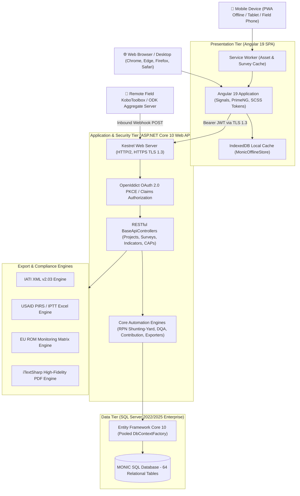
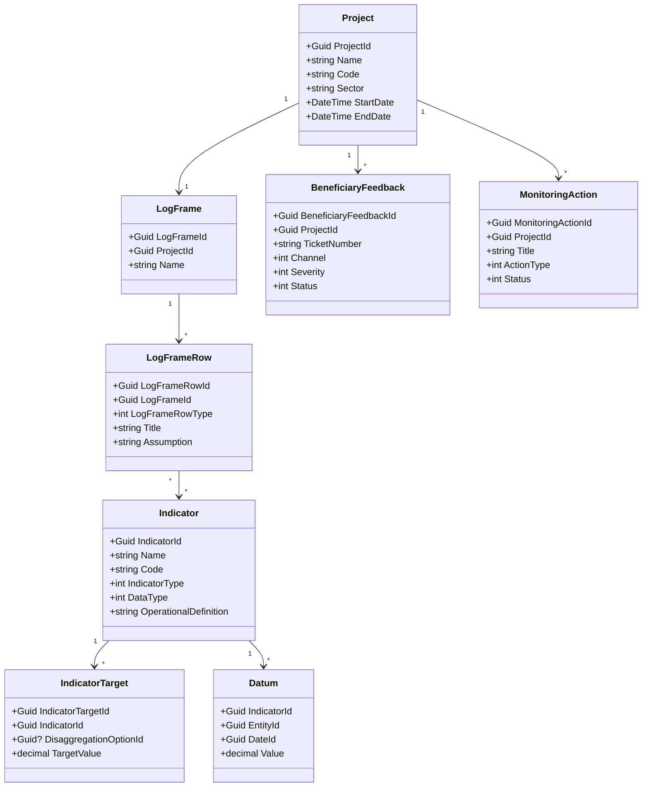
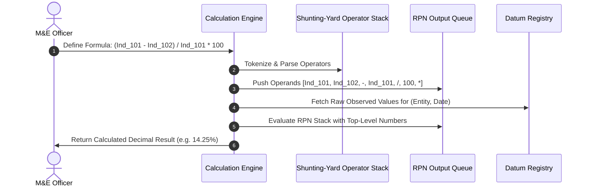
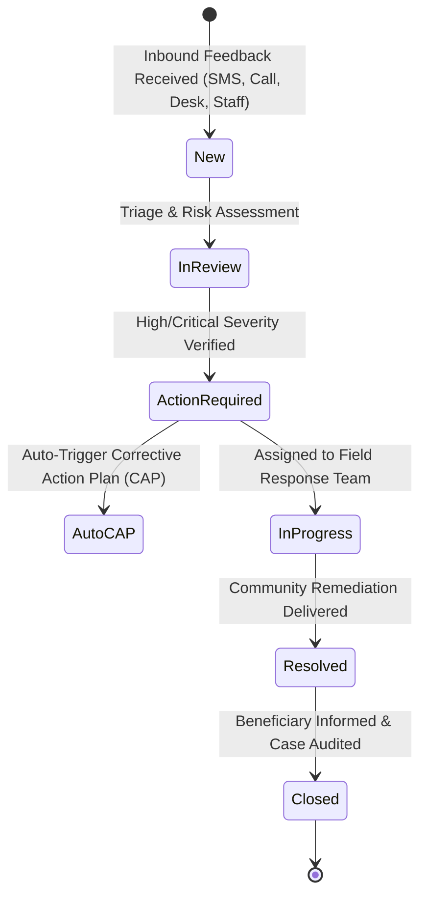
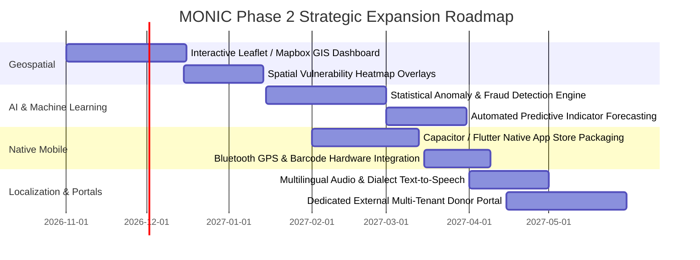

# 📘 MONIC Universal Monitoring & Evaluation Platform
# Comprehensive Full System Detailed Documentation & Architectural Manual

**Document Version:** 2.0.0 (Universal Multi-Sector Edition)  
**Classification:** Confidential — System Architecture, Engineering & Operational Specification  
**Publication Date:** October 2026  
**Target Audience:** Enterprise Program Managers, Lead Evaluators, Cloud Architects, Frontend/Backend Engineers, Donor Review Missions (USAID, EU, World Bank, UN, IATI).

---

## 📑 TABLE OF CONTENTS

1. [Executive Platform Vision & Universal Scope](#1-executive-platform-vision--universal-scope)
2. [Results-Based Management (RBM) & Universal Multi-Sector Matrix](#2-results-based-management-rbm--universal-multi-sector-matrix)
3. [End-to-End Technical Architecture & Enterprise Stack](#3-end-to-end-technical-architecture--enterprise-stack)
4. [Complete 64-Table Database Schema & Subsystem Data Dictionary](#4-complete-64-table-database-schema--subsystem-data-dictionary)
5. [Core Mathematical Calculation Engine & RPN Shunting-Yard Stack](#5-core-mathematical-calculation-engine--rpn-shunting-yard-stack)
6. [Survey Builder, Field Telemetry & Kobo/ODK Inbound Webhooks](#6-survey-builder-field-telemetry--koboodk-inbound-webhooks)
7. [Community Feedback Mechanism (CFM / Front Desk) & Protection System](#7-community-feedback-mechanism-cfm--front-desk--protection-system)
8. [Runtime M&E Plan Automation, 5-Dimension DQA & Corrective Actions (CAP)](#8-runtime-me-plan-automation-5-dimension-dqa--corrective-actions-cap)
9. [Multi-Donor Reporting Suite (IATI XML v2.03, USAID, EU ROM)](#9-multi-donor-reporting-suite-iati-xml-v203-usaid-eu-rom)
10. [Comprehensive REST API Reference & Integration Catalogue](#10-comprehensive-rest-api-reference--integration-catalogue)
11. [Security Architecture, OpenIddict OAuth 2.0 PKCE & RBAC Governance](#11-security-architecture-openiddict-oauth-20-pkce--rbac-governance)
12. [DevOps, Multi-Stage Containerization & Disaster Recovery Runbook](#12-devops-multi-stage-containerization--disaster-recovery-runbook)
13. [Core System Achievements vs. Strategic Gap Analysis & Scale Roadmap](#13-core-system-achievements-vs-strategic-gap-analysis--scale-roadmap)

---

## 1. EXECUTIVE PLATFORM VISION & UNIVERSAL SCOPE

### 1.1 Platform Purpose
**MONIC** is a domain-specialized, enterprise-grade Monitoring & Evaluation (M&E) platform designed to eliminate the fragmentation, manual overhead, and data reconciliation errors typical of complex development programs. 

Most M&E systems in the international development and public sector suffer from critical structural weaknesses:
* **Siloed Tooling**: Indicator tracking occurs in disconnected Excel workbooks; field surveys are managed in separate ODK/Kobo accounts; community complaints sit in paper ledgers; and donor reports are manually collated weeks after reporting deadlines.
* **Calculation Rigidity**: Inability to model non-trivial mathematical formulas (e.g., weighted composite indices, survey-based proportions, disaggregated demographic rollups) without hard-coded developer intervention.
* **Absence of Closed-Loop Governance**: When field indicators fall behind targets, there is no automated mechanism linking data quality audits (DQA) to Corrective Action Plans (CAPs) assigned to responsible field officers.
* **Donor Format Friction**: Translating internal project registries into donor-mandated schemas (such as the International Aid Transparency Initiative — IATI XML v2.03, USAID Performance Management Plans, or European Commission ROM matrices) requires days of error-prone manual copy-pasting.

MONIC solves these challenges through a unified, 4-tier reactive platform combining a high-performance **ASP.NET Core 10 Web API**, a normalized **SQL Server 64-table database**, an **Angular 19 SPA frontend** with Signals reactivity, and an **offline-first IndexedDB Progressive Web App (PWA)** telemetry engine.

### 1.2 Results-Based Management (RBM) Alignment
MONIC adheres strictly to the United Nations Development Group (UNDG) and OECD-DAC principles of **Results-Based Management (RBM)**:

```mermaid
flowchart LR
    A["Financial & Material Inputs"] --> B["Implementation Activities"]
    B --> C["Tangible Project Outputs"]
    C --> D["Intermediate Outcomes"]
    D --> E["Long-Term Societal Impact"]
    
    style A fill:#f8f9fa,stroke:#6c757d,stroke-width:1px
    style B fill:#e2e3e5,stroke:#495057,stroke-width:1px
    style C fill:#d1e7dd,stroke:#0f5132,stroke-width:1px
    style D fill:#cff4fc,stroke:#055160,stroke-width:1px
    style E fill:#cfe2ff,stroke:#084298,stroke-width:1px
```


* **Impact**: Positive and negative, primary and secondary long-term effects produced by a development intervention, directly or indirectly, intended or unintended.
* **Outcome**: The likely or achieved short-term and medium-term effects of an intervention’s outputs (e.g., behavioral changes, adoption of new practices, institutional improvements).
* **Output**: The products, capital goods, and services which result from a development intervention.
* **Activity**: Actions taken or work performed through which inputs are mobilized to produce specific outputs.
* **Input**: The financial, human, and material resources used for the development intervention.

---

## 2. RESULTS-BASED MANAGEMENT (RBM) & UNIVERSAL MULTI-SECTOR MATRIX

MONIC is engineered to be **universal**. Its metadata engine, dynamic terminology dictionaries, and indicator registries can model any type of project across all recognized global development sectors:

```mermaid
mindmap
  root((MONIC Universal M&E Engine))
    Agriculture & Food Security
      Crop Yield (MT/Ha)
      Post-Harvest Loss (%)
      Household Dietary Diversity (HDDS)
      Farmer Field School Adoption
    Public Health & Nutrition
      Immunization Coverage (%)
      Maternal Mortality Ratio (MMR)
      Malaria Case Fatality Rate
      ART Adherence Rate (%)
    WASH & Water Governance
      Liters per Capita per Day (LPCD)
      Water Point Functionality Rate (%)
      Open Defecation Free (ODF) Villages
      Water Quality Compliance (E. coli)
    Education & Skills
      Net Enrollment Rate (NER)
      Primary Completion Rate (%)
      Youth Vocational Employment Rate
      Gender Parity Index (GPI)
    Climate & Environment
      Hectares Restored (Reforestation)
      CO2 Equivalent Abated (MT)
      Renewable Energy Capacity (MW)
      Community Early Warning Activation
    Economic Development
      MSME Loan Repayment Rate (%)
      New Formal Jobs Created
      Household Income Growth (%)
      Financial Literacy Rate
    Governance & Rule of Law
      Case Disposal Timeliness
      Community Perception of Safety
      Citizen Feedback Resolution Rate
      Open Budget Transparency Score
    Emergency Humanitarian
      SPHERE Standards Adherence
      GAM / SAM Prevalence (%)
      Cash & Voucher Timeliness
      Protection / Safeguarding Caseload
```

### 2.1 Multi-Sector Operational Specifications

| Sector | Primary LogFrame Levels | Key Standard Indicators | Typical Disaggregations | Primary Means of Verification (MoV) |
|---|---|---|---|---|
| **Agriculture & Food Security** | Goal: Poverty Alleviation<br>Outcome: Increased Yields<br>Output: Seed Distribution | 1. Crop Yield per Hectare<br>2. Food Insecurity Access Scale (HFIAS)<br>3. Farmer adoption rate | Land size, Crop variety, Gender of smallholder, Agro-ecological zone | Agronomic crop cuts, Farm registries, Mobile survey questionnaires |
| **Public Health & Nutrition** | Goal: Reduced Child Mortality<br>Outcome: Improved Nutrition<br>Output: Clinic Rehabilitation | 1. Fully Immunized Child (FIC) rate<br>2. Skilled Birth Attendance (%)<br>3. Severe Acute Malnutrition cure rate | Age bracket (0-5, 6-23m, 24-59m), Gender, Facility tier, Urban/Rural | DHIS2 routine health data, Spot-check clinical audits, Survey telemetry |
| **WASH & Sanitation** | Goal: Decreased Waterborne Illness<br>Outcome: Universal Clean Water<br>Output: Borehole Drilling | 1. Population within 500m of clean water<br>2. ODF village certification<br>3. Water Management Committee functionality | Community type, Water source technology, Disability status, School vs Community | Water quality lab tests, GPS water point sensors, Village verification logs |
| **Education & Human Capacity** | Goal: Equitable Quality Education<br>Outcome: Enhanced Literacy<br>Output: Teacher Training | 1. Early Grade Reading Assessment (EGRA)<br>2. Pupil-Teacher Ratio (PTR)<br>3. School Attendance Rate (%) | Gender, Grade level, Disability/Special needs, Displacement status | School attendance registers, Standardized exam results, Classroom observations |
| **Climate & Natural Resources** | Goal: Ecosystem Resilience<br>Outcome: Reduced Deforestation<br>Output: Seedling Nurseries | 1. Hectares under sustainable management<br>2. Greenhouse gas reduction (tCO2e)<br>3. Vulnerable households with early warning | Ecosystem type (Mangrove, Savannah, Forest), Governance model, Watershed basin | GIS satellite imagery, Community patrol logs, Weather station telemetry |
| **Economic Development** | Goal: Inclusive Economic Growth<br>Outcome: Increased Household Assets<br>Output: Microfinance Grants | 1. Net business profit increase (%)<br>2. Number of full-time equivalent jobs<br>3. Loan repayment recovery rate | Enterprise sector, Youth (18-35) vs Adult, Women-led enterprise, Informal vs Formal | Financial audit ledgers, Bank disbursement statements, Beneficiary tracer surveys |
| **Governance & Human Rights** | Goal: Democratic Accountability<br>Outcome: Improved Civic Space<br>Output: Legal Aid Clinics | 1. Citizen satisfaction with public services<br>2. Case processing duration (days)<br>3. Proportion of public budget tracked | Administrative district, Vulnerable minority group, Legal case category | Court docket registries, Social audit scorecards, Independent legal reviews |
| **Humanitarian Response** | Goal: Lives Saved & Suffering Mitigated<br>Outcome: Immediate Basic Needs Met<br>Output: NFI / Cash Distribution | 1. SPHERE emergency water supply (15L/day)<br>2. Global Acute Malnutrition (GAM)<br>3. Unaccompanied minors supported | IDP vs Refugee vs Host community, Gender, Female-headed household, Disability | Post-Distribution Monitoring (PDM), Protection intake logs, Camp registries |

---

## 3. END-TO-END TECHNICAL ARCHITECTURE & ENTERPRISE STACK



### 3.1 Backend Specifications
* **Runtime**: .NET 10.0 (C# 13), running with non-blocking async/await throughput across all controller actions.
* **Data Access**: Entity Framework Core 10 with `IDbContextFactory<ApplicationDbContext>` enabling efficient short-lived context pooling and prevention of concurrency collisions.
* **Security Middleware**: OpenIddict 6.x supporting the OAuth 2.0 Authorization Code Flow with Proof Key for Code Exchange (PKCE) for client apps, and client credentials for machine-to-machine telemetry ingestion.
* **File & Stream Operations**: Zero-disk buffer streaming via `Download.GetFileContentResult(Response, fileName, bytes)` with MIME-type headers for instantaneous browser downloads.

### 3.2 Frontend Specifications
* **Framework**: Angular 19.2 leveraging reactive Angular Signals (`signal`, `computed`, `effect`) for instantaneous, flicker-free UI state synchronization.
* **Styling & Design Tokens**: Custom executive themes combining SCSS design tokens, Bootstrap 5.3 utilities, and PrimeNG enterprise data grids.
* **Offline-First PWA**: Progressive Web App architecture featuring `MonicOfflineStore` built on client-side IndexedDB, allowing enumerators to collect field surveys in areas with zero cellular reception.

---

## 4. COMPLETE 64-TABLE DATABASE SCHEMA & SUBSYSTEM DATA DICTIONARY

The MONIC persistence tier consists of **64 normalized relational tables** in SQL Server, structured into 10 cohesive operational subsystems:



### 4.1 Subsystem 1: Portfolio, Organization & Workspace
1. **`Projects`**: Root container for all M&E frameworks. Columns: `ProjectId (PK, Guid)`, `Name (nvarchar 250)`, `Code (nvarchar 50)`, `Description`, `Colour`, `StartDate`, `EndDate`, `Country`, `LeadOrganization`, `TargetBeneficiariesCount`, `TotalBudget`, `Currency`, `Status`.
2. **`ProjectFavorites`**: User-specific quick-access bookmark registry.
3. **`Entities`**: Organizational units, administrative hierarchies, and geographical territories (e.g., National, Provincial, District, Clinic, School, Water Point).
4. **`EntityLinks`**: Hierarchical tree links relating parent entities to child entities with cycle protection.
5. **`EntityPermissions`**: Granular user access matrix per organizational unit.
6. **`Items`**: Abstract entity container allowing polymorphic attachments to folders, projects, or indicators.
7. **`Folders`**: Document and report categorization structure.
8. **`Documents`**: Document metadata registry (FileName, MIME type, size, upload timestamp).
9. **`DocumentContents`**: High-security binary storage table holding document file payloads (`varbinary(max)`).

### 4.2 Subsystem 2: Results Framework, LogFrame & Theory of Change
10. **`TheoriesOfChange`**: Narrative causal pathway definitions explaining the strategic assumptions of the project.
11. **`ToCItems`**: Specific nodes in the Theory of Change diagram.
12. **`ToCLinks`**: Directional causal arrows connecting ToC items.
13. **`LogFrames`**: Top-level 4x4 matrix container for a project.
14. **`LogFrameRows`**: Individual rows in the LogFrame corresponding to standard tiers: `0: Goal / Impact`, `1: Outcome`, `2: Output`, `3: Activity`.
15. **`LogFrameRowTypes`**: Configurable vocabulary definitions for custom donor terminology.
16. **`LogFrameRowIndicators`**: Relational junction table binding indicators to specific LogFrame results rows.
17. **`LogFrameRowRiskAssumptions`**: Relational junction linking LogFrame rows to risk registers.
18. **`LogFrameRowTasks`**: Relational junction connecting activities to operational Gantt chart tasks.
19. **`LogFrameRowBudgetLines`**: Relational junction tying LogFrame activities to specific project financial budget lines.

### 4.3 Subsystem 3: Indicators, Targets & Mathematical Engine
20. **`Indicators`**: Primary indicator master registry. Fields: `IndicatorId (PK)`, `Name`, `Code`, `IndicatorType (Collected=1, Calculated=2, Group=3)`, `DataType (Decimal, Integer, Percentage, Currency, Ratio, Qualitative)`, `AggregationRule (Sum, Average, MostRecent)`, `OperationalDefinition`, `PurposeRationale`, `DataCollectionMethod`, `Frequency`, `ResponsibleParty`.
21. **`IndicatorTargets`**: Baseline, interim milestone, and life-of-project targets. Columns: `IndicatorTargetId (PK)`, `IndicatorId (FK)`, `PeriodId`, `DisaggregationOptionId (FK, nullable)`, `TargetValue`, `BaselineValue`.
22. **`DisaggregationGroups`**: Demographic dimension categories (e.g., "Sex", "Age Cohort", "Geographical Setting").
23. **`DisaggregationOptions`**: Specific discrete categories under a group (e.g., "Female", "Male", "0-5 Years", "6-17 Years", "Urban", "Rural").
24. **`Tokens`**: Reverse Polish Notation tokens defining calculation formulas for calculated indicators. Columns: `TokenId`, `IndicatorId`, `TokenType (Indicator, Number, Operator, Function, Parenthesis)`, `Value`, `SortOrder`.
25. **`Calculations`**: Calculation run execution records and dependency trees.
26. **`CalculationSteps`**: Step-by-step mathematical trace log for audit verification.
27. **`Data` (`Datum`)**: High-throughput time-series observation table. Composite Key: `(IndicatorId, EntityId, DateId)`. Columns: `Value (decimal 18,4)`, `TextValue`, `Comment`, `CreatedDate`, `CreatedBy`.
28. **`DataReviews`**: Append-only data governance ledger tracking 3-stage approvals (`Submit`, `Verify`, `Approve`, `Reject`).

### 4.4 Subsystem 4: Surveys, Questionnaires & Field Telemetry
29. **`Questionnaires`**: Survey instrument definitions with project links, title, description, and status.
30. **`Sections`**: Logical grouping pages within a digital survey questionnaire.
31. **`Questions`**: Survey fields. Types: `Text`, `Number`, `Date`, `SingleSelect`, `MultiSelect`, `LikertScale`, `GPSCoordinate`, `Signature`, `PhotoUpload`.
32. **`QuestionOptions`**: Discrete option values for multiple-choice and single-select questions.
33. **`QuestionOptionGroups`**: Reusable option banks (e.g., 5-point Likert agreement scale, administrative division lists).
34. **`SkipLogicOptions`**: Conditional branching rules determining field visibility based on prior answers.
35. **`Responses`**: Survey submission envelopes. Columns: `ResponseId (PK)`, `QuestionnaireId`, `SubmittedDate`, `EnumeratorId`, `Latitude`, `Longitude`, `DeviceIdentifier`, `PublicCode`.
36. **`Answers`**: Typed responses to specific questions. Columns: `AnswerId (PK)`, `ResponseId (FK)`, `QuestionId (FK)`, `NumericValue`, `StringValue`, `DateValue`, `OptionId`.

### 4.5 Subsystem 5: Community Feedback Mechanism (CFM / Front Desk)
37. **`BeneficiaryFeedbacks`**: Inbound community tickets. Columns: `BeneficiaryFeedbackId (PK)`, `ProjectId`, `TicketNumber (e.g. CFM-2026-0001)`, `Channel (Phone, SMS, Desk, Box, Staff)`, `Severity (Low, Medium, High, Critical/Protection)`, `Status (New, InReview, ActionRequired, Resolved, Closed)`, `Summary`, `Description`, `SubmitterGender`, `IsAnonymous`, `TargetResolutionDate`, `ResolutionNotes`.
38. **`FeedbackChannels`**: Registry of feedback channels.
39. **`FeedbackSeverities`**: Severity levels with automated SLA deadlines.
40. **`FeedbackStatuses`**: Ticketing status workflow definitions.

### 4.6 Subsystem 6: Risk Management, Tasks & Financial Tracking
41. **`RiskAssumptions`**: Risk matrix tracking likelihood, impact, mitigation actions, and critical assumptions.
42. **`Tasks`**: Operational work plan tasks with Gantt dependencies, assignees, and progress percentages.
43. **`Milestones`**: Major time-bound delivery milestones.
44. **`BudgetLines`**: Financial budget entries linked to expense categories and activities.
45. **`Expenditures`**: Real-time project expenditure ledger tracking actual vs. planned burn rate.
46. **`ExpenseCategories`**: Standard accounting chart of accounts categories.

### 4.7 Subsystem 7: Monitoring Governance & DQA Protocol
47. **`MonitoringPlans`**: Master M&E schedule specifying routine audit dates and reporting frequencies.
48. **`MonitoringEvents`**: Field monitoring visits and supervisory inspection missions.
49. **`MonitoringChecks`**: Specific checklists executed during monitoring events.
50. **`MonitoringActions` (Corrective Action Plans — CAP)**: Action items triggered by performance shortfalls. Columns: `MonitoringActionId (PK)`, `ProjectId`, `Title`, `ActionType (TargetShortfall, DqaDeficiency, CfmEscalation)`, `Status (Open, InProgress, Resolved, Verified)`, `AssignedTo`, `DueDate`, `ResolutionSummary`.
51. **`DataQualityAudits`**: Routine 5-dimension DQA scores (Validity, Reliability, Timeliness, Precision, Integrity).

### 4.8 Subsystem 8: Reporting & Document Generation
52. **`ReportDefinitions`**: Configurable reporting templates for donors and quarterly management reviews.
53. **`ReportInstances`**: Generated report artifacts with snapshot data.
54. **`ReportSections`**: Standard narrative sections (e.g., Executive Summary, Progress on Outcomes, Challenges, Lessons Learned).

### 4.9 Subsystem 9: Identity, Access & OpenIddict Security
55. **`Users`**: ASP.NET Core Identity user accounts.
56. **`Roles`**: Global RBAC roles (`Administrator`, `Manager`, `Oversight`, `DataEntry`).
57. **`UserRoles`**: User-to-role junction table.
58. **`UserTokens`**: Two-factor and email confirmation tokens.
59. **`OpenIddictApplications`**: Registered OAuth 2.0 client apps (Angular SPA, Mobile PWA, Kobo Webhook service).
60. **`OpenIddictAuthorizations`**: Issued client authorizations.
61. **`OpenIddictScopes`**: OAuth 2.0 resource scopes (e.g., `api`, `offline_access`).
62. **`OpenIddictTokens`**: JWT access and refresh tokens.

### 4.10 Subsystem 10: Synchronization & System Audit
63. **`SyncOperations`**: Client-side offline synchronization log ensuring idempotent batch submissions.
64. **`AuditLogs`**: Append-only security audit log tracking entity mutations, login events, and permission escalations.

---

## 5. CORE MATHEMATICAL CALCULATION ENGINE & RPN SHUNTING-YARD STACK

### 5.1 The Mathematical Challenge
Monitoring & Evaluation platforms frequently fail when users attempt to model compound indicators such as:
$$\text{Immunization Dropout Rate} = \left( \frac{\text{DTP1 Doses} - \text{DTP3 Doses}}{\text{DTP1 Doses}} \right) \times 100$$
Traditional approaches resort to hardcoded SQL views or brittle database triggers that break whenever non-technical users modify an indicator.

### 5.2 MONIC Reverse Polish Notation (RPN) Shunting-Yard Engine
MONIC evaluates formulas using Edsger Dijkstra’s **Shunting-Yard algorithm** implemented inside [`Calculation.cs`](file:///C:/Users/Administrator/Downloads/MONICv2/MONICv.001/WEB/Code/Calculation.cs). 



#### Token Stack Structure
In MONIC, an indicator formula is stored as an ordered collection of `Token` records:
* `TokenType.Indicator`: Refers to a source indicator ID whose value must be looked up.
* `TokenType.Number`: Constant numeric literals (e.g., `100`, `0.5`).
* `TokenType.Operator`: Arithmetic operators (`+`, `-`, `*`, `/`).
* `TokenType.Function`: Advanced functions (`MIN`, `MAX`, `AVG`, `ROUND`).
* `TokenType.Parenthesis`: Grouping delimiters (`(`, `)`).

#### Topological Sort & Circular Dependency Prevention
Before evaluating calculated indicators across an entire project, MONIC constructs a **Directed Acyclic Graph (DAG)** of all indicator dependencies. A depth-first search (DFS) topological sort executes base `Collected` indicators first, followed by Level-1 calculated indicators, and finally composite indices. If a circular reference is detected (e.g., $A \to B \to A$), the engine rejects the formula with an explicit validation error.

---

## 6. SURVEY BUILDER, FIELD TELEMETRY & KOBO/ODK INBOUND WEBHOOKS

### 6.1 Digital Survey Builder Capabilities
MONIC includes a full visual questionnaire builder enabling program staff to design complex field questionnaires:
* **Rich Question Palette**: Text, Single/Multiple Choice, Number (with range constraints), Date, Time, GPS Coordinates, Photos, Signatures, and Likert scales.
* **Skip Logic & Branching**: Evaluated in real-time in the browser. Questions dynamically show or hide based on the values of preceding responses.
* **Public Anonymous Tokens**: Each survey can generate a `PublicCode` enabling public community surveys without user authentication.

### 6.2 Offline-First PWA Telemetry (IndexedDB)
To support remote enumerators operating with zero cellular coverage:
1. When online, the Angular 19 PWA downloads survey schemas and option sets into local **IndexedDB** storage managed by [`offline-survey.service.ts`](file:///C:/Users/Administrator/Downloads/MONICv2/MONICv.001/WEB/ClientApp/src/app/common/services/offline-survey.service.ts).
2. During field data collection, responses are stored locally in the `MonicOfflineStore` with client-generated UUIDs and timestamps.
3. A background connectivity listener detects when network connectivity is restored and triggers an automatic, idempotent synchronization batch (`POST /api/surveys/sync-offline`).

### 6.3 Inbound KoboToolbox / ODK Webhook
MONIC provides direct webhook ingestion for organizations with established KoboToolbox or ODK workflows via [`ExternalPushController.cs`](file:///C:/Users/Administrator/Downloads/MONICv2/MONICv.001/WEB/Controllers/ExternalPushController.cs):
* **Endpoint**: `POST /api/externalpush/kobo/{surveyId}`
* **Payload Validation**: Authenticates HMAC signatures or shared bearer tokens.
* **Automatic Answer Projection**: The [`FormIndicatorContributionEngine.cs`](file:///C:/Users/Administrator/Downloads/MONICv2/MONICv.001/WEB/Code/FormIndicatorContributionEngine.cs) parses question responses (e.g., `water_source_functional = "yes"`) and increments the corresponding target indicator tally automatically.

---

## 7. COMMUNITY FEEDBACK MECHANISM (CFM / FRONT DESK) & PROTECTION SYSTEM

### 7.1 Accountability to Affected Populations (AAP)
Accountability to Affected Populations (AAP) is a mandatory standard for international humanitarian and development agencies. MONIC includes a purpose-built **Front Desk & CFM Ticketing System** designed to capture, triage, and resolve feedback from community members.



### 7.2 Severity Classification & SLA Timelines
* **Low (General Inquiry / Suggestion)**: Standard response SLA: 14 Days.
* **Medium (Operational Complaint / Non-Delivery)**: Standard response SLA: 7 Days.
* **High (Resource Diversion / Misconduct)**: Standard response SLA: 72 Hours.
* **Critical (Protection, Sexual Exploitation & Abuse - PSEA, Child Safeguarding)**: Standard response SLA: 24 Hours. Automatically creates a linked high-priority `MonitoringAction` (CAP) assigned to the Country Director and Safeguarding Lead.

---

## 8. RUNTIME M&E PLAN AUTOMATION, 5-DIMENSION DQA & CORRECTIVE ACTIONS (CAP)

### 8.1 Runtime Target Shortfall Automation
MONIC continuously evaluates indicator actuals against planned targets. When quarterly data is approved:
1. The system calculates performance ratio: $R = \frac{\text{Actual Value}}{\text{Target Value}} \times 100\%$.
2. If $R < 70\%$ (Underperformance) or $R > 130\%$ (Overachievement / Faulty Target), the system automatically flags an **Indicator Anomaly**.
3. A `MonitoringAction` (Corrective Action Plan) is automatically instantiated in `Open` status, linking directly to the underperforming indicator, the responsible manager, and the target deadline.

### 8.2 Data Quality Assessment (DQA) 5-Dimension Protocol
Following USAID ADS 201 and Global Fund guidelines, MONIC automates Data Quality Audits across five discrete dimensions:
1. **Validity**: Does the data accurately reflect the intended result? Verified via spot-check sample ratios.
2. **Reliability**: Are measurement protocols consistently applied across all field collection sites?
3. **Timeliness**: Was data captured within the prescribed reporting window?
4. **Precision**: Is the margin of error acceptable for programmatic decision-making?
5. **Integrity**: Are audit trails tamper-proof? (Enforced via append-only `DataReviews` and `AuditLogs`).

---

## 9. MULTI-DONOR REPORTING SUITE (IATI XML v2.03, USAID, EU ROM)

MONIC eliminates manual report preparation by providing instantaneous streaming exports formatted to major donor specifications:

### 9.1 IATI XML v2.03 Activity Standard
Generates validated, schema-compliant International Aid Transparency Initiative XML:
* **Root**: `<iati-activities version="2.03">`
* **Activity Metadata**: `<iati-activity>`, `<title>`, `<description>`, `<activity-status>`, `<activity-date>`
* **Participating Organizations**: `<participating-org role="1" ref="..." type="...">`
* **Sector Classification**: `<sector vocabulary="1" code="...">`
* **Results & Indicators**: `<result type="1">`, `<indicator measure="1">`, `<baseline year="..." value="...">`, `<period>`, `<target value="...">`, `<actual value="...">`

### 9.2 USAID Performance Management Plan (PMP / IPTT) Excel
Streams an Excel workbook containing:
* Executive Summary sheet with project metrics and sector tags.
* Complete Indicator Performance Tracking Table (IPTT) with quarterly actual vs. target variances.
* Full Performance Indicator Reference Sheet (PIRS) catalog with operational definitions and data collection protocols.

### 9.3 European Commission ROM Matrix
Formats project logframes directly into the European Commission Results-Oriented Monitoring (ROM) standard, featuring intervention logic, verifiable indicators, baseline/target values, sources of verification, and assumptions.

---

## 10. COMPREHENSIVE REST API REFERENCE & INTEGRATION CATALOGUE

All API endpoints follow RESTful conventions, require TLS 1.3 encryption, and return standardized JSON error envelopes on failure via `ApiExceptionAttribute`.

| Method | Route | Description | Access Role |
|---|---|---|---|
| `GET` | `/api/projects` | List all accessible project portfolios | `DataEntry` + |
| `POST` | `/api/projects` | Create a new project with sector and date metadata | `Manager`, `Admin` |
| `GET` | `/api/logframes/project/{projectId}` | Fetch the 4x4 LogFrame matrix with indicators and budget links | `DataEntry` + |
| `POST` | `/api/logframes/rows` | Add a new objective, outcome, output, or activity row | `Manager`, `Admin` |
| `GET` | `/api/indicators/project/{projectId}` | Fetch complete indicator catalog with PIRS metadata | `DataEntry` + |
| `POST` | `/api/indicators` | Register a new Collected or Calculated indicator | `Manager`, `Admin` |
| `GET` | `/api/indicatortargets/{indicatorId}` | Fetch baseline, targets, and disaggregated targets | `DataEntry` + |
| `POST` | `/api/indicatortargets/disaggregated` | Submit disaggregated targets with sum parity validation | `Manager`, `Admin` |
| `POST` | `/api/forms/data/approve` | Execute 3-stage data approval and trigger automated CAPs | `Manager`, `Admin` |
| `POST` | `/api/surveys/{surveyId}/submit` | Submit digital survey response envelope | `DataEntry`, Anonymous (`PublicCode`) |
| `POST` | `/api/surveys/sync-offline` | Batch sync offline responses stored in IndexedDB PWA | `DataEntry` |
| `POST` | `/api/externalpush/kobo/{surveyId}` | Inbound webhook for KoboToolbox / ODK Aggregate | Public (HMAC / Bearer) |
| `GET` | `/api/beneficiaryfeedback/project/{id}` | Fetch Community Feedback Mechanism (CFM) registry | `Oversight` + |
| `POST` | `/api/beneficiaryfeedback` | Log community complaint, inquiry, or safeguarding incident | Public / `DataEntry` + |
| `GET` | `/api/monitoring/actions/{projectId}` | Fetch Corrective Action Plans (CAP) registry | `Oversight` + |
| `POST` | `/api/monitoring/dqa/calculate` | Execute 5-dimension DQA scoring algorithm | `Manager`, `Admin` |
| `GET` | `/api/downloads/iati/{projectId}` | Stream IATI XML v2.03 Activity file | `Oversight` + |
| `GET` | `/api/downloads/usaid-pirs/{projectId}` | Stream USAID IPTT Performance Matrix Excel workbook | `Oversight` + |
| `GET` | `/api/downloads/eu-rom/{projectId}` | Stream European Commission ROM Matrix Excel workbook | `Oversight` + |
| `GET` | `/api/downloads/showcase-pdf` | Stream Executive Showcase & Gap Analysis PDF | Anonymous / All |
| `GET` | `/api/downloads/system-documentation-pdf` | Stream Full System Detailed Documentation PDF (Publication Manual) | Anonymous / All |

---

## 11. SECURITY ARCHITECTURE, OPENIDDICT OAUTH 2.0 PKCE & RBAC GOVERNANCE

### 11.1 OpenIddict OAuth 2.0 & PKCE
MONIC incorporates an OpenIddict-powered authorization server supporting **Proof Key for Code Exchange (PKCE)**. This protects single-page and mobile clients against authorization code interception attacks. Token issuance provides:
* Short-lived access tokens (60-minute expiry).
* Encrypted refresh tokens stored in secure HTTP-only cookies or encrypted local storage.
* Asymmetric RSA cryptographic signing certificates with automatic local fallback generation (`CertificateHelper.cs`).

### 11.2 Role-Based Access Control (RBAC) Hierarchy
1. **`Administrator`**: Full platform authority. User management, tenant configuration, system-wide database maintenance, raw SQL inspection, security key rotation.
2. **`Manager`**: Project-level leadership. LogFrame creation, indicator formula design, target approvals, DQA execution, Corrective Action Plan assignment.
3. **`Oversight` (Donor / Auditor)**: Read-only access to all dashboards, raw data reviews, audit logs, and donor export streams. Cannot mutate indicators or approve data entries.
4. **`DataEntry`**: Field enumerator role. Submit survey responses, enter routine periodic indicator actuals, view public surveys. Restricted from seeing financial data or audit configurations.

---

## 12. DEVOPS, MULTI-STAGE CONTAINERIZATION & DISASTER RECOVERY RUNBOOK

### 12.1 Multi-Stage Docker Build Architecture
MONIC compiles both frontend and backend assets within a unified, reproducible **multi-stage `Dockerfile`**:
1. **Stage 1 (`client-build`)**: `node:20-alpine` runs `npm ci` and builds the Angular 19 SPA (`npm run build:prod`), generating optimized output under `/app/dist`.
2. **Stage 2 (`server-build`)**: `mcr.microsoft.com/dotnet/sdk:10.0` compiles the C# ASP.NET Core Web API and incorporates the SPA distribution directly into `wwwroot`.
3. **Stage 3 (`runtime`)**: `mcr.microsoft.com/dotnet/aspnet:10.0` lightweight hardened runtime image (under 250MB) running as a non-root security principal.

### 12.2 Deployment Options
* **Coolify / Self-Hosted VPS**: Automated container deployment using `docker-compose.yml`. Persistent volume `/app/data` preserves OpenIddict certificates and data protection keys across container restarts.
* **Render / Railway / AWS ECS**: Cloud container orchestration with automatic TLS certificate termination and reverse proxy header forwarding (`X-Forwarded-For`, `X-Forwarded-Proto`).

### 12.3 Disaster Recovery & Backup Protocol
* **Full Database Backups**: Executed daily via SQL Server maintenance plans.
* **Point-In-Time Recovery**: Full recovery model enabled with 15-minute transaction log dumps.
* **Encryption at Rest**: Sensitive fields and Data Protection keys persisted under `/app/data/dataprotection-keys` encrypted using DPAPI or AES-256.

---

## 13. CORE SYSTEM ACHIEVEMENTS VS. STRATEGIC GAP ANALYSIS & SCALE ROADMAP

### 13.1 Completed System Achievements Matrix
* ✅ **Universal 4x4 Results LogFrame**: Complete hierarchical causal modeling across any development sector.
* ✅ **PIRS & Disaggregations**: Comprehensive performance sheets with gender, age, and location breakdowns validated by sum parity checks.
* ✅ **Offline PWA Telemetry**: Client-side IndexedDB caching enabling field data capture in remote offline environments.
* ✅ **Community Feedback Mechanism (CFM)**: Complete front desk ticketing system managing feedback with SLA escalation.
* ✅ **Automated CAP Pipeline**: Triggering corrective actions on underperforming indicators (<70% or >130%).
* ✅ **5-Dimension DQA Auditing**: Routine data quality assessments across Validity, Reliability, Timeliness, Precision, and Integrity.
* ✅ **Multi-Donor Export Engines**: Instant streaming generation of IATI XML v2.03, USAID IPTT, EU ROM, and PDF M&E plans.
* ✅ **Automated Unit & E2E Test Suite**: 184 automated tests passing with zero failures.

### 13.2 Strategic Gap Analysis & Phase 2 Scaling Roadmap
While the current MONIC release delivers an enterprise-ready foundation, the following strategic expansion roadmap has been formulated for Phase 2:



1. **Interactive GIS Mapping & Spatial Analytics**:
   - *Current State*: Collects latitude, longitude, and administrative bounds.
   - *Phase 2 Upgrade*: Embed interactive Leaflet/Mapbox maps with GeoJSON boundary clustering, satellite imagery layers, and spatial drought/poverty overlays.
2. **Predictive AI / ML Telemetry Anomaly Detection**:
   - *Current State*: Deterministic rule-based threshold detection (<70% or >130%).
   - *Phase 2 Upgrade*: Machine-learning models (Isolation Forests, Mahalanobis Distance) detecting enumerator fraud, fabrication, or timestamp anomalies.
3. **App Store Native Mobile Binaries**:
   - *Current State*: Angular 19 Progressive Web App (PWA).
   - *Phase 2 Upgrade*: Package into Capacitor / Flutter native wrappers distributed via Google Play Store and Apple App Store.
4. **Community Multilingual & Audio Localization**:
   - *Current State*: Text localization in English, French, and Spanish.
   - *Phase 2 Upgrade*: Text-to-speech audio prompts and RTL dialect support for low-literacy field respondents.
5. **Dedicated External Donor Portal**:
   - *Current State*: Role-based `Oversight` access and exported reports.
   - *Phase 2 Upgrade*: Multi-tenant branded donor portal with project-specific token grants and live read-only progress feeds.
