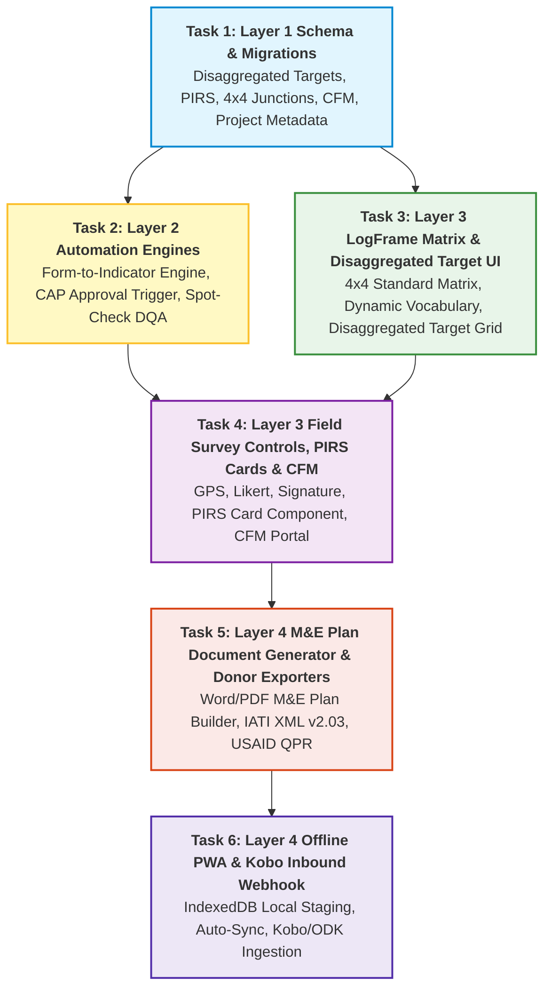

# Universal M&E System Completion Implementation Plan

**Spec Reference**: `docs/superpowers/specs/2026-10-24-universal-me-system-completion-design.md`  
**Domain Standard**: [tools4dev — How to Create a Monitoring and Evaluation (M&E) System](https://tools4dev.org/resources/how-to-create-an-monitoring-and-evaluation-system/)  
**Stack**: ASP.NET Core (`net10.0`), EF Core 10, SQL Server Express (`Server=.\SQLEXPRESS;Database=MONIC`), Angular 19.2 (NgModule + PrimeNG 19).

---

## Global Constraints & Quality Gates

- **Backend Build**: `dotnet build WEB/WEB.csproj --nologo -v q` must succeed with 0 errors.
- **Backend Tests**: `dotnet test WEB.Tests/WEB.Tests.csproj --nologo -v q` must pass (baseline: 156 passed, 0 failed). Tests use EF InMemory where possible and `MonicSqlServerFixture` for SQL Server-specific integration tests.
- **Database Migrations**: Run from repo root:
  - `dotnet ef migrations add <Name> --project WEB`
  - `dotnet ef database update --project WEB`
- **Delete Behavior**: `ApplicationDbContext.OnModelCreating` configures foreign keys to `DeleteBehavior.Restrict` by default. Services handle child cascades explicitly.
- **Change Tracking**: `ApplicationDbContext` runs with `ChangeTracker.AutoDetectChangesEnabled = false`. State must be set explicitly or `DetectChanges()` called before saving.
- **Angular Build**: `npm run build:dev` in `WEB/ClientApp` must succeed; production build `npm run build` must respect bundle budgets.
- **Commits**: Conventional commit format (`feat(me-core): ...`, `test(me-core): ...`), one logical commit per task.

---

## Task Dependency Graph

---

## Task 1: Layer 1 Schema & Domain Primitives Migration

**Deliverable**: Entity updates, configuration partial, EF Core migration `AddUniversalMeSystemCompletion`, applied to local database, with unit tests.

### Files
- `WEB/Models/IndicatorTarget.cs`: Add `DisaggregationOptionId` FK and navigation.
- `WEB/Models/Indicator.cs`: Add PIRS fields (`OperationalDefinition`, `PurposeRationale`, `DataQualityProtocol`, `ReportingSchedule`, `CalculationFormulaNarrative`, `NumeratorIndicatorId`, `DenominatorIndicatorId`).
- `WEB/Models/LogFrameRow.cs`: Add navigation collections for structured junctions `LogFrameRowRiskAssumptions`, `LogFrameRowTasks`, `LogFrameRowBudgetLines`.
- `WEB/Models/LogFrameRowJunctions.cs`: New file containing junction entities:
  - `LogFrameRowRiskAssumption` (`LogFrameRowId`, `RiskAssumptionId`).
  - `LogFrameRowTask` (`LogFrameRowId`, `TaskId`).
  - `LogFrameRowBudgetLine` (`LogFrameRowId`, `BudgetLineId`).
- `WEB/Models/Enums.cs`: Add `Number = 5`, `Date = 6`, `GPS = 7`, `Likert = 8`, `Signature = 9` to `QuestionType`; add `FeedbackStatus` enum (`Received`, `Investigating`, `Resolved`, `Closed`); add `ProjectSector` enum and `ProjectWorkflowMode` enum.
- `WEB/Models/Question.cs`: Add `MinValue`, `MaxValue`, `ValidationRegex`.
- `WEB/Models/BeneficiaryFeedback.cs`: New entity for community feedback/complaints registry.
- `WEB/Models/Project.cs`: Add universal metadata (`Sector`, `StartDate`, `EndDate`, `CurrentPhase`, `DonorName`, `GrantCode`, `TotalBudget`, `Currency`, `TargetDirectBeneficiaries`, `TargetIndirectBeneficiaries`, `WorkflowMode`, `Level4Label`, `Level3Label`, `Level2Label`, `Level1Label`).
- `WEB/Models/ApplicationDBContext.UniversalMe.cs`: Partial configuring indexes, relationships, and DbSets (`BeneficiaryFeedbacks`, `LogFrameRowRiskAssumptions`, `LogFrameRowTasks`, `LogFrameRowBudgetLines`).
- `WEB/Migrations/*`: Generated migration `AddUniversalMeSystemCompletion`.
- `WEB.Tests/UniversalMeModelTests.cs`: Unit tests verifying model constraints, composite indexes, and validations.

### Verification
- `dotnet ef migrations add AddUniversalMeSystemCompletion --project WEB`
- `dotnet ef database update --project WEB`
- `dotnet test WEB.Tests/WEB.Tests.csproj` (all passing).

---

## Task 2: Layer 2 Runtime Form-to-Indicator Engine & Automated CAP Watcher

**Deliverable**: Runtime survey-to-indicator aggregation engine, event-driven CAP watcher on approval, and supervisor spot-check DQA calculator.

### Files
- `WEB/Code/FormIndicatorContributionEngine.cs`: New service implementing:
  - `ProcessSurveyResponseAsync(Guid responseId, ApplicationDbContext db, CancellationToken ct)`: Matches `FormIndicatorMapping`, extracts answers, records `IndicatorContribution`, aggregates into `Data`, and triggers `Calculation.SaveAsync`.
- `WEB/Controllers/SurveysController.cs`: Inject and invoke `FormIndicatorContributionEngine` in `Submit` and `SubmitSection`.
- `WEB/Code/ImportProcessor.cs`: Invoke `FormIndicatorContributionEngine` following bulk questionnaire imports.
- `WEB/Controllers/FormsController.cs`: In `ApproveDataEntry`, invoke `CorrectiveActionService.DetectAndTriggerCapsAsync` so CAPs generate automatically whenever approved data deviates beyond tolerance ($\pm 15\%$).
- `WEB/Code/DataQualityAuditService.cs`: New service implementing:
  - `ComputeDiscrepancy(double reported, double audited)`: Computes error percentage and assigns Grade A ($\le 5\%$), Grade B ($5.1\%-10\%$), or Grade C ($> 10\%$).
- `WEB.Tests/FormIndicatorContributionEngineTests.cs`: Unit tests verifying rule matching, contribution ledger logging, indicator data upserts, and downstream calculation triggering.
- `WEB.Tests/CorrectiveActionAutomationTests.cs`: Unit tests verifying automated CAP instantiation upon data approval.

### Verification
- `dotnet build WEB/WEB.csproj`
- `dotnet test WEB.Tests/WEB.Tests.csproj`

---

## Task 3: Layer 3 Upgraded 4x4 LogFrame Matrix & Disaggregated Target UI

**Deliverable**: Enhanced 4x4 LogFrame matrix with dynamic terminology, interactive progress chips, risk/workplan bindings, and disaggregated target entry grid.

### Files
- `WEB/Controllers/LogFramesController.cs` & `WEB/Controllers/LogFrameRowsController.cs`: Add endpoints to retrieve/save structured row links (`RiskAssumptions`, `Tasks`, `BudgetLines`) and row indicators with live target/actual progress rollups.
- `WEB/ClientApp/src/app/common/models/logframe.model.ts`: Update TypeScript models with structured junction arrays, vocabulary labels, and indicator progress chip summaries.
- `WEB/ClientApp/src/app/logframe/logframe.component.html`:
  - Replace static row headers with project-configured vocabulary aliases (`project.level4Label || 'Goals'`, etc.).
  - Render interactive indicator chips showing Baseline, Target, Latest Actual, Progress Bar %, and RAG badge.
  - Auto-display Means of Verification from linked indicator PIRS metadata.
  - Show structured Risk/Assumption badges with color-coded heat score indicators.
  - For Activity rows, show interactive workplan Task pills (with Gantt % complete) and BudgetLine pills.
- `WEB/ClientApp/src/app/logframe/logframe.row.component.html` & `.ts`: Add multi-select dropdowns for linking Risks/Assumptions, Tasks, and BudgetLines.
- `WEB/Controllers/DataController.cs`: Add support for querying and persisting targets with `DisaggregationOptionId`.
- `WEB/ClientApp/src/app/admin/indicatortargets/`: Update target grid to allow entering targets per demographic breakdown with real-time sum parity verification.
- `WEB.Tests/DisaggregatedTargetTests.cs`: Tests verifying disaggregated target storage, retrieval, and variance calculations.

### Verification
- `dotnet test WEB.Tests/WEB.Tests.csproj`
- `cd WEB/ClientApp; npm run build:dev`

---

## Task 4: Layer 3 Field Survey Controls, PIRS Cards & CFM Portal

**Deliverable**: Field question input controls (GPS, Date, Number range, Likert, Signature), PIRS reference sheet card component, and Beneficiary Feedback / CFM portal.

### Files
- `WEB/Controllers/BeneficiaryFeedbackController.cs`: New controller for CRUD operations, status transitions, and SLA tracking on community complaints.
- `WEB/ClientApp/src/app/pirs/pirs-card.component.ts` & `.html`: New component rendering a standardized Performance Indicator Reference Sheet (PIRS) with one-click Print and PDF export.
- `WEB/ClientApp/src/app/surveys/survey.component.html` & `.ts`:
  - Add `Number` input with min/max validation.
  - Add `Date` input with HTML5 datepicker.
  - Add `GPS` coordinate capture with `navigator.geolocation` and map pin.
  - Add 5-point `Likert` matrix.
  - Add HTML5 canvas `Signature` capture pad.
- `WEB/ClientApp/src/app/surveys/question.edit.component.html`: Support configuring min/max values and question types.
- `WEB/ClientApp/src/app/monitoring/spotcheck-audit.component.ts` & `.html`: Supervisor spot-check comparison interface calculating discrepancy error rate and reliability grade.
- `WEB/ClientApp/src/app/feedback/feedback-registry.component.ts` & `.html`: Community feedback/complaints registry with filterable case table and investigation drawer.
- `WEB.Tests/BeneficiaryFeedbackControllerTests.cs`: Unit tests verifying CFM tracking code generation, status transitions, and permissions.

### Verification
- `dotnet test WEB.Tests/WEB.Tests.csproj`
- `cd WEB/ClientApp; npm run build:dev`

---

## Task 5: Layer 4 M&E Plan Document Generator & Donor Exporters

**Deliverable**: Automated M&E Plan Word (.docx) and PDF document compiler, and official IATI XML v2.03 and USAID/EU donor exporters.

### Files
- `WEB/Code/MePlanDocumentBuilder.cs`: New service compiling:
  - Project Overview, Theory of Change visual, 4x4 LogFrame matrix, PIRS cards, Data Flow & RACI table, Risk Register, Workplan Gantt, and Budget allocations into a publication-ready Word (.docx) and PDF document.
- `WEB/Code/DonorExportService.cs`: New service generating:
  - Official IATI XML v2.03 (`<iati-activity>`, `<result>`, `<indicator>`, `<target>`, `<actual>`, `<dimension>`).
  - USAID Quarterly Performance Report (QPR) spreadsheet.
  - EU Results-Oriented Monitoring (ROM) proforma.
- `WEB/Controllers/DownloadsController.cs`: Add endpoints:
  - `GET api/downloads/projects/{projectId}/me-plan/docx`
  - `GET api/downloads/projects/{projectId}/me-plan/pdf`
  - `GET api/downloads/projects/{projectId}/iati.xml`
- `WEB.Tests/MePlanDocumentBuilderTests.cs`: Unit tests verifying document structure and required sections.
- `WEB.Tests/DonorExportServiceTests.cs`: Unit tests validating XML schema conformance against IATI v2.03 XSD.

### Verification
- `dotnet test WEB.Tests/WEB.Tests.csproj`

---

## Task 6: Layer 4 Offline PWA Field Survey Collection & Inbound Kobo Webhook

**Deliverable**: Offline PWA survey staging with IndexedDB / Dexie.js, auto-sync engine, and KoboToolbox / ODK inbound webhook integration.

### Files
- `WEB/ClientApp/src/app/common/services/offline-survey.service.ts`: Service using Dexie.js / IndexedDB to cache questionnaire definitions and queue offline survey submissions.
- `WEB/ClientApp/src/app/common/services/sync-manager.service.ts`: Detects online status (`window.addEventListener('online')`) and synchronizes queued responses to `POST api/surveys/submit`.
- `WEB/Controllers/ExternalPushController.cs`: Implement `POST api/ExternalPush/kobo/{questionnaireId}`:
  - Parses incoming KoboToolbox / ODK JSON webhook payloads.
  - Resolves questions by code/tag.
  - Records responses and triggers `FormIndicatorContributionEngine`.
- `WEB.Tests/ExternalPushKoboTests.cs`: Unit tests verifying webhook payload parsing and indicator calculation invocation.
- `WEB.Tests/EndToEndMeLifecycleTests.cs`: Integration test running the full lifecycle: Project creation $\to$ 4x4 LogFrame setup $\to$ Survey response submission $\to$ Automated contribution $\to$ Data approval $\to$ CAP generation $\to$ M&E Plan document export.

### Verification
- `dotnet test WEB.Tests/WEB.Tests.csproj`
- `cd WEB/ClientApp; npm run build` (production build verifies clean bundle budget).
