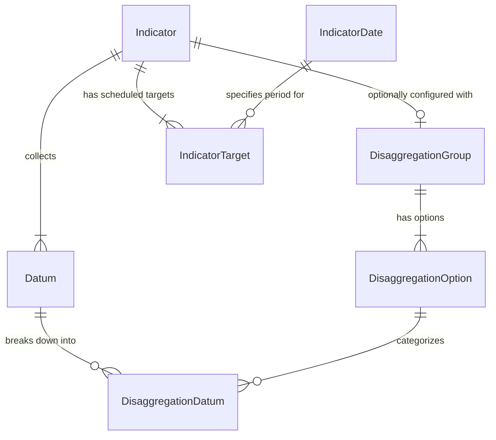

# Phase 1: Data Model Specification

**Feature**: Multi-Dimensional Indicator Disaggregations & Target Variance Tracking  
**Feature Directory**: `specs/001-indicator-disaggregations-targets`  
**Date**: 2026-10-19  

## 1. Entity Definitions

### 1.1 DisaggregationGroup
Represents a reusable breakdown dimension (e.g., Sex, Age Category).

```csharp
namespace Monic.Web.Models
{
    public class DisaggregationGroup
    {
        public Guid DisaggregationGroupId { get; set; }
        public string Name { get; set; } = string.Empty;
        public string? Description { get; set; }
        public bool IsActive { get; set; } = true;
        public DateTime CreatedAt { get; set; } = DateTime.UtcNow;

        // Navigation
        public ICollection<DisaggregationOption> Options { get; set; } = new List<DisaggregationOption>();
        public ICollection<Indicator> Indicators { get; set; } = new List<Indicator>();
    }
}
```

### 1.2 DisaggregationOption
An individual category bucket within a disaggregation group.

```csharp
namespace Monic.Web.Models
{
    public class DisaggregationOption
    {
        public Guid DisaggregationOptionId { get; set; }
        public Guid DisaggregationGroupId { get; set; }
        public string Name { get; set; } = string.Empty; // e.g., "Female", "Male"
        public string? Code { get; set; }                // e.g., "F", "M"
        public int SortOrder { get; set; } = 0;

        // Navigation
        public DisaggregationGroup DisaggregationGroup { get; set; } = null!;
        public ICollection<DisaggregationDatum> DisaggregationData { get; set; } = new List<DisaggregationDatum>();
    }
}
```

### 1.3 DisaggregationDatum
Recorded numerical value for a disaggregated option linked to a parent period observation (`Datum`).

```csharp
namespace Monic.Web.Models
{
    public class DisaggregationDatum
    {
        public Guid DisaggregationDatumId { get; set; }
        public Guid DatumId { get; set; }
        public Guid DisaggregationOptionId { get; set; }
        public decimal Value { get; set; }

        // Navigation
        public Datum Datum { get; set; } = null!;
        public DisaggregationOption DisaggregationOption { get; set; } = null!;
    }
}
```

### 1.4 IndicatorTarget
Periodic milestone target for an indicator.

```csharp
namespace Monic.Web.Models
{
    public class IndicatorTarget
    {
        public Guid IndicatorTargetId { get; set; }
        public Guid IndicatorId { get; set; }
        public Guid IndicatorDateId { get; set; }
        public Guid? EntityId { get; set; } // Nullable: global or location-specific target
        public decimal TargetValue { get; set; }
        public decimal? BaselineValue { get; set; }
        public string? Notes { get; set; }
        public DateTime UpdatedAt { get; set; } = DateTime.UtcNow;

        // Navigation
        public Indicator Indicator { get; set; } = null!;
        public IndicatorDate IndicatorDate { get; set; } = null!;
        public Entity? Entity { get; set; }
    }
}
```

### 1.5 Modifications to Existing Entities (Additive & Non-Breaking)

#### `Indicator.cs`:
Add optional nullable references:
```csharp
// In Monic.Web.Models.Indicator:
public Guid? DisaggregationGroupId { get; set; }
public DisaggregationGroup? DisaggregationGroup { get; set; }

public IndicatorDirection Direction { get; set; } = IndicatorDirection.HigherIsBetter;
public ICollection<IndicatorTarget> IndicatorTargets { get; set; } = new List<IndicatorTarget>();
```

#### `Enums.cs`:
```csharp
public enum IndicatorDirection
{
    HigherIsBetter = 0,
    LowerIsBetter = 1
}
```

#### `Datum.cs`:
Add navigation collection:
```csharp
// In Monic.Web.Models.Datum:
public ICollection<DisaggregationDatum> DisaggregationData { get; set; } = new List<DisaggregationDatum>();
```

---

## 2. Entity-Relationship Diagram



---

## 3. Database Constraints & Indexes

1. **Unique Option Codes per Group**:
   Filtered unique index on `(DisaggregationGroupId, Code)` where `Code IS NOT NULL`.
2. **Unique Disaggregation Datum per Parent**:
   Unique index on `(DatumId, DisaggregationOptionId)` to prevent duplicate entries for the same option within one period observation.
3. **Unique Target Milestone**:
   Unique index on `(IndicatorId, IndicatorDateId, EntityId)` using nullable unique index convention (`CreateNullableUniqueIndex`).
4. **Foreign Key Cascade Rules**:
   - Deleting a `Datum` cascades to delete its `DisaggregationDatum` records.
   - Deleting a `DisaggregationGroup` is restricted if indicators are currently using it (`DeleteBehavior.Restrict`).
